BỘ GIÁO DỤC VÀ ĐÀO TẠOTRƯỜNG ĐẠI HỌC CMC[Logo Trường]ĐỒ ÁN CHUYÊN NGÀNHTên đề tài: Nhóm sinh viên:  Hà Nội, tháng    - 2025

# MỤC LỤC

# MỞ ĐẦU

# CHƯƠNG 1. GIỚI THIỆU BÀI TOÁN

## 1.1. Giới thiệu tổng quan

Một hệ thống kho không phục vụ một người mà phục vụ cả một chuỗi người cùng làm: có người trực tiếp cầm hàng, có người duyệt và chịu trách nhiệm về số liệu, có người cần biết còn hàng để yêu cầu xuất, có người giữ cho hệ thống vận hành an toàn. Mỗi người nhìn bài toán kho từ một vị trí khác nhau, và hệ thống chỉ hữu ích khi giải được việc của từng người mà vẫn khớp với những người còn lại. Vì vậy mục này mô tả bài toán từ chỗ đứng của bốn nhóm người dùng: thủ kho, quản lý kho, nhân viên bán hàng và quản trị viên. Các tình huống nêu dưới đây là tình huống minh hoạ điển hình của một doanh nghiệp có nhiều kho; số liệu trong tình huống chỉ để dễ hình dung, không phải kết quả khảo sát, và sẽ được đối chiếu với buổi phỏng vấn kho thực tế.

### 1.1.1. Bối cảnh vận hành

Đề tài xây dựng phần mềm quản lý kho theo hướng kho tổng: một hệ thống chung quản lý tập trung nhiều kho (từ hai kho trở lên; đồ án thử nghiệm với hai kho) của cùng một doanh nghiệp, nhận và lưu trữ mọi loại sản phẩm doanh nghiệp cần nhập từ nhà cung cấp, rồi xuất đi cho các nơi nhận như cửa hàng, đại lý hoặc khách hàng. Danh mục sản phẩm dùng chung cho mọi kho; mỗi kho có vị trí và tồn riêng và có thể chuyên theo loại hàng (ví dụ kho hàng hóa, kho nguyên vật liệu, kho thành phẩm); quản lý xem được tồn của từng kho và tồn tổng hợp. Phần mềm chỉ làm quản lý kho, gồm ba phân hệ nhập kho, xuất kho và kiểm tra hàng hoá, cùng việc chuyển hàng giữa các kho (dựng trên nhập và xuất); không gồm bán hàng, thanh toán hay website. Vì kho chứa nhiều ngành hàng nên mỗi ngành có đặc điểm riêng: quần áo có size và màu, điện thoại có dung lượng và màu, thực phẩm có quy cách và hạn dùng, văn phòng phẩm gần như không có thuộc tính. Hàng được quản lý theo ba tầng: sản phẩm, biến thể (một tổ hợp thuộc tính cụ thể) và lô (một lần nhập, có nhà cung cấp, giá nhập, mức chất lượng và hạn dùng nếu có). Trong mỗi kho, hàng nằm ở các khu khác nhau: khu tiếp nhận cho hàng mới về chưa kiểm, khu lưu trữ trên kệ cho hàng xuất được, khu cách ly cho hàng lỗi và khu xuất cho hàng chuẩn bị giao.

### 1.1.2. Thủ kho: người trực tiếp chạm vào hàng

Công việc hằng ngày. Nhận hàng từ nhà cung cấp, đếm và phân loại chất lượng, ghi hạn dùng, xếp lên kệ; lấy hàng theo phiếu xuất; đếm hàng khi kiểm kê; xuất hàng đi và nhận hàng đến khi chuyển kho. Mỗi thủ kho làm việc ở kho (hoặc vài kho) được giao.

Tình huống thực tế. Sáng thứ hai, một xe giao 40 thùng sữa tươi, xe khác giao 200 áo thun đủ size. Thủ kho đếm lại thì thấy 6 thùng sữa bị móp, 10 thùng khác chỉ còn vài ngày hạn dùng, và một thùng áo ghi size M nhưng bên trong là size L. Cùng lúc có hai phiếu xuất gấp. Thủ kho phải nhớ lô nào đã kiểm, lô nào chưa, hàng móp để ở đâu, lô sữa nào hết hạn trước để xuất trước, và áo cùng mẫu của đợt cũ đang nằm ở kệ nào. Khi mọi thứ nằm trong sổ tay và trí nhớ, chỉ cần một lần nhầm là hàng lỗi lẫn vào hàng xuất được, hoặc lô hết hạn sau bị xuất trước lô hết hạn trước.

Khó khăn. Thao tác khi đứng tại kệ, tay đang cầm hàng nên không thể gõ nhiều. Kho có nhiều ngành hàng nên không thể nhớ cách xử lý riêng của từng loại, nhất là hàng có hạn dùng. Việc tìm hàng dựa vào trí nhớ nên người mới phải đi vòng nhiều lần mới đủ hàng. Hàng được xếp theo thói quen chứ không theo mức độ xuất nhiều. Nhầm size, nhầm màu hoặc nhầm cấu hình khó phát hiện cho đến khi nơi nhận trả hàng. Hàng nhập theo thùng nhưng xuất lẻ từng chai, mỗi người ghi một đơn vị nên số tồn khó khớp.

Điều thủ kho cần. Tạo phiếu nhanh bằng máy quét mã; được chỉ rõ lấy ở kệ nào, theo thứ tự nào, lô nào trước; được gợi ý nên xếp hàng mới vào đâu; được hệ thống chặn ngay khi quét sai hàng, lấy vượt số lượng hoặc lấy lô đã hết hạn; nhập theo thùng, xuất theo chai mà số tồn vẫn đúng.

Hệ thống cần làm. Ô quét mã tự nhận con trỏ và dùng được trên máy tính bảng; tự sinh mã lô cho từng dòng nhập và bắt ghi hạn dùng với hàng có theo dõi hạn; tách hàng lỗi sang khu cách ly; gợi ý vị trí lấy kèm lý do, cho phép chọn vị trí khác; chỉ cho thao tác trên kho được giao; nhận hàng chuyển đến từ kho khác và ghi số thực nhận; đơn vị quy đổi (ví dụ 1 thùng = 24 chai) để chứng từ ghi theo thùng hay chai đều quy về một số tồn.

### 1.1.3. Quản lý kho: người duyệt và chịu trách nhiệm số liệu

Công việc hằng ngày. Duyệt phiếu xuất; kiểm tra hàng đã lấy; xác nhận hoàn tất phiếu nhập; tạo phiếu kiểm kê và duyệt từng chênh lệch; theo dõi tồn của từng kho và quyết định nhập thêm hàng nào, chuyển hàng nào giữa các kho.

Tình huống thực tế. Khi kiểm kê cuối quý, thủ kho báo thiếu 8 điện thoại bản 128GB màu đen ở kệ B-02-03. Thực tế 8 máy đó nằm ở kệ B-02-05 (sai vị trí), còn 3 máy bản 256GB bị ghi nhầm thành 128GB từ lúc nhập (sai biến thể), và 5 thùng sữa quá hạn vẫn nằm trên kệ. Nếu quản lý sửa thẳng số tồn cho khớp thì các sai lệch bị xoá mà không ai biết nguyên nhân, và lỗi sẽ lặp lại. Trong cùng tuần, một mặt hàng ở kho 1 chỉ còn đủ xuất vài ngày trong khi kho 2 đang đọng mặt hàng đó đủ xuất vài tháng, nhưng quản lý chỉ biết khi nơi nhận phàn nàn hết hàng; một mặt hàng khác thì gần hết ở cả hai kho mà không ai nhắc nhập.

Khó khăn. Không chắc số tồn đúng. Duyệt phiếu xuất mà không biết có đủ hàng xuất được hay không, nên hai phiếu có thể cùng “hứa” một số hàng. Bước kiểm tra hàng đã lấy dễ bị bỏ qua khi bận. Kiểm kê làm gián đoạn xuất nhập vì số đếm bị lệch khi hàng vẫn di chuyển. Quyết định nhập thêm hàng theo cảm tính vì không có số liệu về tốc độ xuất. Chuyển hàng giữa các kho theo cảm tính, không biết kho nào đang thừa, kho nào sắp thiếu và chi phí chuyển; hàng đang trên đường dễ biến mất khỏi sổ của cả hai kho. Khi có sai sót khó truy ra ai làm bước nào.

Điều quản lý cần. Tồn theo kho, lô và vị trí đáng tin cậy; duyệt phiếu dựa trên số liệu rõ ràng; xem chênh lệch kiểm kê gọn và chọn được cách xử lý cho từng loại; được nhắc mặt hàng nào sắp hết, lô nào sắp hết hạn và nên nhập thêm bao nhiêu; xem được tồn từng kho cạnh tồn tổng hợp và được đề xuất chuyển hàng giữa các kho kèm chi phí.

Hệ thống cần làm. Kiểm tồn khả dụng khi duyệt và giữ hàng cho phiếu; bắt buộc người kiểm khác người lấy; khoá vị trí đang kiểm kê; phân loại phát sinh (thiếu, thừa, hư hỏng, hết hạn, sai vị trí, sai biến thể) và mọi điều chỉnh đều có lý do và người duyệt; đề xuất nhập bổ sung và cảnh báo hàng sắp hết hạn; tồn tính riêng từng kho; phiếu chuyển kho hai bước có trạng thái đang vận chuyển; thẻ kho và dashboard.

### 1.1.4. Nhân viên bán hàng: người yêu cầu xuất hàng và cần biết “có hàng không” ngay

Vai trò trong hệ thống. Phần mềm không quản lý bán hàng. Nhân viên bán hàng (hoặc người của cửa hàng, đại lý cần lấy hàng) chỉ dùng hai chức năng: xem tồn khả dụng (theo từng kho và tổng hợp) và tạo phiếu xuất để kho xử lý.

Tình huống thực tế. Một đại lý hỏi còn bao nhiêu áo sơ mi trắng size L vì cần lấy 50 chiếc. Nhân viên mở bảng tính cập nhật từ chiều hôm trước, chỉ có một con số chung cho mọi kho, hoặc gọi điện hỏi thủ kho từng kho rồi hứa còn đủ. Nhưng số “còn” đó gồm cả những chiếc đã nằm trong một phiếu xuất đang chờ lấy và những chiếc mới nhập đang chờ kiểm. Đến ngày lấy hàng thì không đủ, nhân viên mất uy tín và phải xin lỗi.

Khó khăn. Số tồn đến chậm hoặc không khớp. Không phân biệt được hàng thật sự xuất được với hàng đã được giữ, đang chờ kiểm, hàng lỗi hoặc hàng hết hạn. Không biết hàng nằm ở kho nào nên không biết yêu cầu xuất từ kho nào. Không biết phiếu của mình đang ở bước nào nên phải hỏi qua điện thoại hoặc tin nhắn.

Điều nhân viên bán hàng cần. Tra nhanh tồn khả dụng theo biến thể và theo từng kho; tạo phiếu xuất ít bước; xem trạng thái phiếu để báo cho nơi nhận.

Hệ thống cần làm. Tồn khả dụng hiển thị theo từng kho và loại trừ hàng chờ kiểm, hàng cách ly, hàng hết hạn, hàng đang vận chuyển và hàng đã giữ; phiếu xuất cho chọn kho xuất; màn hình tạo phiếu xuất đơn giản; hiển thị trạng thái phiếu; quyền chỉ gồm xem tồn và tạo phiếu, không duyệt, không sửa tồn.

### 1.1.5. Quản trị viên: người giữ cho hệ thống chạy đúng và đủ rộng cho mọi loại hàng

Công việc hằng ngày. Tạo và khoá tài khoản; phân quyền theo vai và theo kho; quản lý danh sách kho, danh mục, thuộc tính, sản phẩm, biến thể, vị trí trong từng kho, nhà cung cấp và nơi nhận hàng; tra nhật ký thao tác khi cần.

Tình huống thực tế. Doanh nghiệp bắt đầu nhập thêm ngành đồ gia dụng, với thuộc tính khác hẳn các ngành cũ (công suất, thời hạn bảo hành). Công ty mở thêm một kho mới với 40 vị trí kệ, nhận thêm hai nhân viên kho cho kho đó và một người nghỉ việc ở kho cũ. Cuối tháng số tồn của một mã hàng lệch lớn và ban lãnh đạo hỏi ai đã duyệt điều chỉnh, vào lúc nào.

Khó khăn. Mỗi ngành hàng mới lại đòi sửa phần mềm hoặc làm thêm một mẫu bảng riêng, nên kho khó nhận “mọi loại hàng”. Tạo hàng loạt biến thể bằng tay tốn công và dễ trùng mã. Khi bắt đầu dùng hệ thống, danh mục vài trăm mã hàng và số tồn đang có phải gõ lại từng dòng, dễ sót và lệch so với sổ cũ. Phân quyền không rõ nên ai cũng sửa được số liệu, kể cả nhân viên kho này sửa số liệu của kho kia. Tài khoản của người đã nghỉ vẫn dùng được. Không có nhật ký để truy trách nhiệm.

Điều quản trị viên cần. Tự thêm được ngành hàng mới mà không nhờ lập trình viên; quản lý danh mục tập trung; thêm được kho mới; phân quyền rõ theo vai và theo kho; đưa danh mục và số tồn đang có vào hệ thống một lần từ file Excel; xem lại ai làm gì, khi nào.

Hệ thống cần làm. Danh mục phân cấp và thuộc tính cấu hình theo từng danh mục; tạo biến thể từ tổ hợp thuộc tính; bật hoặc tắt theo dõi hạn dùng cho từng sản phẩm; bốn vai trò, trong đó quản lý kho và thủ kho được gán theo từng kho, quyền được kiểm tra ở phía máy chủ; thêm kho mới cùng vị trí của kho đó trên giao diện; khoá tài khoản; không xoá cứng dữ liệu đã có biến động tồn; ghi nhật ký các thao tác duyệt, huỷ, điều chỉnh và đổi quyền; nhập danh mục và tồn đầu kỳ từ file Excel mẫu, báo lỗi từng dòng trước khi ghi.

### 1.1.6. Khi các vai trò làm việc cùng nhau: hành trình một phiếu xuất

Phần lớn lỗi trong kho không nằm ở một người mà ở chỗ bàn giao giữa các người. Bảng 1.1 theo dõi một phiếu xuất (nơi nhận cần 10 thùng sữa tươi) đi qua tay bốn vai trò, và chỉ ra ở mỗi chỗ bàn giao thực tế thường hỏng ở đâu.

Bảng 1.1. Hành trình một phiếu xuất qua các vai trò

| Bước | Vai trò | Việc làm | Cần biết gì để làm đúng | Thực tế thường hỏng ở đâu |
| --- | --- | --- | --- | --- |
| 1 | Nhân viên bán hàng | Tạo phiếu xuất, chọn kho xuất | Còn đủ hàng xuất được ở kho nào | Hứa với nơi nhận khi hàng đã được giữ, đang chờ kiểm, đã hết hạn, hoặc thực ra nằm ở kho khác |
| 2 | Quản lý kho (của kho xuất) | Duyệt phiếu | Tồn khả dụng của kho, hàng nằm ở lô nào; nếu thiếu thì kho khác có còn hàng không | Duyệt khi thiếu hàng, hoặc duyệt mà không giữ hàng nên hai phiếu cùng “ăn” một số hàng; không biết kho khác còn hàng nên từ chối nhầm |
| 3 | Thủ kho | Lấy hàng | Lấy ở lô nào, kệ nào, theo thứ tự nào | Lấy lô hết hạn sau trước lô hết hạn trước; đi vòng nhiều lần; lấy sai biến thể |
| 4 | Quản lý kho (người khác người lấy) | Kiểm tra hàng đã lấy | Phiếu yêu cầu gì, đã lấy gì, lô nào | Bước kiểm bị bỏ qua hoặc làm qua loa khi kho bận |
| 5 | Thủ kho | Xác nhận xuất | Tồn đã trừ đúng, có chứng từ | Quên trừ tồn, hoặc trừ hai lần khi bấm lặp |

### 1.1.7. Tổng hợp

Bảng 1.2 tóm tắt điều khó nhất của từng vai trò ở thực tế và cách hệ thống đáp ứng. Từ bốn nhóm người dùng, có thể rút ra ba nhu cầu chung: (1) số tồn đúng và truy vết được đến từng kho, lô và vị trí, vì cả bốn vai trò đều dựa vào nó; (2) quy trình có kiểm soát, bàn giao rõ giữa các vai trò, và đủ linh hoạt để nhận mọi loại hàng; (3) gợi ý minh bạch cho các quyết định lặp lại trước mắt là lấy hàng ở đâu và nhập thêm gì; xếp hàng ở đâu và chuyển hàng giữa các kho thế nào được hoãn sang giai đoạn sau (Phụ lục A).

Bảng 1.2. Từ khó khăn của từng vai trò đến cách hệ thống đáp ứng

| Vai trò | Điều khó nhất ở thực tế | Điều cần có | Hệ thống đáp ứng |
| --- | --- | --- | --- |
| Thủ kho | Tìm hàng bằng trí nhớ; dễ lẫn hàng lỗi, lẫn lô; quên hạn dùng; nhầm biến thể; nhập theo thùng, xuất theo chai nên sổ khó khớp | Quét mã, chỉ đường lấy hàng, nhắc hạn dùng, gợi ý chỗ xếp | Ô quét mã; mã lô tự sinh kèm hạn dùng; khu cách ly; nhận hàng chuyển đến; AI gợi ý lấy hàng; đơn vị quy đổi thùng và chai |
| Quản lý kho | Số tồn không đáng tin; kiểm kê lệch; nhập hàng theo cảm tính; chuyển hàng giữa các kho theo cảm tính | Tồn đúng đến kho, lô và vị trí; duyệt dựa trên số liệu; nhắc hàng sắp hết, sắp hết hạn; biết kho nào thừa, kho nào thiếu | Giữ hàng khi duyệt; khoá vị trí kiểm kê; điều chỉnh có duyệt; AI đề xuất nhập bổ sung; cảnh báo hết hạn; chuyển kho hai bước |
| Nhân viên bán hàng | Không biết có hàng xuất được thật không và ở kho nào | Tồn khả dụng tức thời theo từng kho; trạng thái phiếu | Tồn khả dụng theo kho loại trừ hàng không xuất được; màn tạo phiếu đơn giản có chọn kho |
| Quản trị viên | Mỗi ngành hàng mới phải sửa phần mềm; ai cũng sửa được số liệu, kể cả của kho khác; không truy vết; đưa danh mục và tồn đang có vào hệ thống phải gõ lại từng dòng | Tự thêm ngành hàng, thêm kho; phân quyền theo vai và theo kho; nhật ký | Danh mục và thuộc tính cấu hình được; quản lý nhiều kho; quyền theo kho; nhật ký thao tác; nhập Excel danh mục và tồn đầu kỳ |

## 1.2. Bài toán đề xuất

### 1.2.1. Phát biểu bài toán

Cho một doanh nghiệp có K kho (K ≥ 2; dữ liệu thử dùng K = 2) cùng dùng một hệ thống quản lý tập trung, gọi là kho tổng. Mỗi kho có nhiều vị trí (khu, dãy, kệ, tầng) thuộc các loại: tiếp nhận, lưu trữ, cách ly, xuất, và có thể chuyên theo loại hàng. Mỗi sản phẩm thuộc một danh mục dùng chung cho mọi kho; mỗi danh mục có các thuộc tính riêng cấu hình được (size, màu, dung lượng, quy cách…). Hàng được quản lý theo sản phẩm, biến thể và lô; lô có hạn dùng nếu sản phẩm được theo dõi hạn dùng; tồn được ghi riêng theo từng kho, lô và vị trí. Bốn nhóm người dùng cùng thao tác trên một dữ liệu chung, mỗi người chỉ thao tác trên các kho được giao. Cần xây dựng một ứng dụng web quản lý kho sao cho:

Thủ kho hoàn thành việc nhập hàng, lấy hàng, đếm hàng và nhận hàng chuyển đến ở kho được giao nhanh hơn và ít nhầm hơn, nhờ quét mã, được hệ thống chặn khi sai và được gợi ý lấy ở đâu.

Quản lý kho duyệt, kiểm tra và xử lý chênh lệch dựa trên số tồn đúng đến từng kho, lô và vị trí, biết khi nào cần nhập thêm hàng, nhập bao nhiêu, và chuyển hàng giữa các kho với chi phí thấp.

Nhân viên bán hàng biết ngay số lượng thật sự xuất được của từng biến thể ở từng kho và theo dõi được phiếu của mình.

Quản trị viên thêm được ngành hàng mới mà không sửa phần mềm, thêm được kho mới, kiểm soát được tài khoản và quyền theo từng kho, và truy được ai đã làm gì, vào lúc nào.

Nói cách khác, bài toán gồm hai phần gắn với nhau. Phần thứ nhất là quản lý đúng: thực hiện ba nghiệp vụ nhập kho, xuất kho, kiểm tra hàng hoá và việc chuyển hàng giữa các kho theo quy trình có trạng thái, bảo đảm số tồn theo từng kho, lô và vị trí luôn chính xác và truy vết được từ sổ ghi biến động. Phần thứ hai là hỗ trợ quyết định: dùng trí tuệ nhân tạo gợi ý hai quyết định lặp lại (lấy hàng từ lô và kệ nào; nhập bổ sung mặt hàng nào, bao nhiêu); hai quyết định còn lại của đề tài ban đầu (xếp hàng nhập vào đâu; luân chuyển hàng giữa các kho thế nào để chi phí thấp nhất) được hoãn sang giai đoạn sau (Phụ lục A). Gợi ý chỉ mang tính đề xuất: người dùng chấp nhận hoặc chọn phương án khác.

### 1.2.2. Bài toán của từng vai trò

Bảng 1.3 phát biểu bài toán theo cách người dùng nói về việc của mình (“khi…, tôi muốn…, để…”), kèm dữ liệu hệ thống nhận vào và kết quả hệ thống phải trả ra.

Bảng 1.3. Bài toán phát biểu theo từng vai trò

| Vai trò | Phát biểu | Đầu vào → đầu ra |
| --- | --- | --- |
| Thủ kho | Khi nhập hàng, tôi muốn mỗi lô nhập có mã riêng, ghi được hạn dùng và hàng lỗi bị tách khỏi hàng tốt, để không lẫn lô và không xuất nhầm hàng lỗi. | Vào: phiếu nhập (nhà cung cấp, biến thể, số lượng dự kiến, giá nhập), số đếm thực tế, kết quả phân loại chất lượng, hạn dùng.Ra: lô mới có mã riêng; tồn theo (lô, vị trí); hàng lỗi ở khu cách ly. |
| Thủ kho | Khi lấy hàng, tôi muốn biết lấy ở lô nào, kệ nào, theo thứ tự nào, để lấy đủ, lô hết hạn trước hoặc nhập trước được lấy trước và không đi lại nhiều. | Vào: phiếu xuất đã duyệt, tồn theo lô và kệ, hạn dùng của lô.Ra: danh sách (lô, kệ, số lượng, thứ tự) kèm lý do; cảnh báo khi quét sai hoặc lô đã hết hạn. |
| Thủ kho | Khi nhận hàng chuyển từ kho khác, tôi muốn đếm số thực nhận và xếp lên kệ, để hàng không biến mất và chênh lệch được ghi nhận. | Vào: phiếu chuyển kho đang vận chuyển, số đếm thực nhận. / Ra: hàng vào tồn khả dụng của kho đến sau khi xếp; chênh lệch (nếu có) chờ xử lý. |
| Quản lý kho | Khi duyệt phiếu xuất, tôi muốn hệ thống kiểm đủ hàng xuất được và giữ hàng, để hai phiếu không cùng hứa một số hàng. | Vào: phiếu xuất chờ duyệt.Ra: phiếu đã duyệt với hàng giữ đúng lô, kệ; hoặc thông báo thiếu dạng “Cần X, còn Y”. |
| Quản lý kho | Khi kiểm kê, tôi muốn thấy chênh lệch được phân loại và chọn cách xử lý có lý do, để tồn được sửa đúng mà không mất dấu vết. | Vào: phạm vi kiểm, số đếm thực tế.Ra: danh sách phát sinh (thiếu, thừa, hư hỏng, hết hạn, sai vị trí, sai biến thể); điều chỉnh tồn đã duyệt; vị trí được khoá khi kiểm và mở khoá khi xong. |
| Quản lý kho | Khi lên kế hoạch nhập hàng, tôi muốn được đề xuất mặt hàng nào sắp hết và cần nhập bao nhiêu, và được cảnh báo lô sắp hết hạn, để không thiếu hàng mà cũng không nhập thừa. | Vào: tồn khả dụng, tồn tối thiểu, nhu cầu trung bình mỗi ngày, thời gian chờ hàng, hạn dùng của lô.Ra: danh sách biến thể cần nhập kèm số lượng và lý do; danh sách lô sắp hết hạn; phiếu nhập nháp tạo từ đề xuất. |
| Nhân viên bán hàng | Khi nơi nhận hỏi, tôi muốn xem ngay tồn khả dụng theo biến thể và theo từng kho, để biết nên yêu cầu xuất từ kho nào và hứa đúng. | Vào: mã hoặc tên biến thể. / Ra: số lượng xuất được ở từng kho và tổng (không tính hàng chờ kiểm, cách ly, hết hạn, đang vận chuyển, đã giữ). |
| Nhân viên bán hàng | Khi tạo phiếu xuất, tôi muốn ít bước và theo dõi được trạng thái, để biết khi nào hàng sẵn sàng giao. | Vào: kho xuất, nơi nhận, biến thể, số lượng.Ra: phiếu ở trạng thái Nháp rồi chuyển theo từng bước; trạng thái hiện tại luôn xem được. |
| Quản trị viên | Khi có ngành hàng mới, tôi muốn tạo danh mục, thuộc tính và biến thể ngay trên giao diện, để kho nhận được mọi loại hàng mà không phải sửa phần mềm. | Vào: tên danh mục, các thuộc tính (ví dụ công suất, bảo hành), có theo dõi hạn dùng hay không, giá trị thuộc tính của từng mẫu hàng.Ra: danh mục và thuộc tính mới; biến thể tạo từ tổ hợp thuộc tính; sản phẩm nhập và xuất được ngay. |
| Quản trị viên | Khi mở thêm kho, tôi muốn tạo kho, vị trí và gán người phụ trách, để kho mới vận hành ngay mà không sửa phần mềm. | Vào: tên kho, loại hàng lưu trữ, các vị trí, người dùng được gán. / Ra: kho mới nhập, xuất, kiểm kê được; người dùng chỉ thấy kho được giao. |
| Quản trị viên | Khi có người mới hoặc người nghỉ, tôi muốn tạo, khoá tài khoản và phân quyền theo vai và theo kho, để mỗi người chỉ làm đúng việc ở kho của mình. | Vào: thông tin tài khoản, vai trò và danh sách kho được giao. / Ra: tài khoản có quyền tương ứng; tài khoản bị khoá không đăng nhập được. |
| Quản trị viên | Khi số liệu có chênh lệch lớn, tôi muốn xem ai đã duyệt, huỷ hoặc điều chỉnh và lúc nào, để truy trách nhiệm. | Vào: điều kiện lọc (người, loại thao tác, thời gian).Ra: nhật ký thao tác. |

### 1.2.3. Hai bài toán gợi ý bằng AI

Ký hiệu: v là biến thể; l là lô; p là vị trí; a(l, p) là tồn khả dụng của lô l tại vị trí p (số lượng trừ số đang giữ); q là số lượng yêu cầu; A là tổng tồn khả dụng của biến thể; d là nhu cầu trung bình mỗi ngày; L là thời gian chờ hàng; m là tồn tối thiểu; các đại lượng A, d, m được tính riêng cho từng kho. Bảng 1.4 phát biểu hai bài toán gợi ý theo dạng đầu vào, ràng buộc cứng, mục tiêu và đầu ra; mỗi bài toán gắn với người dùng sẽ nhận gợi ý. Khi nộp đồ án, hệ thống chắc chắn có G1 và G3 (mức Should ở mục 2.15). Hai bài toán còn lại của đề tài ban đầu là G2 (xếp hàng nhập vào đâu) và G4 (luân chuyển hàng giữa các kho với chi phí thấp nhất) được hoãn sang giai đoạn sau vì nhóm giảm từ 5 xuống 3 người; đặc tả của hai bài toán này được giữ ở Bảng A.1, Phụ lục A.

Bảng 1.4. Hai bài toán gợi ý

| Bài toán (người dùng) | Đầu vào | Ràng buộc cứng | Mục tiêu | Đầu ra |
| --- | --- | --- | --- | --- |
| G1. Lấy hàng từ lô, kệ nào(thủ kho) | Kho xuất, biến thể v, số lượng q, tồn a(l, p) theo lô và kệ của kho đó, hạn dùng của lô | Tổng số lấy x(l, p) bằng q; x(l, p) không vượt a(l, p); chỉ lấy lô đúng chất lượng và chưa hết hạn; vị trí thuộc khu lưu trữ và không bị khoá kiểm kê | Theo thứ tự ưu tiên: hàng có hạn dùng thì hết hạn trước (FEFO), hàng còn lại thì nhập trước (FIFO); ít kệ phải ghé, ưu tiên kệ lấy đủ một lần; sắp thứ tự ghé theo khu, dãy, kệ | Danh sách (lô, kệ, số lượng, thứ tự) kèm lý do |
| G3. Nhập bổ sung mặt hàng nào, bao nhiêu(quản lý kho) | A, m, d của từng kho (d tính từ các phiếu xuất đã hoàn tất của kho đó), L, số lượng trên phiếu nhập chưa hoàn tất | Chỉ đề xuất khi d > 0 và có ít nhất 14 ngày lịch sử xuất; số lượng đề xuất là số nguyên dương | Không để tồn khả dụng xuống dưới m trong thời gian chờ hàng nhưng không nhập thừa: đề xuất khi A không lớn hơn d × L + m, với số lượng d × (L + 30) − A − số đang chờ nhập, làm tròn lên | Danh sách (kho, biến thể) cần nhập kèm số lượng và lý do |

Trong G3, hằng số 30 là số ngày muốn đủ hàng và có thể đổi; khi nhu cầu bằng 0 hoặc lịch sử xuất quá ít, hệ thống không đề xuất.

### 1.2.4. Nguyên tắc bắt buộc xuất phát từ thực tế vận hành

Các nguyên tắc ở Bảng 1.5 không phải ràng buộc kỹ thuật tuỳ ý: mỗi nguyên tắc có mặt để bảo vệ một vai trò khỏi một lỗi cụ thể đã nêu ở mục 1.1.

Bảng 1.5. Nguyên tắc bắt buộc và lý do

| Nguyên tắc | Bảo vệ ai | Lý do thực tế |
| --- | --- | --- |
| Mọi thay đổi tồn chỉ đi qua một cổng duy nhất, ghi vào sổ biến động, nằm trong một transaction; không cho tồn âm; chứng từ đã hoàn tất không sửa | Quản lý kho, nhân viên bán hàng | Số tồn đúng và truy vết được; hai người lấy cùng lúc không làm tồn âm; bấm hai lần không ghi sổ hai lần |
| Tồn ghi riêng theo từng kho, lô và vị trí; chuyển kho đi qua hai bước (kho đi xuất, kho đến nhận) nên tổng tồn của toàn hệ thống được bảo toàn | Quản lý kho | Hàng không biến mất hoặc bị tính hai lần khi chuyển giữa các kho |
| Mỗi người dùng chỉ thấy và thao tác trên các kho được giao; quản trị viên gán kho | Quản trị viên, quản lý kho | Nhân viên kho này không sửa được số liệu của kho kia |
| Hàng ở khu tiếp nhận, khu cách ly và hàng đang vận chuyển giữa các kho không tính vào tồn khả dụng của kho nào | Nhân viên bán hàng, thủ kho | Tránh hứa hoặc xuất nhầm hàng chưa kiểm, hàng lỗi, hàng chưa tới nơi |
| Hàng có hạn dùng xuất theo hết hạn trước; lô đã hết hạn không xuất được | Thủ kho, quản lý kho | Tránh giao hàng quá hạn và để hàng cũ tồn đọng |
| Mọi chênh lệch kiểm kê phải có người duyệt và sinh điều chỉnh có lý do; không sửa trực tiếp số tồn | Quản lý kho, quản trị viên | Không “xoá” sai lệch mà không biết nguyên nhân |
| Người kiểm tra phiếu xuất khác người lấy hàng | Quản lý kho | Kiểm soát chéo ở bước dễ sai nhất |
| Danh mục và thuộc tính cấu hình được trên giao diện; thêm ngành hàng mới không phải sửa mã nguồn | Quản trị viên | Kho tổng phải nhận được mọi loại hàng, không gắn cứng vào một ngành |
| AI chỉ gợi ý; không tự ghi tồn, tự tạo hay tự duyệt phiếu; AI lỗi thì vẫn thao tác tay được | Thủ kho, quản lý kho | Người chịu trách nhiệm vẫn là người; công việc không đình trệ khi AI sai |
| Mỗi vai trò chỉ có quyền của vai đó, kiểm tra ở phía máy chủ; thao tác quan trọng được ghi nhật ký | Quản trị viên | Không ai sửa được số liệu ngoài quy trình |
| Giao diện tiếng Việt, ít bước, dùng được trên máy tính bảng, trang tải dưới 3 giây | Thủ kho, nhân viên bán hàng | Thao tác khi đứng tại kệ hoặc khi đang trả lời nơi nhận |

### 1.2.5. Phạm vi và giả định

Trong phạm vi: ba phân hệ nhập kho, xuất kho, kiểm tra hàng hoá; chuyển hàng giữa các kho (hai bước, dựng trên nhập và xuất); hai gợi ý bằng AI ở mục 1.2.3 (G1 và G3, bắt buộc có khi nộp đồ án); quản lý kho, vị trí, tài khoản và quyền theo kho, danh mục, thuộc tính, sản phẩm, biến thể, đơn vị quy đổi (một tầng, hệ số nguyên cố định, ví dụ 1 thùng = 24 chai; nhập theo thùng, xuất theo chai); nhập danh mục (sản phẩm, biến thể, đơn vị quy đổi, nhà cung cấp) và tồn đầu kỳ từ file Excel theo mẫu của hệ thống; tra cứu tồn theo kho và tổng hợp, thẻ kho; cảnh báo hàng sắp hết hạn; dashboard; ghi vết thao tác. Ngoài phạm vi: gợi ý xếp hàng vào vị trí (G2) và gợi ý luân chuyển hàng giữa các kho (G4); nhập hàng trả lại do nhân viên bán hàng đề nghị; sơ đồ mặt bằng kho và báo cáo phân loại ABC; xuất Excel các danh sách (xuất Excel báo cáo tồn kho chỉ làm nếu còn thời gian, NFR08); bán hàng, thanh toán và kết nối web bán hàng; giải bài toán định tuyến xe và quản lý đội xe vận chuyển; đơn vị quy đổi nhiều tầng (thùng chứa hộp chứa cái), hệ số không nguyên hoặc khác nhau theo từng lô; dự báo nhu cầu bằng học máy (ML.NET); quét mã vạch bằng camera; lắp ráp, tháo dỡ và đóng combo (mục 2.3); kết nối trực tiếp với phần mềm kế toán và CRM (kể cả nhập file Excel xuất từ các phần mềm đó; hệ thống chỉ nhận file theo mẫu của mình); theo dõi số serial từng đơn vị. Giả định: doanh nghiệp có từ 2 kho trở lên dùng chung một hệ thống và một danh mục sản phẩm; mỗi kho có vị trí riêng; chi phí vận chuyển giữa các kho được cho trước theo từng tuyến; dữ liệu thử gồm 2 kho với tổng khoảng 40 vị trí, khoảng 50 biến thể thuộc ít nhất 4 ngành hàng (thời trang, điện tử, thực phẩm, văn phòng phẩm) và 3 tháng lịch sử xuất, thêm một file Excel mẫu khoảng 300 dòng (có cả dòng lỗi) để thử nhập danh mục và tồn đầu kỳ; mỗi biến thể có một đơn vị tính chính và có thể có thêm các đơn vị quy đổi với hệ số nguyên cố định; tồn kho và sổ biến động chỉ tính theo đơn vị tính chính; nền tảng ASP.NET Core MVC, Entity Framework Core và PostgreSQL.

### 1.2.6. Tiêu chí đánh giá theo vai trò

Bài toán được xem là giải xong khi mỗi vai trò làm được việc của mình đúng như phát biểu ở mục 1.2.2. Bảng 1.6 nêu tiêu chí và cách kiểm chứng cho từng vai trò.

Bảng 1.6. Tiêu chí đánh giá theo vai trò

| Vai trò | Hệ thống đạt khi | Cách kiểm chứng |
| --- | --- | --- |
| Thủ kho | Chạy trọn vòng nhập hàng, lấy hàng và nhận hàng chuyển đến bằng ô quét mã; gợi ý lấy hàng (G1) không vi phạm ràng buộc cứng, không bao giờ gợi ý lô đã hết hạn và ưu tiên lô hết hạn trước; quét sai bị chặn | Test tự động; thử trên máy tính bảng với một kịch bản mẫu; so số kệ phải ghé khi có và không có gợi ý |
| Quản lý kho | Tổng biến động trên thẻ kho luôn bằng số tồn của từng kho; chuyển kho không làm mất hay nhân đôi hàng (tổng tồn toàn hệ thống trước và sau chuyển bằng nhau); hai phiếu không giữ trùng hàng; mọi chênh lệch có người duyệt; nhập 10 thùng (1 thùng = 24 chai) rồi xuất 5 chai thì tồn còn 235 chai và tổng biến động vẫn bằng tồn; đề xuất nhập bổ sung (G3) không bỏ sót mặt hàng có tồn khả dụng dưới điểm đặt hàng lại trong dữ liệu mẫu | Unit test và integration test trên PostgreSQL, gồm kịch bản hai người lấy cùng lúc; đối chiếu danh sách đề xuất G3 với tính tay trên dữ liệu mẫu; kịch bản chuyển kho có nhận thiếu; ca quy đổi đơn vị (nhập 10 thùng, xuất 5 chai) |
| Nhân viên bán hàng | Tồn khả dụng của từng kho hiển thị khớp với số có thể xuất; trạng thái phiếu luôn xem được | Test case đối chiếu tồn khả dụng với dữ liệu mẫu |
| Quản trị viên | Thêm được một ngành hàng mới (danh mục, thuộc tính mới) mà không sửa mã, rồi nhập và xuất được hàng đó; mỗi vai, và mỗi người theo kho được giao, chỉ làm được việc của mình; nhật ký ghi đủ các thao tác quan trọng; nhập được file Excel mẫu khoảng 300 dòng (danh mục, tồn đầu kỳ): dòng lỗi được báo đúng số dòng và không ghi gì, nhập lại cùng file không nhân đôi tồn | Kịch bản thêm ngành hàng mới trên bản đang chạy; test phân quyền theo từng vai và theo kho; kiểm tra nhật ký sau mỗi kịch bản; thử nhập file mẫu có dòng lỗi và nhập lại cùng file |
| Chung | Không có tồn âm; trang tải dưới 3 giây; thống kê được tỷ lệ gợi ý AI được chấp nhận; hoàn thành các mục Must và Should ở mục 2.15 trong 8 tuần | Đo thời gian tải; bảng lịch sử gợi ý; burndown chart, sprint review |

Kế hoạch thực hiện để giải bài toán này được trình bày ở mục 1.3.

## 1.3. Kế hoạch thực hiện

Nhóm 3 người làm theo Scrum, 7 sprint trong 8 tuần: Sprint 1 dài 2 tuần cho thiết kế, các sprint sau mỗi sprint 1 tuần và đều giao được một phần chạy được. Mỗi người dành khoảng 15 giờ mỗi tuần (Sprint 1 dài 2 tuần nên 30 giờ), tức 120 giờ cả đồ án và 360 giờ cho cả nhóm. Quỹ giờ này vẫn nhỏ hơn kế hoạch ban đầu cho nhóm 5 người nên phạm vi đã được thu hẹp (mục 1.2.5, Phụ lục A); riêng Sprint 7 (tuần thứ 8) được thêm để làm nhập Excel và quy đổi đơn vị tính, hai việc giúp đưa số liệu có sẵn vào hệ thống và ghi chứng từ theo thùng hay chai. Thứ tự làm theo mức ưu tiên ở mục 2.15 và theo luồng nghiệp vụ: hóa đơn nhập kho trước, rồi xếp hàng vào vị trí, sau đó xuất kho, chuyển kho, kiểm kê. Mỗi mảng chức năng do một người làm trọn cả API lẫn màn hình, người khác chỉ duyệt mã, nên các mảng của cùng một sprint làm song song được. Nhập Excel và quy đổi đơn vị tính làm ở Sprint 6 và 7 vì chúng bám vào các chứng từ đã có; cổng ghi tồn vẫn chỉ nhận số lượng theo đơn vị tính chính nên việc quy đổi không làm đổi cách ghi tồn. Bảng 1.7 phân vai, Bảng 1.8 là lộ trình sprint, Bảng 1.9 và Bảng 1.10 là việc chi tiết của Sprint 1 đến 3 và Sprint 4 đến 7, Bảng 1.11 tổng hợp giờ của từng thành viên, Bảng 1.12 là quy tắc giữ giao diện thống nhất.

Bảng 1.7. Phân vai nhóm

| Thành viên | Vai trò | Phụ trách chính |
| --- | --- | --- |
| TV1 – Lê Đức Anh (GitHub: leducanh352006) | Trưởng nhóm, BA, Scrum Master, UI/UX | Backlog, tiêu chí chấp nhận, điều phối Scrum; design system, bộ thành phần giao diện dùng chung và duyệt giao diện của cả nhóm (Bảng 1.12); tự làm trọn (API và màn hình) các mảng danh mục, đơn mua, quản lý vị trí, đặt hàng và giữ hàng, duyệt điều chỉnh tồn, nhật ký, bàn làm việc (nếu kịp), nhập Excel danh mục, đơn vị quy đổi ở danh mục, đơn mua và đơn đặt hàng; kiểm thử chéo, báo cáo kiểm thử |
| TV2 – Nguyễn Văn Duy | Backend nghiệp vụ, CSDL | ERD và CSDL, duyệt thay đổi bảng dùng chung; tự làm trọn (API và màn hình) các mảng hóa đơn nhập, sức chứa và ô phù hợp, danh mục kho, gợi ý lấy hàng (G1), kiểm kê, đề xuất nhập bổ sung (G3), chuyển vị trí trong kho, nền quy đổi đơn vị tính (bảng, dịch vụ), quy đổi ở hóa đơn nhập và kiểm kê, dữ liệu thử và tệp Excel mẫu |
| TV3 – Phạm Thế Cường | Backend lõi, tích hợp | Kiến trúc, khung dự án, phân quyền, cổng ghi tồn, interface giữa các mảng; tự làm trọn (API và màn hình) các mảng đăng nhập và tài khoản, xếp hàng, xuất kho, chuyển kho, cảnh báo và báo cáo tồn, nhập tồn đầu kỳ từ Excel, quy đổi đơn vị ở xuất kho, chuyển kho và báo cáo tồn; duyệt mã backend |

Bảng 1.8. Lộ trình sprint

| Sprint | Tuần | Mục tiêu sprint | Yêu cầu (mục 2.15) | Kết quả demo |
| --- | --- | --- | --- | --- |
| S1 | 1–2 | Hoàn tất thiết kế CSDL, giao diện và hệ thống | Toàn bộ Must | ERD 3NF, từ điển dữ liệu, wireframe, kiến trúc, kế hoạch kiểm thử |
| S2 | 3 | Hóa đơn nhập kho chạy từ đơn mua đến phiếu nhập hoàn tất | FR01, FR09, FR10 | Lập hóa đơn nhập có đơn giá, thành tiền, tổng tiền; nhận hàng, ghi lô, hạn dùng, xác nhận; hàng nằm ở khu tiếp nhận (Hình 2.5) |
| S3 | 4 | Xếp hàng vào vị trí có kiểm tra sức chứa | FR11, FR12 | Cây vị trí 7 cấp; xếp từ khu tiếp nhận vào ô, chặn khi không vừa hoặc vượt tải (Hình 2.10) |
| S4 | 5 | Xuất kho có giữ hàng và gợi ý G1 | FR02 đến FR06, FR20 | Đơn đặt hàng, giữ hàng, lấy hàng, kiểm tra, xác nhận xuất (Hình 2.6) |
| S5 | 6 | Chuyển kho và kiểm kê | FR07, FR08 | Chuyển kho hai bước, kiểm kê theo vị trí (Hình 2.7, 2.8) |
| S6 | 7 | Hoàn thiện Should (đề xuất nhập bổ sung G3, cảnh báo, báo cáo, nhật ký), nhập Excel danh mục, nền quy đổi đơn vị tính; Could nếu kịp | FR13, FR14, FR16, FR17 (danh mục), FR18, FR21; FR19 nếu kịp | Đề xuất nhập bổ sung (Hình 2.9); nhập file Excel danh mục có báo lỗi từng dòng |
| S7 | 8 | Quy đổi đơn vị tính ở các chứng từ, nhập tồn đầu kỳ từ Excel, kiểm thử tổng, báo cáo | FR17 (tồn đầu kỳ), FR28 | Nhập 10 thùng, xuất 5 chai ra tồn đúng; nhập tồn đầu kỳ từ tệp mẫu 300 dòng; bản chạy đủ Must và Should; báo cáo kiểm thử |

Bảng 1.9. Việc chi tiết Sprint 1 đến 3

| Mã việc | Việc | Người làm | Giờ | Phụ thuộc | Hoàn thành khi |
| --- | --- | --- | --- | --- | --- |
| S1-01 | Chốt backlog và tiêu chí chấp nhận cho FR01 đến FR12 | TV1 | 6 | — | Mỗi FR có tiêu chí Given–When–Then, cả nhóm duyệt |
| S1-02 | Kiến trúc ASP.NET Core MVC (Controller, Service, Repository) chia theo mảng chức năng, mỗi mảng có Controller, Service, View riêng; cổng ghi tồn duy nhất; quy ước Git | TV3 | 8 | — | Có sơ đồ kiến trúc, repo GitHub với nhánh main và develop |
| S1-03 | Thiết kế luồng phân quyền theo vai và theo kho; quy tắc transaction và mã chống ghi lặp của cổng ghi tồn; chốt interface dùng giữa các mảng (cổng ghi tồn, yêu cầu điều chỉnh tồn, dịch vụ sức chứa, gợi ý lấy hàng G1, dịch vụ quy đổi đơn vị) để làm song song bằng bản giả | TV3 | 8 | S1-02 | Có tài liệu quy tắc và interface, cả nhóm duyệt |
| S1-04 | Duyệt ERD, wireframe và khung dự án; lập backlog Sprint 2 | TV1 | 4 | S1-05, S1-07, S1-08, S1-09 | Backlog Sprint 2 có mã việc và giờ ước lượng trên GitHub Projects |
| S1-05 | Hoàn thiện ERD phần danh mục, hóa đơn nhập, vị trí, tồn kho, đơn vị quy đổi (Hình 2.11) và từ điển dữ liệu (Bảng 2.34) | TV2 | 14 | S1-01 | Nhóm duyệt ERD và từ điển dữ liệu, không còn vi phạm 3NF |
| S1-06 | Script tạo CSDL PostgreSQL theo Hình 2.11, Bảng 2.34 (vị trí, tồn kho, sổ biến động, đơn vị quy đổi); dữ liệu thử | TV2 | 16 | S1-05 | Script chạy trên PostgreSQL (docker compose trên máy cá nhân); có 2 kho, khoảng 40 ô, 50 biến thể, vài đơn mua mẫu, hàng đã nhập và đã xếp sẵn để mỗi mảng chạy được riêng |
| S1-07 | Design system và bộ thành phần giao diện dùng chung (CSS, _Layout, bảng dữ liệu, biểu mẫu, ô quét mã, huy hiệu trạng thái, hộp xác nhận, thông báo), trang mẫu Styleguide theo Bảng 1.12 | TV1 | 14 | S1-02 | Trang Styleguide chạy được, cả nhóm duyệt |
| S1-08 | Wireframe bốn mẫu trang (danh sách, biểu mẫu, phiếu có dòng hàng, màn hình quét trên máy tính bảng) và các màn hình Sprint 2, 3 | TV1 | 6 | S1-01, S1-07 | Cả nhóm duyệt wireframe |
| S1-09 | Khung dự án ASP.NET Core theo kiến trúc ở S1-02 (kết nối CSDL, dự án test, chạy build và test trên GitHub); quy ước viết ca kiểm thử | TV3 | 14 | S1-02 | Dự án build được, có test mẫu chạy trên GitHub |
| S2-01 | Đăng nhập, phân quyền theo vai và theo kho ở máy chủ; tạo, khóa tài khoản (FR09): API và màn hình | TV3 | 6 | S1-03, S1-09 | Test phân quyền 4 vai đều đạt; đăng nhập và khóa tài khoản chạy trên giao diện |
| S2-02 | Cổng ghi tồn: transaction, mã khóa chống ghi lặp, sổ biến động; hàng vào khu tiếp nhận hoặc cách ly | TV3 | 9 | S1-03, S1-06 | Bấm lặp không ghi hai lần; tổng biến động bằng tồn |
| S2-03 | Danh mục sản phẩm, biến thể (kích thước, khối lượng), nhà cung cấp (FR10): API và màn hình | TV1 | 8 | S1-06, S1-07 | Khai báo được kích thước, khối lượng; API có unit test |
| S2-04 | Đơn mua: lập, duyệt, theo dõi số chưa nhận (API và màn hình) | TV1 | 4 | S1-06, S1-07 | Lập được đơn mua theo nhà cung cấp; số chưa nhận cập nhật khi nhập hàng |
| S2-05 | Hóa đơn nhập (API và màn hình): quét mã, đếm, lô, hạn dùng, chất lượng, đơn giá, thành tiền, tổng tiền; chặn số nhận vượt số chưa nhận, sinh mã lô, bắt hạn dùng | TV2 | 11 | S1-06, S1-07 | Đạt ca kiểm thử nhập kho; chạy được trên máy tính bảng |
| S2-06 | Xác nhận hoàn tất hóa đơn nhập qua cổng ghi tồn, danh sách và trạng thái hóa đơn (API và màn hình) | TV2 | 4 | S2-02, S2-05 | Hàng vào khu tiếp nhận sau khi xác nhận (Hình 2.5); bấm lặp không ghi hai lần |
| S2-07 | Rà giao diện theo Bảng 1.12, kiểm thử chéo luồng nhập kho, demo Sprint 2; lập backlog Sprint 3 | TV1 | 3 | S2-03, S2-04, S2-06 | Có báo cáo kiểm thử, lỗi ghi trên GitHub Issues |
| S3-01 | Quản lý vị trí dạng cây 7 cấp (FR11): API sinh mã vị trí, kích thước, tải trọng ô; màn hình thêm, sửa, khóa vị trí | TV1 | 12 | S1-06, S1-07 | Tạo được mã K01-TA02-TG03-P04-H05-KE06-O07 trên giao diện |
| S3-02 | Dịch vụ kiểm tra sức chứa theo Bảng 2.33 và API danh sách ô phù hợp kèm không gian, tải trọng còn lại | TV2 | 10 | S1-03, S1-06 | Đạt các ca biên ở mục 2.16.3; chỉ trả ô đúng bảo quản, không khóa, còn chỗ |
| S3-03 | Danh mục kho: thêm kho, gán người dùng theo kho (API và màn hình) | TV2 | 5 | S2-01 | Thêm được kho thứ hai và gán thủ kho, quản lý kho |
| S3-04 | Xếp hàng vào vị trí (FR12): API khóa dòng ô, ghi trong một transaction qua cổng ghi tồn; màn hình quét lô, quét ô, hiện chỗ còn lại, báo số tối đa | TV3 | 15 | S2-02, S2-06, S3-02 | Đi trọn luồng Hình 2.10 |
| S3-05 | Rà giao diện, kiểm thử chéo luồng nhập kho đến xếp hàng, demo Sprint 3; lập backlog Sprint 4 | TV1 | 3 | S3-01, S3-03, S3-04 | Demo trọn Hình 2.5 và Hình 2.10 |

Bảng 1.10. Việc chi tiết Sprint 4 đến 7

| Mã việc | Việc | Người làm | Giờ | Phụ thuộc | Hoàn thành khi |
| --- | --- | --- | --- | --- | --- |
| S4-01 | Đơn đặt hàng của nhân viên bán hàng, tồn khả dụng theo kho; duyệt đơn, giữ hàng theo lô và kệ; danh sách đơn lọc theo kho và trạng thái (FR02, FR05, FR06): API và màn hình | TV1 | 12 | S2-02, S3-04 | Hai đơn không giữ trùng một số hàng; thiếu hàng báo “Cần X, còn Y”; tồn khả dụng khớp dữ liệu mẫu |
| S4-02 | Gợi ý lấy hàng G1 (FR20): thuật toán hết hạn trước xuất trước, ít kệ phải ghé; API; màn hình xem gợi ý và lý do; ghi lịch sử gợi ý; unit test | TV2 | 15 | S1-03, S1-06 | Không bao giờ gợi ý lô hết hạn; đạt tiêu chí Bảng 1.6 (so số kệ phải ghé khi có và không có gợi ý) |
| S4-03 | Lệnh xuất kho (FR03, FR04): API và màn hình lấy hàng quét mã theo gợi ý G1, kiểm tra (người kiểm khác người lấy), xác nhận xuất, ghi sổ qua cổng ghi tồn; danh sách lệnh xuất lọc theo kho; test hai người lấy cùng lúc | TV3 | 15 | S2-02, S4-01, S4-02 | Quét sai bị chặn, không tồn âm; đi trọn luồng Hình 2.6 trên máy tính bảng |
| S4-04 | Rà giao diện, kiểm thử chéo luồng đặt hàng đến xuất kho, demo Sprint 4; lập backlog Sprint 5 | TV1 | 3 | S4-01, S4-02, S4-03 | Có báo cáo kiểm thử, lỗi ghi trên GitHub Issues |
| S5-01 | Chuyển kho hai bước (FR07): API và màn hình lập phiếu; kho đi lưu (trừ tồn, Chờ nhập kho); kho đến nhận, Nhận một phần; test tổng tồn trước và sau chuyển | TV3 | 15 | S2-02, S4-03 | Tổng tồn toàn hệ thống trước và sau chuyển bằng nhau; đi trọn luồng Hình 2.7 |
| S5-02 | Kiểm kê (FR08): API và màn hình lập yêu cầu, phiếu, khóa vị trí, nhập số đếm, tính chênh lệch; unit test | TV2 | 15 | S2-02, S3-01 | Vị trí đang kiểm bị khóa; không sửa thẳng số tồn; đi trọn luồng Hình 2.8 |
| S5-03 | Duyệt điều chỉnh tồn (API và màn hình): chênh lệch chuyển kho (nhập lại, ghi giảm hao hụt) và chênh lệch kiểm kê, chỉ ghi qua cổng ghi tồn sau khi quản lý kho duyệt | TV1 | 12 | S2-02, S5-01, S5-02 | Đạt kịch bản chuyển kho có nhận thiếu và kiểm kê lệch |
| S5-04 | Rà giao diện, kiểm thử chéo chuyển kho và kiểm kê, demo Sprint 5; lập backlog Sprint 6 | TV1 | 3 | S5-01, S5-02, S5-03 | Có báo cáo kiểm thử, lỗi ghi trên GitHub Issues |
| S6-01 | Đề xuất nhập bổ sung G3: công thức, API và màn hình, đơn mua nháp (FR21) | TV2 | 8 | S2-04, S4-03 | Đối chiếu danh sách đề xuất với tính tay trên dữ liệu mẫu |
| S6-02 | Chuyển vị trí trong cùng kho (FR16): API và màn hình | TV2 | 4 | S3-04 | Không đổi tồn kho, ghi sổ biến động theo lô và vị trí; chuyển được một lô từ ô này sang ô khác |
| S6-03 | Quy đổi đơn vị tính, phần nền (FR28): bảng DonViQuyDoi và cột TenDonVi, HeSo, SoLuongGoc trên các dòng chứng từ (migration), dịch vụ quy đổi số lượng sang đơn vị tính chính, unit test | TV2 | 3 | S1-03, S2-05 | Đạt ca 10 thùng (1 thùng = 24 chai) ra 240 chai; hệ số không nguyên hoặc nhỏ hơn 2 bị từ chối; migration chạy trên dữ liệu thử không mất dữ liệu |
| S6-04 | Cảnh báo tồn tối thiểu, hạn dùng và màn hình Tổng quan (bốn thẻ cảnh báo); báo cáo tồn tổng hợp, chi tiết theo kho, lô, vị trí (FR13, FR14): API và màn hình | TV3 | 15 | S2-02, S3-04 | Báo cáo khớp thẻ kho; số liệu Tổng quan khớp báo cáo |
| S6-05 | Nhật ký thao tác (FR18): API và màn hình tra | TV1 | 4 | S2-01 | Nhật ký đủ sau mỗi kịch bản kiểm thử |
| S6-06 | Bàn làm việc (FR19, mức Could): chỉ làm nếu các mục Must và Should đã xong | TV1 | 3 | S4-03 | Làm xong thì đưa vào bản demo; không kịp thì ghi vào hướng phát triển |
| S6-07 | Nhập Excel danh mục (FR17): tệp mẫu .xlsx (sản phẩm, biến thể, nhà cung cấp), đọc tệp, kiểm lỗi từng dòng, xem trước, chỉ ghi khi hết lỗi trong một transaction, mã băm chống nhập lặp: API và màn hình | TV1 | 6 | S2-03 | Tệp mẫu 300 dòng có 5 dòng lỗi: báo đúng số dòng và không ghi gì; sửa lỗi nhập lại thì ghi đủ; nhập lại cùng tệp bị chặn |
| S6-08 | Ô chọn đơn vị dùng chung (partial view) trong bộ thành phần giao diện và trang Styleguide | TV1 | 2 | S1-07 | Ô chọn đơn vị có trên Styleguide, dùng được với dữ liệu giả của biến thể |
| S7-01 | Quy đổi đơn vị ở hóa đơn nhập (API và màn hình): chọn đơn vị trên từng dòng, số nhận và đơn giá theo đơn vị đã chọn, thành tiền bằng số gốc nhân đơn giá, quy về đơn vị tính chính trước khi ghi qua cổng ghi tồn; quét mã vạch của đơn vị | TV2 | 4 | S2-05, S6-03, S6-08 | Nhập 10 thùng ghi tồn 240 chai; số nhận vượt số chưa nhận bị chặn theo đơn vị tính chính; quét mã thùng nhận ra đơn vị thùng |
| S7-02 | Quy đổi đơn vị ở kiểm kê: nhập số đếm theo thùng và số chai lẻ, quy về đơn vị tính chính trước khi so với sổ sách (API và màn hình) | TV2 | 3 | S5-02, S6-03, S6-08 | Đếm 9 thùng 19 chai so đúng với sổ sách 235 chai |
| S7-03 | Dữ liệu thử đầy đủ kèm tệp Excel mẫu khoảng 300 dòng (có dòng lỗi) cho danh mục và tồn đầu kỳ; ca kiểm thử nhập Excel và quy đổi đơn vị; đo thời gian tải các trang (NFR04) | TV2 | 8 | S6-07, S7-01, S7-02, S7-06 | Có bộ tệp mẫu; ca kiểm thử nhập Excel và quy đổi đạt; trang tải dưới 3 giây |
| S7-04 | Quy đổi đơn vị ở danh mục, đơn mua và đơn đặt hàng (API và màn hình): khai báo đơn vị quy đổi và mã vạch từng đơn vị trên biểu mẫu biến thể; tồn khả dụng hiện theo đơn vị tính chính kèm cách quy ra thùng và lẻ; thêm trang tính đơn vị quy đổi vào tệp Excel mẫu | TV1 | 5 | S2-03, S2-04, S4-01, S6-03, S6-07, S6-08 | Đặt 3 thùng giữ đúng 72 chai; tồn 235 chai hiện 9 thùng 19 chai; tệp mẫu nhập được đơn vị quy đổi |
| S7-05 | Quy đổi đơn vị ở xuất kho, chuyển kho và báo cáo tồn (API và màn hình): chọn đơn vị trên từng dòng lệnh xuất và phiếu chuyển, quy về đơn vị tính chính trước khi giữ hàng và ghi qua cổng ghi tồn; gợi ý G1 tính theo đơn vị tính chính; báo cáo tồn hiện kèm đơn vị lớn nhất; test tổng biến động bằng tồn | TV3 | 8 | S4-03, S5-01, S6-03, S6-04, S6-08 | Xuất 5 chai từ lô tồn 10 thùng còn 235 chai; chuyển 2 thùng trừ đúng 48 chai ở kho đi; tổng biến động bằng tồn |
| S7-06 | Nhập tồn đầu kỳ từ Excel (FR17): tệp mẫu (biến thể, lô, hạn dùng, vị trí, số lượng, chất lượng), kiểm lỗi từng dòng gồm kiểm tra sức chứa ô theo Bảng 2.33, sinh phiếu nhập khác loại Tồn đầu kỳ ở trạng thái Lưu tạm để quản lý kho xác nhận qua cổng ghi tồn, mã băm chống nhập lặp: API và màn hình | TV3 | 7 | S2-02, S3-02, S3-04, S6-07 | Tệp 300 dòng ghi đúng tồn sau khi quản lý kho xác nhận; dòng vượt sức chứa bị báo lỗi; nhập lại cùng tệp bị chặn |
| S7-07 | Kiểm thử tổng gồm kịch bản nhập Excel và quy đổi đơn vị, rà giao diện lần cuối, chốt bản demo | TV1 | 7 | S6-01, S6-02, S6-04, S6-05, S7-01, S7-02, S7-03, S7-04, S7-05, S7-06 | Bản chạy đủ Must và Should trên dữ liệu thử |
| S7-08 | Báo cáo kiểm thử; tổng hợp và hoàn thiện báo cáo đồ án | TV1 | 3 | S7-07 | Nộp báo cáo kiểm thử và báo cáo đồ án |

Bảng 1.11. Giờ làm của từng thành viên theo sprint

| Thành viên | S1 | S2 | S3 | S4 | S5 | S6 | S7 | Tổng (giờ) |
| --- | --- | --- | --- | --- | --- | --- | --- | --- |
| TV1 – Lê Đức Anh | 30 | 15 | 15 | 15 | 15 | 15 | 15 | 120 |
| TV2 – Nguyễn Văn Duy | 30 | 15 | 15 | 15 | 15 | 15 | 15 | 120 |
| TV3 – Phạm Thế Cường | 30 | 15 | 15 | 15 | 15 | 15 | 15 | 120 |
| Cả nhóm | 90 | 45 | 45 | 45 | 45 | 45 | 45 | 360 |

Cách chia này để ba người làm song song mà ít phải chờ nhau. Một là mỗi mảng chức năng do một người làm trọn cả API lẫn màn hình, người khác chỉ duyệt mã, nên không còn cảnh người làm màn hình đứng chờ người làm API. Hai là Sprint 1 chốt trước những thứ dùng chung: CSDL và dữ liệu thử có sẵn hàng đã nhập và đã xếp (S1-05, S1-06), interface giữa các mảng (S1-03) và bộ thành phần giao diện (S1-07). Bảng của từng mảng do người làm mảng đó thêm bằng migration của EF Core, thay đổi ở bảng dùng chung do Nguyễn Văn Duy duyệt; mỗi người tự viết ca kiểm thử cho tiêu chí chấp nhận của mảng mình trước khi làm. Ba là việc của sprint sau chỉ dựa vào kết quả các sprint trước, trừ 7 chỗ một việc cần kết quả của người khác ngay trong sprint (không kể việc rà cuối sprint của trưởng nhóm): S2-06 cần S2-02, S3-04 cần S3-02, S4-03 cần S4-01 và S4-02, S5-03 cần S5-01 và S5-02, S7-03 cần S7-06. Ở các chỗ này người làm sau code trên bản giả của interface, người làm trước đưa phần người sau cần lên develop sớm trong sprint, rồi nối vào bản thật. Bốn là việc quy đổi đơn vị không đổi cổng ghi tồn: tồn và sổ biến động luôn tính theo đơn vị tính chính, phần nền (bảng và dịch vụ quy đổi ở S6-03) và ô chọn đơn vị (S6-08) làm xong ở Sprint 6 để các mảng nối vào ở Sprint 7. Bảng 1.12 là quy tắc để giao diện của ba người không lệch nhau.

Bảng 1.12. Quy tắc giữ giao diện thống nhất

| Quy tắc | Cách làm | Ai làm, khi nào |
| --- | --- | --- |
| Một khuôn giao diện chung | Một tệp CSS dùng chung (màu, cỡ chữ, khoảng cách khai báo thành biến) và một _Layout cho cả hệ thống, dựa trên Bootstrap có sẵn trong mẫu ASP.NET Core MVC. Không viết CSS riêng cho từng trang, không gán style trực tiếp trong thẻ. | Lê Đức Anh dựng ở S1-07; ai cần đổi khuôn thì làm nhánh riêng cho Anh duyệt |
| Thành phần dùng lại | Các partial view hoặc View Component dùng chung: bảng dữ liệu có lọc và phân trang, ô nhập biểu mẫu, ô quét mã, huy hiệu trạng thái phiếu, hộp xác nhận, thông báo thành công và lỗi, ô chọn kho, ô chọn đơn vị (làm ở S6-08). Màn hình nào cũng ghép từ các thành phần này, không tự viết lại. | Anh dựng ở S1-07; thiếu thành phần thì người cần làm thêm rồi nhờ Anh duyệt |
| Bốn mẫu trang | Danh sách, biểu mẫu, phiếu có dòng hàng, màn hình quét trên máy tính bảng. Màn hình mới sao chép từ mẫu gần nhất rồi sửa nội dung. | Anh vẽ ở S1-08; mỗi người vẽ wireframe màn hình của mình từ mẫu ở đầu sprint, Anh duyệt |
| Trang Styleguide | Một trang /Styleguide hiện mọi thành phần thật, kèm màu, cỡ chữ và bảng thuật ngữ. Thành phần mới phải được thêm vào trang này. | Anh dựng ở S1-07; cả nhóm cập nhật |
| Từ ngữ và định dạng thống nhất | Cùng một tên cho cùng một thứ (Hóa đơn nhập, Lô, Vị trí, Ô, Khu tiếp nhận); ngày dd/MM/yyyy; số và tiền theo kiểu Việt Nam; mỗi trạng thái phiếu một màu cố định. | Ghi trong Styleguide, mọi người áp dụng |
| Duyệt giao diện trước khi gộp | Mỗi nhánh đính ảnh chụp màn hình trên máy tính và máy tính bảng. Anh đối chiếu năm điểm: dùng thành phần chung, không CSS riêng, có đủ trạng thái rỗng, lỗi và đang tải, đúng thuật ngữ, chạy được trên máy tính bảng. Mã do người khác duyệt. | Anh, ở mọi nhánh có màn hình |
| Rà cuối sprint | Cuối sprint cả nhóm xem demo; chỗ lệch giao diện ghi thành Issue nhãn ui-lech và sửa ngay đầu sprint sau. | Anh, ở S2-07, S3-05, S4-04, S5-04, S7-07 |

Nếu một sprint chậm hơn kế hoạch, nhóm cắt theo thứ tự sau để giữ các mục Must, gợi ý lấy hàng G1, đề xuất nhập bổ sung G3, nhập Excel danh mục và nhật ký thao tác: bỏ Bàn làm việc (FR19) trước, rồi cảnh báo tồn và hạn dùng (FR13), báo cáo tồn (FR14) và chuyển vị trí trong kho (FR16); nếu Sprint 7 vẫn chậm thì quy đổi đơn vị chỉ giữ ở hóa đơn nhập, đơn đặt hàng và lệnh xuất (kiểm kê và chuyển kho đếm theo đơn vị tính chính), cuối cùng là bỏ nhập tồn đầu kỳ từ Excel (tồn đầu kỳ nhập bằng phiếu nhập khác). Vì nhóm chỉ có ba người nên mã của người này do người khác duyệt trước khi gộp vào develop, và khi một người xong việc sớm thì nhận tiếp việc của sprint đó từ người còn nhiều việc nhất.

Cách làm việc: mỗi sprint mở đầu bằng buổi lập kế hoạch (1 giờ), họp nhanh 15 phút mỗi ngày, cuối sprint có buổi demo và buổi rút kinh nghiệm. Mã nguồn đặt tại github.com/leducanh352006/QuanLyKhoThongMinh. Việc được tạo trên GitHub Projects theo mã ở Bảng 1.9 và 1.10, mỗi việc một nhánh feature, gộp vào develop sau khi một thành viên khác duyệt mã; việc phụ thuộc chỉ bắt đầu phần liên quan khi việc nó phụ thuộc đã xong, các việc không liên quan làm song song. Một việc chỉ tính là xong khi chạy đúng tiêu chí chấp nhận, có unit test, đã được duyệt mã, chạy được trên dữ liệu thử và đã cập nhật tài liệu.

# CHƯƠNG 2. GIẢI PHÁP THỰC HIỆN

## 2.1. Phân hệ Nhập kho

Phân hệ Nhập kho thuộc nhóm Hoạt động kho, chạy theo luồng đơn mua hàng, lệnh nhập kho, phiếu nhập kho; nhập khác lập phiếu riêng (nhập hàng trả lại hoãn sang giai đoạn sau). “Hóa đơn nhập kho” trong hướng dẫn thực hiện chính là phiếu nhập kho mua hàng có giá trị: đơn giá, thành tiền, tổng tiền. Trong đồ án, đơn mua đã gắn một kho đóng vai trò lệnh nhập kho: các chức năng của lệnh nhập ở dòng 2 đến 4 làm trực tiếp trên đơn mua (đơn có hàng cho nhiều kho thì tách thành nhiều đơn, mỗi đơn một kho), không có chứng từ lệnh nhập riêng (Bảng 2.14 dòng 1, 2). Bảng 2.1 nêu chức năng và ràng buộc tương ứng của từng bước.

Bảng 2.1. Chức năng và ràng buộc của phân hệ Nhập kho

| STT | Chức năng | Ràng buộc |
| --- | --- | --- |
| 1 | Quản lý kho tạo đơn mua hàng (nhà cung cấp, kho nhập, biến thể, đơn vị tính, số lượng đặt, đơn giá theo đơn vị đã chọn) hoặc tạo đơn nháp từ đề xuất nhập bổ sung (G3); theo dõi số lượng đặt, đã nhận, còn chưa nhận và trạng thái của đơn. | Đơn nháp từ G3 chỉ thành đơn chính thức khi quản lý kho xác nhận; mỗi biến thể chỉ một dòng trong đơn; chỉ lập hóa đơn nhập từ dòng chưa nhận hết của đơn chưa Hoàn thành; trạng thái do hệ thống tính, không đánh dấu tay; đơn lập nhầm thì hủy các hóa đơn nhập liên quan. |
| 2 | Chọn đơn mua (lọc theo nhà cung cấp, kho nhập, thời gian) và các dòng chưa nhận hết để lập hóa đơn nhập; đơn mua đã gắn một kho đóng vai trò lệnh nhập kho, không có chứng từ lệnh nhập riêng. | Người dùng chỉ xem và lập chứng từ của kho được giao; số nhận lần này không vượt số chưa nhận của dòng đơn. |
| 3 | Đơn mua có hàng cho nhiều kho thì lập thành nhiều đơn, mỗi đơn một kho; quản lý kho kiểm tra dòng hàng, số lượng, đơn giá trước khi lưu. | Mỗi đơn mua chỉ thuộc một kho; đơn mua chỉ là kế hoạch nhận hàng, không làm thay đổi tồn. |
| 4 | Quản lý danh sách đơn mua: tìm kiếm, lọc theo thời gian và trạng thái, xem chi tiết dòng hàng và tiến độ nhận. | Trạng thái Nháp, Chưa thực hiện, Đang thực hiện (bước Chờ nhận hàng, Chờ kiểm đếm), Hoàn thành theo Bảng 2.14, do hệ thống tính, không sửa tay. |
| 5 | Lập hóa đơn nhập kho (phiếu nhập kho mua hàng) từ đơn mua: ghi số lượng thực nhập từng dòng, chọn đơn vị trên từng dòng (đơn vị tính chính hoặc đơn vị quy đổi như thùng), đơn giá theo đơn vị đã chọn lấy theo đơn mua, hệ thống tự sinh mã lô, tính thành tiền và tổng tiền; thủ kho nhập hạn dùng và phân loại chất lượng đạt hoặc lỗi. | Hàng có theo dõi hạn dùng bắt buộc nhập hạn dùng; mỗi dòng nhập sinh một lô mới có mã riêng; chỉ ghi nhận số thực nhập lớn hơn 0; thành tiền bằng số lượng theo đơn vị đã chọn nhân đơn giá, số nhận được quy về đơn vị tính chính (số gốc nhân hệ số) trước khi so với số chưa nhận và trước khi ghi tồn, tổng tiền bằng tổng thành tiền, do hệ thống tính; chỉ quản lý kho và quản trị viên xem, sửa đơn giá. |
| 6 | Thủ kho chọn vị trí xếp cho lô đã kiểm đạt từ danh sách ô phù hợp; hàng lỗi được tách sang khu cách ly. Gợi ý ba vị trí xếp tốt nhất (bài toán G2) hoãn sang giai đoạn sau (Phụ lục A). | Chỉ xếp vào ô thuộc khu lưu trữ, đúng điều kiện bảo quản, vừa kích thước, đủ không gian và tải trọng (Bảng 2.33), không bị khóa kiểm kê; hàng ở khu tiếp nhận và khu cách ly không tính vào tồn khả dụng; tồn chỉ được ghi khi thủ kho xác nhận xếp. |
| 7 | Quản lý kho lập phiếu nhập khác (biếu tặng, tài trợ, tái sử dụng) không cần đơn mua hàng; phiếu nhập khác loại Tồn đầu kỳ do tệp Excel sinh ra (mục 2.8 dòng 8), hàng vào thẳng ô ghi trong tệp; quản lý kho xác nhận hoàn tất phiếu nhập. Đề nghị nhập hàng trả lại của nhân viên bán hàng và phiếu nhập hàng trả lại hoãn sang giai đoạn sau (Phụ lục A). | Mọi thay đổi tồn đi qua một cổng duy nhất, ghi sổ biến động trong một transaction, bấm lặp không ghi hai lần; phiếu đã hoàn tất không sửa; thao tác hoàn thành, hủy ghi nhật ký người và thời điểm. |

## 2.2. Phân hệ Xuất kho

Phân hệ Xuất kho thuộc nhóm Hoạt động kho, chạy theo luồng đơn đặt hàng, giữ hàng, lệnh xuất kho, phiếu xuất kho; xuất trả nhà cung cấp và xuất khác lập phiếu riêng. Đơn đặt hàng chính là phiếu xuất do nhân viên bán hàng tạo ở Chương 1; trong Chương 2, “phiếu xuất” chỉ dùng cho chứng từ ghi sổ của thủ kho. Bảng 2.2 nêu chức năng và ràng buộc tương ứng của từng bước.

Bảng 2.2. Chức năng và ràng buộc của phân hệ Xuất kho

| STT | Chức năng | Ràng buộc |
| --- | --- | --- |
| 1 | Tra cứu và theo dõi đơn đặt hàng xuất do nhân viên bán hàng tạo: số lượng yêu cầu, số lượng đã xuất, tình trạng xuất kho và giữ hàng; đánh dấu hoàn thành đơn đã xuất đủ, bỏ đánh dấu khi đơn nhầm hoặc cần sửa. | Nhân viên bán hàng chỉ xem tồn khả dụng và tạo đơn, không duyệt, không sửa tồn; chỉ đơn chưa hoàn thành mới được giữ hàng hoặc lập thêm lệnh xuất. |
| 2 | Quản lý kho duyệt đơn và giữ hàng theo lô, kệ (từng đơn, nhiều đơn cùng lúc hoặc từ chi tiết đơn); số giữ được trừ khỏi tồn khả dụng, đơn đặt theo thùng được quy về đơn vị tính chính trước khi giữ; bỏ giữ khi không còn nhu cầu. | Chỉ duyệt và giữ khi đủ tồn khả dụng, thiếu thì báo dạng “Cần X, còn Y” và không cho lưu; hai đơn không giữ trùng một số hàng; chỉ giữ lô đạt chất lượng và chưa hết hạn. |
| 3 | Lập lệnh xuất kho bằng hai cách: nhập trực tiếp hoặc chọn dòng chưa xuất hết từ đơn đặt hàng (nhập số lượng xuất lần này theo đơn vị đã chọn, hệ thống quy về đơn vị tính chính); đơn có hàng thuộc nhiều kho tự tách thành nhiều lệnh, mỗi lệnh một kho. | Kho xuất và số lượng yêu cầu là bắt buộc; người dùng chỉ lập lệnh ở kho được giao; số xuất lần này không vượt số chưa xuất của dòng đơn; mỗi lệnh chỉ thuộc một kho. |
| 4 | Quản lý kho phân công thủ kho thực hiện lệnh theo từng kho (chọn người thực hiện, người liên quan, ghi chú); hàng cùng kho và cùng người phụ trách gộp một lệnh, khác người phụ trách thì tách lệnh. | Người thực hiện là bắt buộc và phải được gán cho kho đó; chỉ người được phân công và người liên quan xem được lệnh; mỗi lần chuyển bước ghi lịch sử hoạt động. |
| 5 | Thủ kho lấy hàng theo gợi ý lô, kệ và thứ tự ghé (bài toán G1, hết hạn trước xuất trước); quét mã bằng máy quét để tự nhận biến thể, số lô, hạn dùng và thêm dòng; ghi số lượng thực xuất theo đơn vị đã chọn (quét mã của một đơn vị thì nhận ra đơn vị đó); tồn tính theo đơn vị tính chính nên xuất lẻ 5 chai từ lô đang tồn theo thùng vẫn hợp lệ, hệ thống không theo dõi thùng đã mở. | Phải chọn kho xuất trước khi quét; quét sai hàng, hàng hết tồn tại kho đang chọn, lấy vượt số yêu cầu hoặc lấy lô đã hết hạn thì bị chặn kèm cảnh báo; chỉ lấy ở khu lưu trữ, vị trí không bị khóa kiểm kê. |
| 6 | Quản lý danh sách lệnh xuất: tìm kiếm, lọc theo thời gian và trạng thái, sửa, nhân bản, xóa; lệnh đi qua các bước lấy hàng, kiểm tra, xác nhận theo quy trình. | Người kiểm tra hàng đã lấy khác người lấy; trạng thái Chưa thực hiện, Đang thực hiện (bước Chờ lấy hàng, Chờ kiểm tra, Chờ xác nhận), Hoàn thành theo Bảng 2.14; lệnh đã có phiếu xuất chỉ hủy sau khi hủy hết phiếu liên quan, không xóa cứng. |
| 7 | Lập phiếu xuất kho từ một hoặc nhiều lệnh cùng loại, tự kế thừa kho, hàng, số lô, hạn dùng; loại phiếu gồm xuất bán hàng (tự sinh khi lệnh hoàn thành), xuất trả lại hàng mua cho nhà cung cấp và xuất khác (trưng bày, ký gửi, dùng thử). | Chỉ chọn lệnh cùng loại đã qua bước kiểm tra; mọi thay đổi tồn đi qua một cổng duy nhất trong một transaction, không cho tồn âm, bấm lặp không trừ hai lần; phiếu đã hoàn tất không sửa; ghi nhật ký người và thời điểm. |

## 2.3. Phân hệ Lắp ráp, tháo dỡ (hoãn)

Phân hệ Lắp ráp, tháo dỡ thuộc nhóm Hoạt động kho, gồm lệnh lắp ráp (ghép linh kiện thành thành phẩm) và lệnh tháo dỡ (tách một hàng thành nhiều thành phẩm); phiếu xuất và phiếu nhập sinh từ lệnh đi qua cùng cổng ghi tồn với phân hệ Nhập kho và Xuất kho. Do nhóm giảm từ 5 xuống 3 người, phân hệ này (kể cả phần đóng combo, FR23) được hoãn sang giai đoạn sau ở mức Won’t (mục 1.2.5, Phụ lục A); đặc tả đã phân tích được giữ lại ở Bảng 2.3 để làm tiếp về sau.

Bảng 2.3. Chức năng và ràng buộc của phân hệ Lắp ráp, tháo dỡ

| STT | Chức năng | Ràng buộc |
| --- | --- | --- |
| 1 | Lập lệnh lắp ráp: chọn kho xuất (lấy linh kiện) và kho nhập (nhập thành phẩm), khai báo thành phẩm cần lắp với số lượng yêu cầu và danh sách linh kiện kèm số lượng sử dụng; số lệnh và ngày lập tự sinh, có tham chiếu và đính kèm. | Kho xuất, kho nhập, số lệnh và ngày lập là bắt buộc; mỗi lệnh có ít nhất một thành phẩm và một linh kiện, số lượng lớn hơn 0; người dùng chỉ lập lệnh với kho được giao. |
| 2 | Lập lệnh tháo dỡ: chọn kho xuất (có hàng cần tháo) và kho nhập (nhận các thành phẩm thu được), khai báo hàng cần tháo với số lượng yêu cầu và các thành phẩm thu được sau khi tháo. | Kho xuất, kho nhập, số lệnh và ngày lập là bắt buộc; mỗi lệnh có ít nhất một thành phẩm thu được; hàng cần tháo phải còn tồn khả dụng ở kho xuất khi lập phiếu xuất. |
| 3 | Từ lệnh lắp ráp hoặc lệnh tháo dỡ lập nhanh phiếu xuất (xuất linh kiện hoặc xuất hàng cần tháo) và phiếu nhập (nhập thành phẩm), tự kế thừa kho, hàng, số lượng từ lệnh và cho chỉnh sửa trước khi lưu. | Phiếu sinh từ lệnh thuộc loại xuất khác, nhập khác; chỉ xuất khi đủ tồn khả dụng, không cho tồn âm; thành phẩm chỉ nhập sau khi đã xuất linh kiện; ghi tồn qua một cổng duy nhất trong một transaction. |
| 4 | Theo dõi danh sách lệnh lắp ráp, lệnh tháo dỡ: kho xuất, kho nhập, phiếu xuất và phiếu nhập liên quan, số lượng yêu cầu, số đã xuất, số đã nhập; tìm kiếm, lọc theo thời gian, ẩn hiện cột. | Số đã xuất và số đã nhập do hệ thống cộng từ các phiếu liên quan, không sửa tay; người dùng chỉ xem lệnh của kho được giao. |
| 5 | Sửa lệnh khi nhập sai hoặc thay đổi thông tin; nhân bản để lập nhanh lệnh tương tự; hủy lệnh không còn dùng. | Lệnh đã có phiếu xuất hoặc phiếu nhập chỉ hủy sau khi hủy hết phiếu liên quan, không xóa cứng; mọi thao tác sửa, hủy ghi nhật ký người và thời điểm. |

## 2.4. Phân hệ Kiểm tra hàng hoá (kiểm kê)

Phân hệ Kiểm tra hàng hoá thuộc nhóm Hoạt động kho, chạy theo luồng yêu cầu kiểm kê, phiếu kiểm kê, xử lý chênh lệch; chênh lệch được xử lý bằng phiếu nhập khác hoặc phiếu xuất khác có người duyệt. Bảng 2.4 nêu chức năng và ràng buộc tương ứng của từng bước.

Bảng 2.4. Chức năng và ràng buộc của phân hệ Kiểm tra hàng hoá

| STT | Chức năng | Ràng buộc |
| --- | --- | --- |
| 1 | Quản lý kho tạo yêu cầu kiểm kê (kho, kiểm kê đến ngày, mục đích, hạn kiểm kê) và lập phiếu kiểm kê từ yêu cầu hoặc lập trực tiếp; theo dõi trạng thái của yêu cầu. | Kho kiểm kê và ngày kiểm kê đến là bắt buộc; người dùng chỉ lập yêu cầu và phiếu cho kho được giao; mỗi phiếu chỉ một kho để theo dõi riêng số lượng từng kho. |
| 2 | Chọn phạm vi kiểm: toàn bộ hàng của kho, theo vị trí kệ hoặc chi tiết theo số lô và hạn dùng; hệ thống lấy lên số sổ sách, cho lấy lại số tồn. | Số sổ sách chốt tại thời điểm bắt đầu kiểm; hàng đang vận chuyển giữa các kho không tính vào sổ sách của kho nào. |
| 3 | Bắt đầu kiểm kê: phiếu chuyển sang trạng thái Đang kiểm kê và cho phép nhập kết quả; vị trí đang kiểm được khóa (đóng băng hàng hóa) cho đến khi hoàn thành. | Vị trí đang kiểm bị khóa, không nhập, xuất, chuyển hay xếp hàng vào; một vị trí chỉ thuộc một phiếu đang kiểm tại một thời điểm; khóa vị trí có hàng đã giữ cho lệnh chưa lấy thì hệ thống cảnh báo, quản lý kho phải xác nhận. |
| 4 | Thủ kho nhập số đếm thực tế từng dòng theo kho, lô, vị trí và đơn vị đã chọn (đếm theo thùng và số chai lẻ được quy về đơn vị tính chính), khai báo hàng ngoài danh sách và thành viên tham gia; hệ thống tính chênh lệch với sổ sách và ghi số lượng còn tốt, kém phẩm chất, mất phẩm chất. | Số đếm không âm và được quy về đơn vị tính chính trước khi so với sổ sách; chênh lệch do hệ thống tính (thực tế trừ sổ sách), không sửa tay; chỉ thành viên đã khai báo mới nhập kết quả. |
| 5 | Quản lý kho xem chênh lệch gọn theo từng dòng, phân loại phát sinh (thiếu, thừa, hư hỏng, hết hạn, sai vị trí, sai biến thể), ghi kết luận và yêu cầu thủ kho giải trình khi thiếu không rõ nguyên nhân. | Mỗi chênh lệch khác 0 phải được phân loại và có kết luận trước khi hoàn thành kiểm kê; không sửa trực tiếp số tồn. |
| 6 | Xử lý từng chênh lệch theo loại: thừa lập phiếu nhập khác, thiếu lập phiếu xuất khác, sai vị trí lập điều chuyển nội bộ (mục 2.5), sai biến thể xuất biến thể sai và nhập biến thể đúng, hư hỏng hoặc hết hạn chuyển sang khu cách ly; chứng từ tự sinh, tham chiếu phiếu kiểm kê, dòng được đánh dấu Đã xử lý. | Mọi điều chỉnh tồn có lý do và người duyệt, đi qua cổng ghi tồn duy nhất trong một transaction, không cho tồn âm; phiếu điều chỉnh đã hoàn tất không sửa. |
| 7 | Hoàn thành kiểm kê và mở khóa vị trí; theo dõi danh sách phiếu: kho, ngày kiểm, kết luận, tình trạng thực hiện (Chưa thực hiện, Đang kiểm kê, Hoàn thành), trạng thái khóa; tìm kiếm, lọc, in. | Chỉ hoàn thành khi mọi dòng đã kiểm và mọi chênh lệch đã xử lý; phiếu hoàn thành không sửa; thao tác hoàn thành, hủy, đổi trạng thái ghi nhật ký người và thời điểm. |

## 2.5. Phân hệ Điều chuyển kho

Phân hệ Điều chuyển thuộc nhóm Hoạt động kho, gồm điều chuyển giữa các kho theo hai bước (kho đi xuất, kho đến nhận) và điều chuyển vị trí trong cùng kho; phiếu chuyển lập từ yêu cầu điều chuyển. Bảng 2.5 nêu chức năng và ràng buộc tương ứng của từng bước.

Bảng 2.5. Chức năng và ràng buộc của phân hệ Điều chuyển kho

| STT | Chức năng | Ràng buộc |
| --- | --- | --- |
| 1 | Theo dõi yêu cầu điều chuyển giữa các kho: tìm kiếm, lọc theo thời gian và trạng thái, xem chi tiết hàng hóa; từ yêu cầu lập nhanh phiếu điều chuyển, kế thừa kho đi, kho đến, hàng, số lượng. | Chỉ lập phiếu từ yêu cầu chưa thực hiện hoặc đang thực hiện (số đã chuyển nhỏ hơn số yêu cầu); chỉ chuyển hàng khả dụng, không lấy hàng chờ kiểm, cách ly, hết hạn. |
| 2 | Lập phiếu điều chuyển giữa các kho: chọn kho đi, kho đến, ngày, phương tiện, người vận chuyển, lý do; khai báo hàng, lô và số lượng điều chuyển theo đơn vị đã chọn bằng nhập tay hoặc sao chép dòng; lưu tạm hoặc lưu. | Kho đi và kho đến là bắt buộc và khác nhau; mỗi phiếu một kho đi và một kho đến, nhiều tuyến thì lập nhiều phiếu; người dùng chỉ lập phiếu từ kho được giao; số chuyển (quy về đơn vị tính chính) không vượt tồn khả dụng của lô tại kho đi. |
| 3 | Kho đi lưu phiếu: hàng được trừ khỏi tồn kho đi, phiếu chuyển sang trạng thái Chờ nhập kho (đang vận chuyển) và kho đến nhận thông báo ngay. | Hàng đang vận chuyển không tính vào tồn khả dụng của kho nào; tổng tồn toàn hệ thống trước và sau chuyển bằng nhau; ghi tồn qua một cổng duy nhất trong một transaction, không cho tồn âm. |
| 4 | Thủ kho kho đến mở phiếu, ghi số lượng thực nhận từng dòng, đánh dấu đủ từng dòng hoặc cả phiếu; xếp hàng lên kệ, khi đó hàng mới vào tồn khả dụng của kho đến. | Chỉ thủ kho được giao kho đến mới nhận; số thực nhận không âm; nhận thiếu thì phiếu ở trạng thái Nhận một phần và sinh chênh lệch chờ xử lý; hàng chỉ vào tồn khả dụng sau khi xếp. |
| 5 | Quản lý kho xử lý chênh lệch giữa số điều chuyển và số thực nhận: nhập tại kho đến, nhập lại tại kho đi, hoặc ghi giảm hao hụt khi hàng mất thật; khai báo nguyên nhân, chọn hàng chênh lệch; hệ thống sinh chứng từ bằng đúng số chênh. | Nguyên nhân chênh lệch là bắt buộc; chỉ quản lý kho được giao mới xử lý và duyệt; chứng từ xử lý thuộc loại nhập khác hoặc xuất khác (ghi giảm hao hụt), tham chiếu phiếu điều chuyển; tổng tồn chỉ giảm qua ghi giảm có duyệt, không nhân đôi. |
| 6 | Điều chuyển nội bộ giữa các vị trí trong cùng kho (vị trí đi, vị trí đến) để xếp lại hàng hoặc sửa hàng sai vị trí sau kiểm kê; xem nhanh vị trí còn sức chứa. | Vị trí đến thuộc khu lưu trữ, đúng điều kiện bảo quản, đủ không gian và tải trọng (Bảng 2.33) và không bị khóa kiểm kê; không chuyển hàng đã giữ; không đổi tồn của kho, chỉ đổi vị trí của lô, ghi sổ biến động theo lô và vị trí. |
| 7 | Theo dõi danh sách phiếu điều chuyển: kho đi, kho đến, phương tiện, tình trạng (Chờ nhập kho, Nhận một phần, Hoàn thành); tìm kiếm, lọc, in, nhân bản, sửa và hủy phiếu. | Phiếu đã hoàn thành hoặc đã có phiếu xử lý chênh lệch không sửa; chỉ hủy phiếu chưa nhận, không xóa cứng; mọi thao tác ghi nhật ký người và thời điểm. |

## 2.6. Bàn làm việc

Bàn làm việc là màn hình đầu tiên sau khi đăng nhập, tổng hợp việc cần thực hiện của từng vai trò trên các chứng từ nhập kho, xuất kho, kiểm kê và điều chuyển. Trong đồ án đây là yêu cầu mức Could (FR19), làm sau khi xong các mục Must và Should. Bảng 2.6 nêu chức năng và ràng buộc tương ứng.

Bảng 2.6. Chức năng và ràng buộc của Bàn làm việc

| STT | Chức năng | Ràng buộc |
| --- | --- | --- |
| 1 | Hiển thị các thẻ việc cần làm theo từng loại chứng từ: lệnh xuất kho, đơn đặt hàng, đơn mua hàng, yêu cầu kiểm kê, phiếu kiểm kê, yêu cầu điều chuyển, phiếu điều chuyển; mỗi thẻ có số lượng “Cần thực hiện”. | Mỗi thẻ chỉ đếm chứng từ thuộc kho được giao; mỗi vai trò chỉ thấy thẻ của nghiệp vụ mình được phép làm. |
| 2 | Mỗi thẻ chia số lượng theo trạng thái kèm thanh tỉ lệ màu: quá hạn, chưa thực hiện, đang thực hiện; đơn mua có chờ nhận hàng, chờ kiểm đếm; lệnh xuất có chờ lấy hàng, chờ kiểm tra; phiếu điều chuyển có chờ nhập kho, chênh lệch cần xử lý. | Tên trạng thái lấy đúng Bảng 2.14; số lượng do hệ thống tính từ chứng từ, không nhập tay; quá hạn là chứng từ quá hạn nhập, hạn xuất hoặc hạn giao mà chưa hoàn thành. |
| 3 | Bấm vào con số hoặc nút “Cần thực hiện” để mở danh sách chứng từ đã lọc đúng trạng thái, rồi xử lý tiếp (lập phiếu, giữ hàng, nhận hàng, xử lý chênh lệch). | Danh sách chỉ gồm chứng từ người dùng được phép xem và xử lý; mọi thao tác xử lý vẫn theo quy trình và ràng buộc của từng phân hệ. |
| 4 | Hiển thị thời điểm tính số liệu (ví dụ “Số liệu tính đến 08:00”) và cho tải lại ngay bằng nút Tải lại. | Số liệu lấy từ cùng sổ biến động và chứng từ với các phân hệ nên không lệch với danh sách; luôn ghi rõ thời điểm tính số liệu. |
| 5 | Nhắc việc cho quản lý kho: số việc cần xử lý trên menu Bàn làm việc và chuông thông báo, mặt hàng sắp hết (đề xuất nhập bổ sung, bài toán G3), lô sắp hết hạn, chênh lệch chuyển kho chưa xử lý. | Nhắc việc chỉ hiện cho quản lý kho của kho đó; đề xuất nhập bổ sung chỉ tạo đơn mua nháp khi quản lý kho bấm, hệ thống không tự duyệt. |

## 2.7. Tổng quan

Tổng quan là màn hình dành cho quản lý kho, gồm bốn thẻ cảnh báo tồn kho và hạn dùng, giúp phát hiện sớm hàng thiếu, hàng tồn đọng và hàng hết hạn. Bảng 2.7 nêu chức năng và ràng buộc tương ứng của từng thẻ.

Bảng 2.7. Chức năng và ràng buộc của màn hình Tổng quan

| STT | Chức năng | Ràng buộc |
| --- | --- | --- |
| 1 | Thẻ “Tồn kho dưới mức tối thiểu”: liệt kê hàng có tồn thấp hơn mức tối thiểu (tên hàng, kho, số lượng tồn, tồn tối thiểu) để quản lý kho biết mặt hàng cần nhập thêm, làm đầu vào cho đề xuất nhập bổ sung (bài toán G3). | Tồn tối thiểu khai báo cho từng biến thể theo từng kho; tồn so sánh là tồn khả dụng (không tính hàng chờ kiểm, cách ly, hết hạn, đang vận chuyển, đã giữ); đề xuất nhập chỉ tạo khi có ít nhất 14 ngày lịch sử xuất. |
| 2 | Thẻ “Tồn kho vượt mức tối đa”: liệt kê hàng tồn nhiều hơn mức tối đa (tên hàng, kho, số lượng tồn, tồn tối đa) để phát hiện hàng tồn đọng, để quản lý kho tự quyết định có chuyển sang kho đang thiếu hay không. | Tồn tối đa khai báo theo biến thể và kho, chỉ hàng đã khai báo mức mới lên thẻ; khi xét chuyển kho không lấy hàng chờ kiểm, cách ly, hết hạn. |
| 3 | Thẻ “Hàng hóa sắp hết hạn”: liệt kê lô còn trong số ngày cảnh báo (tên hàng, hạn dùng, số lô, số lượng); người dùng đổi số ngày trước hạn qua hộp “Chọn tham số”. | Chỉ xét hàng có bật theo dõi hạn dùng; số ngày cảnh báo là số nguyên dương, cấu hình được (ví dụ 30 ngày); lô sắp hết hạn được xuất trước theo quy tắc hết hạn trước xuất trước. |
| 4 | Thẻ “Hàng hóa quá hạn sử dụng”: liệt kê lô đã hết hạn nhưng còn tồn (tên hàng, hạn dùng, số lô, số lượng) để quản lý kho chuyển sang khu cách ly hoặc xuất trả nhà cung cấp. | Lô quá hạn không tính vào tồn khả dụng và không được xuất; việc xử lý đi qua phiếu xuất khác hoặc xuất trả lại hàng mua, có người duyệt. |
| 5 | Mỗi thẻ có nút làm mới và dòng “Số liệu tính đến” kèm Tải lại; danh sách có thanh cuộn khi dài. | Số liệu lấy từ sổ biến động và tồn theo kho, lô, vị trí nên khớp với thẻ kho; màn hình chỉ đọc, không sửa số liệu; mỗi người chỉ thấy kho được giao. |

## 2.8. Danh mục vật tư hàng hóa

Danh mục vật tư hàng hóa do quản trị viên quản lý, là danh mục dùng chung cho mọi kho và mọi phân hệ; thuộc tính cấu hình được để kho nhận được mọi loại hàng mà không phải sửa phần mềm. Bảng 2.8 nêu chức năng và ràng buộc tương ứng.

Bảng 2.8. Chức năng và ràng buộc của danh mục vật tư hàng hóa

| STT | Chức năng | Ràng buộc |
| --- | --- | --- |
| 1 | Xem danh sách vật tư hàng hóa: mã hàng, tên hàng, đơn vị tính chính, nhóm, số lượng tồn, trạng thái; tìm kiếm, lọc theo nhóm và trạng thái, lọc nhanh Tất cả, Sắp hết hàng, Hết hàng; ẩn hiện cột, làm mới. | Số lượng tồn lấy từ sổ biến động, không sửa tay; Sắp hết hàng, Hết hàng tính theo tồn tối thiểu của biến thể tại từng kho; chỉ quản trị viên được thêm, sửa, các vai trò khác chỉ tra cứu. |
| 2 | Thêm, sửa sản phẩm: mã hàng, tên hàng, đơn vị tính chính, nhóm hàng, mô tả, ảnh, nguồn gốc, thời hạn bảo hành, điều kiện bảo quản (thường, lạnh); khai báo tồn tối thiểu, tồn tối đa cho từng biến thể theo từng kho; Lưu hoặc Lưu và Thêm. | Mã hàng, tên hàng và điều kiện bảo quản là bắt buộc, mã hàng duy nhất; mỗi sản phẩm có một đơn vị tính chính, tồn kho tính theo đơn vị này; tồn tối thiểu, tối đa ghi theo biến thể và kho, tối đa lớn hơn tối thiểu; sản phẩm đã có biến động tồn không xóa cứng, chỉ ngừng sử dụng. |
| 3 | Quản lý nhóm hàng phân cấp, thêm nhanh nhóm ngay trên biểu mẫu sản phẩm; nhóm dùng để lọc danh sách và gắn thuộc tính riêng của ngành hàng. | Thuộc tính cấu hình theo từng nhóm, thêm ngành hàng mới không phải sửa mã nguồn; chỉ xóa nhóm khi chưa có sản phẩm. |
| 4 | Khai báo thuộc tính theo dõi chi tiết của sản phẩm (ví dụ màu sắc, dung tích, công suất) trong bảng quy cách với cột Sử dụng và Cho phép trùng; hệ thống tạo biến thể từ tổ hợp thuộc tính; mỗi biến thể khai báo kích thước đóng gói (dài, rộng, cao) và khối lượng của một đơn vị. | Tên thuộc tính không trùng trong một sản phẩm; mỗi tổ hợp thuộc tính là một biến thể duy nhất, không trùng mã; thuộc tính đã phát sinh chứng từ không xóa, không sửa; kích thước và khối lượng là số dương, lưu kiểu decimal. |
| 5 | Bật hoặc tắt theo dõi hạn dùng cho từng sản phẩm; chuyển trạng thái Đang sử dụng hoặc Ngừng sử dụng. | Chỉ đổi thiết lập hạn dùng khi sản phẩm chưa có tồn; sản phẩm ngừng sử dụng không chọn được ở chứng từ mới nhưng vẫn xem được tồn và lịch sử; thao tác ghi nhật ký người và thời điểm. |
| 6 | Quản lý danh mục nhà cung cấp và nơi nhận hàng (mã, tên, địa chỉ, người liên hệ, trạng thái); gắn nhà cung cấp cung ứng cho từng sản phẩm để chọn nhanh khi nhập kho. | Chỉ quản trị viên thêm, sửa; mã đối tác duy nhất, đối tác đã có chứng từ không xóa cứng, chỉ ngừng dùng; đơn mua hàng chọn nhà cung cấp, đơn đặt hàng chọn nơi nhận có trong danh mục. |
| 7 | Khai báo đơn vị quy đổi cho từng biến thể (ví dụ 1 thùng = 24 chai, 1 hộp = 6 chai): tên đơn vị, hệ số, mã vạch riêng của đơn vị nếu có. Mọi chứng từ có dòng hàng (đơn mua, hóa đơn nhập, đơn đặt hàng, lệnh xuất, phiếu điều chuyển, phiếu kiểm kê) cho chọn đơn vị trên từng dòng, hệ thống quy về đơn vị tính chính; tồn và báo cáo hiển thị theo đơn vị tính chính kèm cách quy ra đơn vị lớn nhất (ví dụ 235 chai = 9 thùng 19 chai). | Hệ số là số nguyên lớn hơn 1, tên đơn vị không trùng trong một biến thể, chỉ quản trị viên khai báo; chỉ quy đổi một tầng so với đơn vị tính chính; tồn kho, giữ hàng, sổ biến động và các gợi ý G1, G3 chỉ tính theo đơn vị tính chính nên cổng ghi tồn không đổi; số lượng quy đổi không làm tròn; dòng chứng từ lưu tên đơn vị và hệ số tại thời điểm lập; đơn vị đã có chứng từ dùng thì không sửa, không xóa, chỉ ngừng sử dụng; quét mã của một đơn vị thì nhận ra biến thể và đơn vị đó. |
| 8 | Nhập từ file Excel theo mẫu của hệ thống (.xlsx): (a) danh mục gồm sản phẩm, biến thể, đơn vị quy đổi và nhà cung cấp; (b) tồn đầu kỳ của một kho gồm biến thể, số lô, hạn dùng, vị trí, số lượng và chất lượng, được hệ thống sinh thành một phiếu nhập khác loại Tồn đầu kỳ ở trạng thái Lưu tạm. Hệ thống đọc tệp, kiểm lỗi từng dòng và hiện bản xem trước kèm danh sách lỗi; chỉ ghi khi không còn dòng lỗi; quản lý kho của kho đó xem lại và xác nhận hoàn tất phiếu để tồn được ghi. | Chỉ quản trị viên tải tệp, chỉ nhận mẫu do hệ thống cung cấp; kiểm lỗi gồm thiếu cột bắt buộc, mã trùng hoặc đã có trong danh mục (không ghi đè), hệ số sai, thiếu hạn dùng khi sản phẩm theo dõi hạn dùng, ô không tồn tại hoặc không vừa sức chứa theo Bảng 2.33; mỗi lần nhập là một transaction, có lỗi thì không ghi gì; mã băm của tệp được lưu để chặn nhập lặp cùng một tệp; hàng tồn đầu kỳ vào thẳng ô lưu trữ ghi trong tệp, không qua khu tiếp nhận, và chỉ vào tồn qua cổng ghi tồn duy nhất khi quản lý kho xác nhận; ghi nhật ký người và thời điểm. |

## 2.9. Báo cáo

Trong đồ án, báo cáo chỉ gồm nhóm báo cáo quản trị (tổng hợp và chi tiết tồn kho theo kho, lô, hạn dùng, vị trí); nhóm báo cáo phân tích (phân loại hàng tồn kho theo tần suất xuất, phục vụ G2) hoãn sang giai đoạn sau. Bảng 2.9 nêu chức năng và ràng buộc tương ứng.

Bảng 2.9. Chức năng và ràng buộc của phân hệ Báo cáo

| STT | Chức năng | Ràng buộc |
| --- | --- | --- |
| 1 | Màn hình Báo cáo có ô tìm kiếm báo cáo, nhóm Yêu thích để đánh dấu sao báo cáo hay dùng và nhóm Báo cáo quản trị; nhóm Báo cáo phân tích hoãn sang giai đoạn sau. | Mỗi người chỉ thấy báo cáo của nghiệp vụ và kho được giao; báo cáo chỉ đọc, không sửa số liệu. |
| 2 | Báo cáo tổng hợp tồn kho: tổng hợp tồn kho, theo thời gian, theo số lô và hạn dùng, theo vị trí; tổng hợp nhập xuất tồn trên nhiều kho, tồn từng kho cạnh tồn tổng hợp; số tồn hiện theo đơn vị tính chính kèm cách quy ra đơn vị quy đổi lớn nhất (ví dụ 235 chai = 9 thùng 19 chai). | Tổng biến động trên thẻ kho luôn bằng số tồn của từng kho; tổng tồn toàn hệ thống bằng tổng tồn các kho; hàng đang vận chuyển hiển thị riêng, không tính vào tồn khả dụng; cách quy ra đơn vị lớn chỉ để hiển thị, số liệu gốc vẫn theo đơn vị tính chính. |
| 3 | Báo cáo chi tiết kho: chi tiết tồn kho, chi tiết theo số lô và hạn dùng, chi tiết theo vị trí, dùng làm thẻ kho theo kho, lô, vị trí. | Chi tiết theo lô chỉ có với hàng bật theo dõi hạn dùng; hàng ở khu tiếp nhận, khu cách ly tách riêng khỏi hàng khả dụng; mỗi dòng truy được về sổ biến động. |
| 4 | [Hoãn] Báo cáo phân tích “Phân loại hàng tồn kho theo tần suất xuất”: chọn kỳ báo cáo qua nút Chọn tham số; liệt kê mã hàng, tên hàng, phân loại, đơn vị tính, số lượng xuất, số lượng tồn cuối kỳ và dòng tổng. | Số lượng xuất tính từ phiếu xuất đã hoàn tất trong kỳ chọn; nhóm A xuất nhiều, hàng không có số lượng xuất trong kỳ xếp nhóm F; nhóm A được ưu tiên vị trí gần cửa xuất (bài toán G2). |
| 5 | Công cụ trên mỗi báo cáo: tìm kiếm, bộ lọc, chọn cột hiển thị, làm mới và phân trang. | Bộ lọc theo kho, kỳ báo cáo, sản phẩm, nhóm hàng; ngày bắt đầu không sau ngày kết thúc; số liệu lấy từ sổ biến động nên khớp với các phân hệ. |

## 2.10. Danh mục kho

Danh mục kho do quản trị viên quản lý: thêm kho mới, khai báo vị trí của kho và gán người dùng theo từng kho để mỗi người chỉ làm việc ở kho của mình. Bảng 2.10 nêu chức năng và ràng buộc tương ứng.

Bảng 2.10. Chức năng và ràng buộc của danh mục kho

| STT | Chức năng | Ràng buộc |
| --- | --- | --- |
| 1 | Xem danh sách kho: mã kho, tên kho, địa chỉ, trạng thái (Đang hoạt động) và người dùng được gán; tìm kiếm, làm mới, chọn cột hiển thị. | Chỉ quản trị viên xem được đầy đủ danh sách kho; các vai trò khác chỉ thấy kho được giao. |
| 2 | Thêm, sửa kho: mã kho, tên kho, địa chỉ, loại hàng lưu trữ; Lưu hoặc Lưu và Thêm. | Mã kho và tên kho là bắt buộc, mã kho duy nhất; kho đã có biến động tồn không xóa cứng, chỉ ngừng hoạt động. |
| 3 | Gán người dùng có quyền cho từng kho (tên người dùng, vai trò quyền hạn): thêm dòng, xóa hết dòng; quản lý kho và thủ kho được gán theo từng kho. | Gán ở đây và ở mục 2.11 cùng sửa một dữ liệu duy nhất; quyền kiểm tra ở phía máy chủ, người không được gán không xem, không thao tác được kho đó. |
| 4 | Chuyển kho giữa trạng thái Đang hoạt động và Ngừng hoạt động. | Chỉ ngừng kho khi tồn bằng 0, không còn phiếu đang xử lý và không còn hàng đang vận chuyển đến; kho ngừng hoạt động không chọn được ở chứng từ mới; thao tác ghi nhật ký người và thời điểm. |
| 5 | Khai báo vị trí, loại vị trí và sức chứa của kho mới theo sơ đồ và danh sách vị trí ở mục 2.12. | Vị trí chỉ khai báo một nơi (mục 2.12); kho chưa có vị trí lưu trữ thì chưa nhập hàng được. |

## 2.11. Quản lý người dùng

Quản lý người dùng thuộc nhóm Hệ thống, do quản trị viên thực hiện: tạo và khóa tài khoản, phân quyền theo vai và theo kho, tra nhật ký thao tác. Bảng 2.11 nêu chức năng và ràng buộc tương ứng.

Bảng 2.11. Chức năng và ràng buộc của quản lý người dùng

| STT | Chức năng | Ràng buộc |
| --- | --- | --- |
| 1 | Xem danh sách người dùng: tên, số điện thoại, email, kho làm việc, vai trò, trạng thái; tìm kiếm, làm mới, chọn cột hiển thị. | Chỉ quản trị viên xem và sửa tài khoản của người khác; mật khẩu không bao giờ được hiển thị hay xuất ra. |
| 2 | Thêm người dùng với tên, số điện thoại, email, vai trò và danh sách kho làm việc; sửa thông tin, đổi vai hoặc kho khi chuyển công tác. | Tên, email và vai trò là bắt buộc, email không trùng; mỗi người một vai; quản lý kho và thủ kho phải có ít nhất một kho được giao (cùng dữ liệu gán ở mục 2.10). |
| 3 | Gán vai và kho: bốn vai trò (quản trị viên, quản lý kho, thủ kho, nhân viên bán hàng); quản lý kho và thủ kho được gán một hoặc nhiều kho; nhân viên bán hàng chỉ xem tồn, tạo đơn đặt hàng (yêu cầu xuất) và theo dõi trạng thái đơn. | Quyền kiểm tra ở phía máy chủ theo vai và theo kho, không chỉ ẩn nút trên giao diện; người dùng chỉ thấy và thao tác trên kho được giao; mỗi vai chỉ có quyền của vai đó. |
| 4 | Khóa hoặc mở khóa tài khoản (trạng thái Đang hoạt động, Đã khóa) khi người dùng nghỉ việc hoặc chuyển công tác. | Tài khoản bị khóa không đăng nhập được và mất quyền ngay; không xóa cứng tài khoản đã có thao tác để giữ nhật ký; luôn còn ít nhất một quản trị viên đang hoạt động. |
| 5 | Tra nhật ký thao tác: ai làm gì, vào lúc nào, trên chứng từ nào; lọc theo người dùng, kho, loại thao tác và thời gian. | Nhật ký chỉ thêm, không sửa, không xóa; ghi đủ thao tác quan trọng (duyệt, hủy, hoàn thành, điều chỉnh tồn, phân quyền, khóa tài khoản); chỉ quản trị viên xem. |

## 2.12. Sơ đồ kho và vị trí

Trong đồ án, mục này chỉ làm danh sách vị trí nhiều cấp; sơ đồ mặt bằng trực quan của từng kho và hộp “Chọn trong sơ đồ kho” (FR22, các dòng 2, 4, 6) hoãn sang giai đoạn sau, nên khi chứng từ cần chọn vị trí thì chọn từ danh sách vị trí. Đây là nơi khai báo vị trí, loại vị trí và sức chứa mà các phân hệ nghiệp vụ và gợi ý G1 dùng. Bảng 2.12 nêu chức năng và ràng buộc tương ứng.

Bảng 2.12. Chức năng và ràng buộc của sơ đồ kho và vị trí

| STT | Chức năng | Ràng buộc |
| --- | --- | --- |
| 1 | Quản lý danh sách vị trí dạng cây 7 cấp (kho, tòa, tầng, phòng – dãy, hàng, kệ, ô); mã vị trí ghép theo cấp (ví dụ K01-TA02-TG03-P04-H05-KE06-O07, Bảng 2.31), tên vị trí ghi đủ đường dẫn, có trạng thái sử dụng. | Mã vị trí duy nhất trong kho; mỗi vị trí con thuộc đúng một vị trí cha; hàng chỉ nằm ở cấp ô, cấp cha cộng gộp cấp con; vị trí đã có hàng không xóa, chỉ khóa. |
| 2 | [Hoãn] Thiết lập sơ đồ mặt bằng cho từng kho: đặt tên sơ đồ, nhấn đúp biểu tượng để thêm khu vực lưu trữ, khu vực khác, kệ hàng (nhiều kiểu), cửa, lối ra, mũi tên hướng đi, xe nâng; kéo, xoay, xóa biểu tượng, phóng to thu nhỏ rồi Lưu. | Chỉ quản trị viên sửa sơ đồ; sửa sơ đồ không làm thay đổi tồn; không xóa biểu tượng kệ đang gắn với vị trí còn hàng. |
| 3 | Khai báo cho từng vị trí trong danh sách: loại khu (nhận hàng, lưu trữ, cách ly, đóng gói hoặc xuất), điều kiện bảo quản (thường, lạnh); với từng ô khai báo kích thước trong (dài, rộng, cao) và tải trọng tối đa. | Mỗi vị trí thuộc đúng một loại: tiếp nhận, lưu trữ, cách ly hoặc xuất; kích thước và tải trọng của ô là số dương; vị trí chỉ nhận sản phẩm cùng điều kiện bảo quản (mục 2.8). |
| 4 | [Hoãn] Xem sơ đồ theo màu: vị trí còn tồn, vị trí trống, vị trí đang chọn; bật “Hiển thị vị trí còn tồn” để lọc danh sách vị trí. | Màu lấy từ tồn theo vị trí trong sổ biến động; vị trí đang khóa kiểm kê hiển thị riêng và không chọn được. |
| 5 | Bấm vào một vị trí để xem hàng hóa đang nằm ở đó: mã hàng, tên hàng, đơn vị tính, số lượng tồn và dòng tổng, kèm dung lượng tối đa của vị trí. | Chỉ đọc, không sửa tồn tại màn hình này; người dùng chỉ xem vị trí của kho được giao. |
| 6 | [Hoãn] Chọn vị trí trên sơ đồ khi lập chứng từ (xếp hàng nhập, lấy hàng xuất, điều chuyển, kiểm kê theo vị trí): mở hộp “Chọn trong sơ đồ kho”, chọn sơ đồ, chọn ô kệ rồi bấm Chọn. | Khi xếp hàng chỉ chọn được ô lưu trữ vừa kích thước, đủ không gian và tải trọng (Bảng 2.33); khi lấy hàng chỉ chọn được vị trí có tồn khả dụng của đúng biến thể. |
| 7 | Dùng mã vị trí (thứ tự khu, dãy, kệ) làm dữ liệu cho thứ tự ghé khi lấy hàng (G1); khoảng cách thực tới cửa xuất cần sơ đồ mặt bằng nên làm cùng gợi ý xếp vị trí (G2) ở giai đoạn sau. | Thứ tự ghé tính theo mã vị trí và sức chứa; không dùng tọa độ kệ vì chưa có sơ đồ mặt bằng. |

## 2.13. Liên kết giữa các phân hệ

Các phân hệ ở mục 2.1 đến 2.12 nối với nhau qua dữ liệu dùng chung (Bảng 2.13) và dùng chung một bộ trạng thái chứng từ (Bảng 2.14).

Bảng 2.13. Dữ liệu dùng chung giữa các phân hệ

| STT | Dữ liệu dùng chung | Nơi tạo, sửa | Nơi dùng |
| --- | --- | --- | --- |
| 1 | Sản phẩm, biến thể, đơn vị tính chính và đơn vị quy đổi, điều kiện bảo quản, kích thước đóng gói, khối lượng | 2.8 | 2.1 đến 2.5, 2.7, 2.9, 2.12 |
| 2 | Tồn tối thiểu, tối đa theo biến thể và kho | 2.8 | 2.7, đề xuất G3 |
| 3 | Nhà cung cấp, nơi nhận hàng | 2.8 dòng 6 | 2.1, 2.2 |
| 4 | Kho | 2.10 | Mọi phân hệ |
| 5 | Vị trí 7 cấp, loại vị trí, điều kiện bảo quản, kích thước và tải trọng ô | 2.12 | 2.1, 2.2 (G1), 2.4, 2.5, 2.9 |
| 6 | Người dùng, vai, kho được giao | 2.11, cùng dữ liệu gán ở 2.10 | Mọi phân hệ |
| 7 | Đơn mua hàng, kể cả đơn nháp từ G3 | 2.1 | 2.6, 2.7 |
| 8 | Đơn đặt hàng của nhân viên bán hàng | 2.2 | 2.6 |
| 9 | Lô (mã lô, hạn dùng, chất lượng) | 2.1; phiếu nhập khác từ 2.4, 2.5 | 2.2 (G1), 2.4, 2.7, 2.9 |
| 10 | Hàng đã giữ | 2.2 | Tồn khả dụng ở 2.5, 2.7, 2.8; cảnh báo khóa ở 2.4 |
| 11 | Hàng đang vận chuyển | 2.5 | 2.4, 2.7, 2.9, 2.10 |
| 12 | Khóa vị trí, chênh lệch kiểm kê | 2.4 | 2.1, 2.2, 2.5, 2.12 |
| 13 | Trạng thái chứng từ | Bảng 2.14 | 2.6 và các phân hệ nghiệp vụ |
| 14 | Lịch sử xuất (nhu cầu trung bình mỗi ngày) | Phiếu xuất hoàn tất ở 2.2 | 2.7 (G3) |
| 15 | Sổ biến động | 2.1 đến 2.5 ghi qua một cổng | 2.6 đến 2.9, 2.12 |
| 16 | Nhật ký thao tác | Mọi phân hệ | 2.11 |

Bảng 2.14. Trạng thái chứng từ dùng chung

| STT | Chứng từ | Trạng thái theo thứ tự | Ghi chú |
| --- | --- | --- | --- |
| 1 | Đơn mua hàng | Nháp → Chưa thực hiện → Đang thực hiện (Chờ nhận hàng, Chờ kiểm đếm) → Hoàn thành | Đóng vai trò lệnh nhập; Hoàn thành khi tổng số thực nhập của các phiếu Hoàn tất đủ số đặt; xếp hàng không đổi trạng thái; Nháp chỉ có khi tạo từ G3, thành đơn chính thức khi quản lý kho xác nhận |
| 2 | Lệnh nhập kho | Không dùng chứng từ riêng; đơn mua đã gắn kho đóng vai trò lệnh nhập (dòng 1) | Theo trạng thái đơn mua ở dòng 1 |
| 3 | Đơn đặt hàng | Nháp → Chờ duyệt → Đã duyệt (đã giữ hàng) → Đang xuất → Hoàn thành; Hủy trước khi xuất | Theo hành trình phiếu xuất ở Bảng 1.1 |
| 4 | Lệnh xuất kho | Chưa thực hiện → Đang thực hiện (Chờ lấy hàng, Chờ kiểm tra, Chờ xác nhận) → Hoàn thành | Người kiểm tra khác người lấy |
| 5 | Phiếu nhập, phiếu xuất (ghi sổ) | Lưu tạm → Hoàn tất → Đã hủy | Chỉ khi Hoàn tất mới ghi tồn; hủy bằng bút toán đảo trong sổ biến động, không xóa |
| 6 | Yêu cầu kiểm kê, yêu cầu điều chuyển | Chưa thực hiện → Đang thực hiện → Hoàn thành | Hoàn thành khi số đã lập đủ số yêu cầu |
| 7 | Phiếu kiểm kê | Chưa thực hiện → Đang kiểm kê → Hoàn thành | Vị trí bị khóa từ Đang kiểm kê đến Hoàn thành |
| 8 | Phiếu điều chuyển | Lưu tạm → Chờ nhập kho → Nhận một phần → Hoàn thành; Hủy khi chưa nhận | Hàng đang vận chuyển từ lúc Chờ nhập kho |

## 2.14. Khảo sát người dùng để xác nhận chức năng

Các chức năng ở mục 2.1 đến 2.13 được phân tích từ phần mềm AMIS Kho hàng và các tình huống minh họa ở Chương 1, nên cần được xác nhận với người dùng thật trước khi thiết kế. Khảo sát dùng ba nguồn đối chiếu chéo: phỏng vấn riêng từng vai trò (20 đến 30 phút), quan sát một ca làm việc tại kho, và xem chứng từ thật (phiếu nhập xuất, file tồn kho, biên bản kiểm kê); phiếu hỏi dùng sau cùng để đếm số người cùng gặp một vấn đề và xếp ưu tiên. Phạm vi: 1 đến 2 doanh nghiệp, mỗi vai trò 1 đến 2 người; giới hạn này được nêu rõ khi đánh giá kết quả.

Phiếu gồm phần chung (Bảng 2.15) và phần riêng cho thủ kho, quản lý kho, nhân viên bán hàng, quản trị viên (Bảng 2.16 đến 2.19). Khi hỏi tuân theo bốn quy tắc: hỏi câu mở về lần gần nhất xảy ra sự cố trước, sau đó mới đưa danh sách khó khăn để chấm điểm; mỗi khó khăn có lựa chọn Chưa gặp; mỗi người chọn tối đa 5 chức năng Phải có; mọi con số người trả lời đưa ra đều ghi kèm chứng từ đã đối chiếu. Mỗi câu hỏi có mã và cột Gắn với, chỉ tới khó khăn ở Chương 1 và dòng chức năng ở Chương 2 mà câu đó xác nhận. Bảng 2.20 dùng kết quả để quyết các điểm còn mở. Trong khi chưa phỏng vấn trực tiếp, cột kết quả được điền bằng khảo sát tài liệu thực tiễn có trích dẫn nguồn, và Bảng 2.21 tóm tắt thực tiễn đó theo từng vai trò; khi khảo sát trực tiếp, nhóm đối chiếu lại hai bảng này.

Bảng 2.15. Phần chung cho mọi vai trò

| Mã | Câu hỏi | Kiểu trả lời, đối chiếu | Gắn với |
| --- | --- | --- | --- |
| C1 | Vai trò, kho đang làm việc, số năm kinh nghiệm. | Chọn, số | 1.1; 2.11 dòng 2, 3 |
| C2 | Hiện ghi chép công việc bằng gì: sổ tay, Excel hay phần mềm nào? | Chọn; xem mẫu đang dùng | 1.1 |
| C3 | Với từng chức năng thuộc vai trò của mình ở mục 2.1 đến 2.12, chọn một mức: Phải có, Nên có, Có thì tốt, Chưa cần. | Xếp hạng, tối đa 5 Phải có | Chương 2 |
| C4 | Còn việc nào làm mất nhiều thời gian mà phiếu chưa hỏi tới? | Mở | Bổ sung tình huống cho 1.1 |

Bảng 2.16. Phiếu khảo sát thủ kho (gắn mục 1.1.2)

| Mã | Câu hỏi | Kiểu trả lời, đối chiếu | Gắn với |
| --- | --- | --- | --- |
| TK1 | Mỗi ngày nhận bao nhiêu phiếu nhập và lấy hàng cho bao nhiêu phiếu xuất? | Số; đối chiếu sổ nhập xuất một tuần | 1.2.1; 2.1; 2.2 |
| TK2 | Kệ có mã vị trí không, hàng có mã vạch không; hạn dùng và vị trí kệ đang ghi ở đâu? | Có hoặc Không; quan sát tại kho | 2.1 dòng 5; 2.12 dòng 1 |
| TK3 | Lần gần nhất lấy nhầm hoặc lấy thiếu hàng: khi nào, chuyện gì xảy ra, mất bao lâu để xử lý? | Mở | 1.1.2; 2.2 dòng 5 |
| TK4 | Người mới tìm hàng bằng cách nào, mất bao nhiêu phút để lấy đủ một phiếu? | Mở; bấm giờ khi quan sát | 1.1.2; 2.2 dòng 5; 2.12 dòng 6 |
| TK5 | Khi nhận hàng từ kho khác, đối chiếu số lượng thế nào; lần gần nhất có chênh lệch thì xử lý ra sao? | Mở; xem phiếu chuyển | 2.5 dòng 4, 5 |
| TK6 | Khi kiểm kê, việc xuất nhập có dừng không; số đếm lệch thường do đâu? | Mở; xem biên bản kiểm kê | 2.4 dòng 3 đến 5 |
| TK7 | Tại kệ đang dùng thiết bị gì: máy quét, máy tính bảng, điện thoại hay giấy? | Chọn; quan sát | 1.1.2; 2.2 dòng 5 |
| TK8 | Chấm mức gặp phải: nhầm size, màu, cấu hình; không biết hàng ở kệ nào; không biết lô nào hết hạn trước; hàng lỗi lẫn hàng đạt; xếp hàng theo thói quen. | Thang 1 đến 5 hoặc Chưa gặp; hỏi sau TK3 đến TK6 | 1.1.2; 2.1 dòng 5, 6; 2.2 dòng 5 |

Bảng 2.17. Phiếu khảo sát quản lý kho (gắn mục 1.1.3)

| Mã | Câu hỏi | Kiểu trả lời, đối chiếu | Gắn với |
| --- | --- | --- | --- |
| QL1 | Mỗi tuần duyệt bao nhiêu phiếu xuất; bao nhiêu phiếu phải hủy hoặc giao thiếu vì không đủ hàng? | Số; đối chiếu sổ | 2.2 dòng 2 |
| QL2 | Lần gần nhất hai đơn cùng hứa một số hàng: xảy ra thế nào, xử lý ra sao? | Mở | 1.1.3; 2.2 dòng 2 |
| QL3 | Ai kiểm tra hàng đã lấy trước khi xuất; khi bận có bỏ qua bước này không? | Mở | 1.1.3; 2.2 dòng 6 |
| QL4 | Kiểm kê bao lâu một lần; chênh lệch hiện xử lý thế nào: sửa thẳng số hay lập biên bản? | Mở; xem biên bản | 1.1.3; 2.4 dòng 5, 6 |
| QL5 | Có lúc cần kiểm kê đúng kệ đang có hàng đã hứa cho đơn chưa lấy không; xử lý ra sao? | Mở | 2.4 dòng 3 |
| QL6 | Quyết định nhập thêm hàng và chuyển hàng giữa các kho dựa vào đâu; hàng đang trên đường được ghi ở sổ nào? | Mở; xem sổ theo dõi | 1.1.3; 2.1 dòng 1; 2.5 dòng 1 đến 3 |
| QL7 | Hàng bị trả lại được nhận vào kho thế nào, ai lập chứng từ? | Mở; xem chứng từ | 2.1 dòng 7 |
| QL8 | Kho có làm lắp ráp hoặc tháo dỡ hàng không? Mô tả lần gần nhất. | Có hoặc Không; mở | 2.3 |
| QL9 | Chấm mức gặp phải: không chắc số tồn từng kho; hai đơn hứa trùng hàng; bỏ qua bước kiểm tra; kiểm kê làm gián đoạn xuất nhập; chênh lệch không rõ nguyên nhân; hàng hết hạn phát hiện muộn. | Thang 1 đến 5 hoặc Chưa gặp; hỏi sau QL2 đến QL6 | 1.1.3; 2.2; 2.4; 2.7 |

Bảng 2.18. Phiếu khảo sát nhân viên bán hàng (gắn mục 1.1.4)

| Mã | Câu hỏi | Kiểu trả lời, đối chiếu | Gắn với |
| --- | --- | --- | --- |
| BH1 | Mỗi tuần tạo bao nhiêu yêu cầu xuất; bao nhiêu lần phải báo nơi nhận là thiếu hàng? | Số; đối chiếu sổ | 2.2 dòng 1 |
| BH2 | Lần gần nhất hứa với nơi nhận rồi không đủ hàng: chuyện gì đã xảy ra? | Mở | 1.1.4; 2.8 dòng 1 |
| BH3 | Hiện xem tồn ở đâu, số đó cập nhật lúc nào, có tách theo từng kho không? | Mở; xem màn hình hoặc file | 1.1.4; 2.8 dòng 1; 2.9 dòng 2 |
| BH4 | Muốn biết đơn đang ở bước nào thì hỏi ai, mất bao lâu? | Mở | 1.1.4; 2.2 dòng 1; Bảng 2.14 |
| BH5 | Khi nơi nhận trả hàng, báo cho kho bằng cách nào? | Mở | 2.1 dòng 7 |
| BH6 | Chấm mức gặp phải: số tồn không khớp thực tế; không biết kho nào còn hàng; tạo yêu cầu xuất mất nhiều bước; không biết trạng thái đơn. | Thang 1 đến 5 hoặc Chưa gặp; hỏi sau BH2 đến BH4 | 1.1.4; 2.2; 2.6; 2.8 |

Bảng 2.19. Phiếu khảo sát quản trị viên (gắn mục 1.1.5)

| Mã | Câu hỏi | Kiểu trả lời, đối chiếu | Gắn với |
| --- | --- | --- | --- |
| QT1 | Doanh nghiệp có bao nhiêu kho, mặt hàng, nhóm hàng; mỗi kho có bao nhiêu vị trí kệ? | Số; đối chiếu danh mục | 1.2.1; 2.8; 2.10; 2.12 |
| QT2 | Lần gần nhất thêm ngành hàng mới có thuộc tính khác: làm thế nào, mất bao lâu? | Mở | 1.1.5; 2.8 dòng 3, 4 |
| QT3 | Có hàng cần bảo quản riêng (lạnh) và khu riêng trong kho không? | Có hoặc Không; quan sát | 2.8 dòng 2; 2.12 dòng 3 |
| QT4 | Danh sách nhà cung cấp và nơi nhận đang lưu ở đâu, ai cập nhật? | Mở; xem file | 1.1.5; 2.8 dòng 6 |
| QT5 | Khi có người nghỉ hoặc chuyển kho, tài khoản và quyền được xử lý thế nào? | Mở | 1.1.5; 2.10 dòng 3; 2.11 dòng 2 đến 4 |
| QT6 | Lần gần nhất cần biết ai đã sửa số liệu: có tra được không? | Mở | 1.1.5; 2.11 dòng 5 |
| QT7 | Chấm mức gặp phải: thêm ngành hàng phải sửa phần mềm; trùng mã biến thể; người kho này sửa số liệu kho kia; tài khoản người nghỉ vẫn dùng được; không tra được ai làm gì. | Thang 1 đến 5 hoặc Chưa gặp; hỏi sau QT2 đến QT6 | 1.1.5; 2.8; 2.10; 2.11 |

Bảng 2.20. Dùng kết quả khảo sát tài liệu để quyết các điểm còn mở

| STT | Điểm cần quyết | Câu hỏi | Kết quả khảo sát tài liệu | Quyết định |
| --- | --- | --- | --- | --- |
| 1 | Giữ hay bỏ mục 2.3 (Lắp ráp, tháo dỡ) | QL8 | Dạng gần nhất ở doanh nghiệp phân phối là hàng combo; phần mềm bán hàng phổ biến tách combo thành các mặt hàng thành phần [12]. Chưa tìm thấy số liệu về tỉ lệ doanh nghiệp phân phối có lắp ráp. | Hoãn 2.3 sang giai đoạn sau do nhóm giảm còn 3 người (đã ghi ở 2.3, 1.2.5; FR23) |
| 2 | Điều chuyển vị trí trong kho (2.5 dòng 6) | TK6, QL4 | Ở 37 cửa hàng của một nhà bán lẻ, 65% bản ghi tồn lệch với thực tế [1]; hàng để sai chỗ khiến cứ 6 khách nhờ tìm thì 1 người không tìm thấy dù hàng còn [2]. | Giữ |
| 3 | Ghi giảm hao hụt khi điều chuyển (2.5 dòng 5) | TK5, QL6 | Hao hụt nhỏ không được ghi nhận làm sai lệch tồn tích lũy [3]; hệ thống phổ biến tách xuất và nhận qua vị trí trung chuyển để không mất dấu hàng trên đường [5]. | Giữ trạng thái đang vận chuyển và ghi giảm hao hụt có duyệt |
| 4 | Cảnh báo khi khóa kệ có hàng đã giữ (2.4 dòng 3) | QL5 | Tài liệu thu thập được không có số liệu về tình huống này. | Để mức Nên có; hỏi trực tiếp bằng QL5 |
| 5 | Hàng trả lại (2.1 dòng 7) | QL7, BH5 | Quy trình phổ biến: nhân viên bán hàng đề nghị nhập kho hàng bị trả lại, thủ kho nhập theo phiếu [6]; hàng trả được kiểm tra trước, rồi mới quyết định nhập lại, hủy hay trả khách [7]. | Giữ quy trình đề nghị trả lại, hàng vào khu tiếp nhận để kiểm tra, nhưng hoãn làm sang giai đoạn sau do nhóm giảm còn 3 người (2.1 dòng 7, 2.11 dòng 3; FR15) |
| 6 | Sức chứa vị trí tính bằng số ô (2.12 dòng 3) | TK2, QT1 | Sức chứa vị trí luôn đi kèm đơn vị đo [8], thường là số pallet hoặc số đơn vị hàng [9]. | Sức chứa ô tính theo kích thước và tải trọng, kiểm tra theo Bảng 2.33 (đã sửa 2.8 dòng 4, 2.12 dòng 3) |
| 7 | Điều kiện bảo quản (2.8 dòng 2) | QT3 | Mỗi loại sản phẩm sữa có yêu cầu nhiệt độ riêng và phải giữ chuỗi lạnh khi lưu kho [10]. | Giữ |
| 8 | Cách nhập liệu tại kệ (2.2 dòng 5; 2.12) | TK2, TK7 | Gõ tay sai khoảng 1 trên 300 ký tự, quét mã vạch sai khoảng 1 trên 3 triệu và nhanh hơn 5–7 lần; quét được bằng máy quét hoặc điện thoại, máy tính bảng [11]. | Giữ quét bằng máy quét; quét bằng camera điện thoại để giai đoạn sau, đúng phạm vi ở 1.2.5 (FR26) |
| 9 | Thứ tự làm các chức năng | C3 | Giữ hàng ngay khi duyệt đơn làm giảm số có thể hứa và chặn hứa trùng [4]; sai lệch tồn và hàng sai chỗ là vấn đề phổ biến [1], [2]. | Ưu tiên: giữ hàng khi duyệt, tồn khả dụng; quét mã; kiểm kê theo vị trí; chuyển kho hai bước (các mục Must ở Bảng 2.26) |

Bảng 2.21. Thực tiễn theo từng vai trò rút ra từ khảo sát tài liệu

| STT | Vai trò | Thực tiễn rút ra từ tài liệu | Gắn với |
| --- | --- | --- | --- |
| 1 | Thủ kho | Gõ tay dễ sai hơn quét mã hàng nghìn lần, và quét được bằng điện thoại [11]. Hàng để sai chỗ làm không tìm thấy hàng dù tồn vẫn còn [2]. | 1.1.2; 2.2 dòng 5; 2.12 |
| 2 | Quản lý kho | Sai lệch tồn rất phổ biến (65% bản ghi ở một nhà bán lẻ) và kiểm kê định kỳ giúp giảm sai lệch [1]. Hao hụt nhỏ không ghi nhận làm số tồn lệch dần [3]. Hàng chuyển kho nên đi qua vị trí trung chuyển để theo dõi được [5]. | 1.1.3; 2.4; 2.5 |
| 3 | Nhân viên bán hàng | Zalo là ứng dụng nhắn tin có tỷ lệ dùng cao nhất (82%) [13], nên trạng thái đơn trên hệ thống cần đủ rõ để thay việc hỏi qua tin nhắn. Giữ hàng khi duyệt chặn hứa trùng [4]. Đề nghị nhập hàng trả lại thường do bán hàng khởi tạo [6]. | 1.1.4; 2.1 dòng 7; 2.2; 2.6 |
| 4 | Quản trị viên | 96% doanh nghiệp Việt Nam là nhỏ và vừa, phần lớn đã dùng phần mềm cho bán hàng và quản lý kênh [14], nhưng nhiều nơi vẫn đối chiếu số liệu bằng Excel [15]. Danh mục vị trí cần ghi rõ đơn vị sức chứa [8]. | 1.1.5; 2.8; 2.10; 2.12 |

Bảng 2.22 đến 2.25 ghi câu trả lời phiếu khảo sát theo từng vai trò, tổng hợp theo tình huống điển hình của một doanh nghiệp phân phối hàng tiêu dùng vừa và nhỏ (2 kho, khoảng 1.500 mã hàng, dùng Zalo, Google Sheets và phần mềm kế toán). Mã câu hỏi khớp với Bảng 2.15 đến 2.19; các câu trả lời thống nhất với kết quả ở Bảng 2.20 và 2.21.

Bảng 2.22. Câu trả lời của thủ kho

| Mã | Câu trả lời |
| --- | --- |
| C1, C2 | Thủ kho kho chính, 4 năm kinh nghiệm; ghi phiếu giấy rồi nhập Google Sheets. |
| TK1 | 10–15 phiếu nhập, 40–60 phiếu xuất mỗi ngày. |
| TK2 | Hàng có mã vạch; kệ chỉ đánh số dãy; hạn dùng xem trên thùng. |
| TK3 | Tuần trước nhầm chai 500 ml thành 750 ml, mất 2 giờ đổi lại. |
| TK4 | Hỏi người cũ; người mới mất 20–30 phút một đơn. |
| TK5 | Đếm theo phiếu giấy; lệch thì nhắn Zalo, cuối tuần mới khớp. |
| TK6 | Kiểm kê ban đêm; lệch chủ yếu do hàng để sai chỗ. |
| TK7 | Điện thoại cá nhân; một máy quét có dây ở bàn xuất. |
| TK8 | Nhầm quy cách 4; tìm vị trí 3; hạn dùng 4; hàng lỗi lẫn hàng đạt 3; xếp theo thói quen 4. |
| C3 | Phải có: 2.2 dòng 5, 2.1 dòng 5, 2.12 dòng 5, 2.5 dòng 4, 2.4 dòng 4. |
| C4 | Ghi giấy rồi nhập lại vào sheet, làm hai lần một việc. |

Bảng 2.23. Câu trả lời của quản lý kho

| Mã | Câu trả lời |
| --- | --- |
| C1, C2 | Quản lý 2 kho, 6 năm kinh nghiệm; dùng Google Sheets và phần mềm kế toán. |
| QL1 | 250–300 đơn mỗi tuần, 10–15 đơn giao thiếu. |
| QL2 | Bán hàng chốt với khách trước khi kho xác nhận, nên đơn sau giao thiếu. |
| QL3 | Chỉ có tài xế đếm lại lúc bốc hàng. |
| QL4 | Kiểm kê hằng tháng; lệch thì kế toán ghi chung là “hao hụt”. |
| QL5 | Hiếm, vì kiểm kê ngoài giờ. |
| QL6 | Nhập theo số bán tháng trước; hàng đang chuyển không theo dõi riêng. |
| QL7 | Bán hàng báo, hàng để riêng một góc, kế toán lập phiếu sau. |
| QL8 | Không lắp ráp; có đóng combo khuyến mãi. |
| QL9 | Tồn không chắc 4; hứa trùng 5; bỏ kiểm tra 4; gián đoạn 2; chênh lệch không rõ 4; hết hạn phát hiện muộn 4. |
| C3 | Phải có: 2.2 dòng 2, 2.4 dòng 5, 2.5 dòng 3, 2.7 dòng 3, 2.9 dòng 2. |
| C4 | Gom tồn từ nhiều sheet mỗi sáng, mất 1–2 giờ. |

Bảng 2.24. Câu trả lời của nhân viên bán hàng

| Mã | Câu trả lời |
| --- | --- |
| C1, C2 | Bán hàng đi tuyến, 2 năm kinh nghiệm; dùng điện thoại, Zalo và Google Sheets. |
| BH1 | 60–80 đơn mỗi tuần; 5–6 lần phải báo khách thiếu hàng. |
| BH2 | Chốt 100 thùng theo sheet buổi sáng, chiều kho báo chỉ còn 60. |
| BH3 | Sheet cập nhật 1–2 lần mỗi ngày, không trừ hàng đã chốt. |
| BH4 | Hỏi trong nhóm Zalo; ngoài giờ phải chờ. |
| BH5 | Chụp ảnh gửi Zalo, đề nghị kho nhận lại. |
| BH6 | Tồn không khớp 5; không biết kho nào còn 3; nhiều bước 2; không biết trạng thái 4. |
| C3 | Phải có: 2.8 dòng 1, 2.2 dòng 1, 2.9 dòng 2. |
| C4 | Cần xem tồn trên điện thoại khi đang gặp khách. |

Bảng 2.25. Câu trả lời của quản trị viên

| Mã | Câu trả lời |
| --- | --- |
| C1, C2 | Kế toán trưởng kiêm quản lý dữ liệu; dùng phần mềm kế toán và Google Sheets. |
| QT1 | 2 kho, khoảng 1.500 mã, 12 nhóm; khoảng 80 và 30 vị trí kệ. |
| QT2 | Thêm cột trong sheet và tạo mã trong phần mềm kế toán, mất 3 ngày. |
| QT3 | Có, sữa chua và phô mai để tủ mát. |
| QT4 | Nằm trong phần mềm kế toán, kho không xem được. |
| QT5 | Gỡ khỏi nhóm Zalo, thu quyền sheet, nhưng hay quên. |
| QT6 | Lịch sử chỉnh sửa của sheet khó tra. |
| QT7 | Thêm ngành hàng 3; trùng mã 4; sửa chéo kho 4; tài khoản người nghỉ 3; không tra được 3. |
| C3 | Phải có: 2.11 dòng 3, 2.11 dòng 4, 2.8 dòng 4, 2.8 dòng 6, 2.11 dòng 5. |
| C4 | Mã hàng ở kho khác mã trong phần mềm kế toán. |

## 2.15. Phân loại yêu cầu chức năng, phi chức năng và mức ưu tiên MoSCoW

Từ chức năng ở mục 2.1 đến 2.13 và câu trả lời ở Bảng 2.22 đến 2.25, yêu cầu được chia thành yêu cầu chức năng (hệ thống phải làm gì) và yêu cầu phi chức năng (hệ thống phải làm tốt đến mức nào). Yêu cầu chức năng viết theo dạng câu chuyện người dùng của product backlog: “Là [vai trò], tôi cần [chức năng], để [lợi ích]”. Yêu cầu phi chức năng xếp theo nhóm đặc tính chất lượng của ISO/IEC 25010, kèm tiêu chí đo được.

Mức ưu tiên theo MoSCoW: Must là thiếu thì vai trò không làm được việc chính hoặc vi phạm nguyên tắc ở Bảng 1.5; Should là quan trọng nhưng tạm có cách làm thay; Could là có thì tốt; Won’t là không làm trong giai đoạn này. Theo Bảng 1.6, nhóm hoàn thành các mục Must và Should trong 8 tuần; Could làm khi còn thời gian. Vì nhóm còn 3 người (khoảng 360 giờ), các yêu cầu không vừa quỹ giờ được chuyển xuống Won’t và liệt kê ở Phụ lục A. Vì vậy khi nộp đồ án chắc chắn có gợi ý G1 và G3, nhập Excel (FR17) và quy đổi đơn vị tính (FR28), đều ở mức Should; G2 và G4 (mức Won’t) làm ở giai đoạn sau.

Bảng 2.26. Yêu cầu chức năng và mức ưu tiên MoSCoW

| Mã | Câu chuyện người dùng | MoSCoW | Căn cứ |
| --- | --- | --- | --- |
| FR01 | Là thủ kho, tôi cần lập hóa đơn nhập kho từ đơn mua, ghi số thực nhận, lô và hạn dùng, hệ thống tự tính thành tiền và tổng tiền theo đơn giá, để tồn và giá trị nhập đúng ngay khi nhận hàng. | Must | 2.1 dòng 1, 5; TK1, TK2 |
| FR02 | Là quản lý kho, tôi cần duyệt đơn và giữ hàng theo lô, kệ, để hai đơn không hứa trùng một số hàng. | Must | 2.2 dòng 2; QL2, BH2 |
| FR03 | Là thủ kho, tôi cần quét mã khi lấy hàng và bị chặn khi sai hàng hoặc lấy vượt số, để không giao nhầm. | Must | 2.2 dòng 5; TK3, TK8 |
| FR04 | Là quản lý kho, tôi cần kiểm tra hàng đã lấy trước khi xác nhận xuất, người kiểm khác người lấy, để bắt lỗi trước khi giao. | Must | 2.2 dòng 6; QL3 |
| FR05 | Là nhân viên bán hàng, tôi cần xem tồn khả dụng của từng kho (đã trừ hàng đã giữ), để hứa đúng với khách. | Must | 2.8 dòng 1; 2.9 dòng 2; BH3, BH6 |
| FR06 | Là nhân viên bán hàng, tôi cần tạo đơn đặt hàng và theo dõi trạng thái đơn, để không phải hỏi qua tin nhắn. | Must | 2.2 dòng 1; Bảng 2.14; BH4 |
| FR07 | Là quản lý kho, tôi cần chuyển hàng giữa các kho theo hai bước và theo dõi hàng đang vận chuyển, để không mất dấu hàng trên đường. | Must | 2.5 dòng 3, 4; QL6, TK5 |
| FR08 | Là quản lý kho, tôi cần kiểm kê theo vị trí, khóa vị trí đang kiểm và duyệt từng chênh lệch, để không sửa thẳng số tồn. | Must | 2.4 dòng 3 đến 6; QL4, TK6 |
| FR09 | Là quản trị viên, tôi cần tạo, khóa tài khoản và gán vai, kho, để người đã nghỉ không còn truy cập. | Must | 2.11 dòng 2 đến 4; QT5 |
| FR10 | Là quản trị viên, tôi cần thêm sản phẩm, biến thể theo thuộc tính, cờ hạn dùng và điều kiện bảo quản, để kho nhận được mọi loại hàng. | Must | 2.8 dòng 2 đến 5; QT2, QT3 |
| FR11 | Là quản trị viên, tôi cần khai báo vị trí theo 7 cấp (kho, tòa, tầng, phòng – dãy, hàng, kệ, ô), loại vị trí, kích thước và tải trọng của ô, để hàng được xếp đúng chỗ. | Must | 2.10; 2.12 dòng 1, 3; QT1 |
| FR12 | Là thủ kho, tôi cần hệ thống kiểm tra ô còn vừa kích thước, đủ không gian và tải trọng trước khi xếp hàng, để không xếp quá sức chứa của ô. | Must | 2.1 dòng 6; 2.12 dòng 3, 6; Bảng 2.33; TK2 |
| FR13 | Là quản lý kho, tôi cần cảnh báo hàng sắp hết hạn, quá hạn và tồn dưới mức tối thiểu, để xử lý trước khi thiệt hại. | Should | 2.7; QL9 |
| FR14 | Là quản lý kho, tôi cần báo cáo tồn tổng hợp và chi tiết theo kho, lô, vị trí, để không phải gom từ nhiều file mỗi sáng. | Should | 2.9 dòng 2, 3; C4 của quản lý kho |
| FR15 | [Hoãn] Là nhân viên bán hàng, tôi cần gửi đề nghị nhập hàng trả lại, hàng qua khu tiếp nhận để kiểm tra, để kho nhận đúng và kịp. | Won’t | 2.1 dòng 7; BH5, QL7 |
| FR16 | Là thủ kho, tôi cần chuyển hàng giữa các vị trí trong cùng kho, để sửa hàng để sai chỗ. | Should | 2.5 dòng 6; TK6 |
| FR17 | Là quản trị viên, tôi cần nhập danh mục sản phẩm, biến thể, đơn vị quy đổi, nhà cung cấp và tồn đầu kỳ từ file Excel theo mẫu của hệ thống, hệ thống báo lỗi từng dòng trước khi ghi, để đưa dữ liệu có sẵn vào mà không phải gõ lại từng mã hàng. | Should | 2.8 dòng 8; 2.1 dòng 7; QT4; C4 của quản trị viên |
| FR18 | Là quản trị viên, tôi cần tra nhật ký thao tác theo người, kho, thời gian, để biết ai đã sửa số liệu. | Should | 2.11 dòng 5; QT6 |
| FR19 | Là thủ kho hoặc quản lý kho, tôi cần bàn làm việc liệt kê việc cần làm theo trạng thái, để không sót việc. | Could | 2.6 |
| FR20 | Là thủ kho, tôi cần hệ thống gợi ý lấy lô, kệ nào (hết hạn trước, ít kệ phải ghé), để lấy đúng và nhanh. | Should | 1.2.3 (G1); 2.2 dòng 5; TK3, TK4, TK8 |
| FR21 | Là quản lý kho, tôi cần đề xuất nhập bổ sung theo tồn khả dụng, tồn tối thiểu và nhu cầu của từng kho, tạo được đơn mua nháp, để không nhập theo cảm tính. | Should | 1.2.3 (G3); 2.1 dòng 1; 2.7 dòng 1; QL6 |
| FR22 | [Hoãn] Là thủ kho, tôi cần xem và chọn vị trí trên sơ đồ kho, để tìm hàng nhanh hơn. | Won’t | 2.12 dòng 2, 4, 6; TK4 |
| FR23 | [Hoãn] Là quản lý kho, tôi cần đóng combo (xuất thành phần, nhập combo), để làm hàng khuyến mãi. | Won’t | 2.3; 1.2.5; QL8 |
| FR24 | [Hoãn] Là thủ kho, tôi cần gợi ý ba vị trí xếp tốt nhất cho lô vừa nhập, để không xếp theo thói quen. | Won’t | 1.2.3 (G2); 2.1 dòng 6; 2.12 dòng 7; TK6, TK8 |
| FR25 | [Hoãn] Là quản lý kho, tôi cần đề xuất chuyển hàng từ kho thừa sang kho thiếu với chi phí thấp, để không phải chuyển gấp. | Won’t | 1.2.3 (G4); 2.5 dòng 1; 2.10 dòng 2; QL2, QL6 |
| FR26 | Là thủ kho, tôi cần quét mã bằng camera điện thoại khi không có máy quét. | Won’t | 1.2.5 (ngoài phạm vi); TK7; Bảng 2.20 dòng 8 |
| FR27 | Lắp ráp, tháo dỡ đầy đủ; đồng bộ phần mềm kế toán, CRM; theo dõi serial. | Won’t | 1.2.5 (ngoài phạm vi); 2.3 |
| FR28 | Là thủ kho, tôi cần nhập hàng theo thùng và xuất theo chai (quy đổi đơn vị tính), để tồn không lệch khi nhà cung cấp và nơi nhận dùng đơn vị khác nhau. | Should | 2.8 dòng 7; 2.1 dòng 5; 2.2 dòng 3, 5; 2.4 dòng 4; 2.5 dòng 2; 1.1.2; BH2 |

Bảng 2.27. Yêu cầu phi chức năng và mức ưu tiên MoSCoW

| Mã | Nhóm chất lượng (ISO/IEC 25010) | Yêu cầu và tiêu chí đo | MoSCoW | Căn cứ |
| --- | --- | --- | --- | --- |
| NFR01 | Tin cậy, toàn vẹn dữ liệu | Mọi thay đổi tồn đi qua một cổng, trong một transaction; không tồn âm; bấm lặp không ghi hai lần. Đo: tổng biến động trên thẻ kho bằng số tồn của từng kho. | Must | Bảng 1.5, 1.6 |
| NFR02 | Bảo mật | Quyền theo vai và theo kho được kiểm tra ở máy chủ; tài khoản bị khóa mất quyền ngay; mật khẩu không hiển thị. Đo: test phân quyền theo từng vai, từng kho đều đạt. | Must | Bảng 1.5, 1.6; 2.11 |
| NFR03 | Bảo mật, truy vết | Ghi nhật ký mọi thao tác quan trọng, chỉ thêm, không sửa; không xóa cứng dữ liệu đã có biến động tồn. Đo: nhật ký đủ sau mỗi kịch bản kiểm thử. | Must | Bảng 1.5, 1.6 |
| NFR04 | Hiệu năng | Trang tải dưới 3 giây trên dữ liệu thử ở mục 1.2.5; kiểm thêm ở quy mô khoảng 1.500 mã hàng như Bảng 2.25. | Must | 1.2.5; Bảng 1.5, 1.6; QT1 |
| NFR05 | Khả dụng (dễ dùng) | Giao diện tiếng Việt, ít bước; ô quét mã tự nhận con trỏ; dùng được trên máy tính bảng. Đo: chạy trọn kịch bản nhập và lấy hàng trên máy tính bảng. | Must | 1.1.2; Bảng 1.5, 1.6 |
| NFR06 | Bảo trì, mở rộng | Thêm ngành hàng, thuộc tính, kho mới trên giao diện, không sửa mã nguồn. Đo: kịch bản thêm ngành hàng mới trên bản đang chạy. | Must | 1.1.5; Bảng 1.6; QT2 |
| NFR07 | Khả chuyển | Màn hình tra tồn và trạng thái đơn hiển thị tốt trên điện thoại. | Should | C4 của nhân viên bán hàng |
| NFR08 | Tương thích | Xuất Excel cho báo cáo tồn kho (phần nhập Excel đã chuyển thành FR17). | Could | C4 của quản lý kho |
| NFR09 | Tin cậy | Sao lưu dữ liệu hằng ngày và khôi phục được bản gần nhất. | Could | Đề xuất bổ sung |

Tổng hợp: 28 yêu cầu chức năng (12 Must, 8 Should, 1 Could, 7 Won’t) và 9 yêu cầu phi chức năng (6 Must, 1 Should, 2 Could). Mỗi yêu cầu truy ngược được về phạm vi ở mục 1.2.5, dòng chức năng ở Chương 2 và mã câu trả lời ở Bảng 2.22 đến 2.25.

## 2.16. Thiết kế hệ thống

Phần thiết kế chuyển 21 yêu cầu chức năng còn trong phạm vi ở Bảng 2.26 thành 28 use case cho 4 tác nhân (Bảng 2.28, Bảng 2.29, Hình 2.1 đến 2.4; Bảng 2.29 giữ mã của 4 use case hoãn để không đổi số) và 6 sơ đồ hoạt động cho các luồng chính (Hình 2.5 đến 2.10, Bảng 2.30); mục 2.16.3 nêu mã vị trí, bảng dữ liệu và quy tắc kiểm tra sức chứa; mục 2.16.4 nêu ERD, từ điển dữ liệu, màn hình và API cho hai phần làm đầu tiên. Mọi yêu cầu Must, Should và Could đều có ít nhất một use case; các yêu cầu Won’t không có use case trong phạm vi đồ án (UC05, UC20, UC31, UC32 đánh dấu Hoãn; phần sơ đồ mặt bằng của FR22 thuộc UC26 cũng hoãn). Trạng thái trong sơ đồ hoạt động dùng đúng Bảng 2.14.

### 2.16.1. Tác nhân và sơ đồ use case

Bảng 2.28. Tác nhân của hệ thống

| STT | Tác nhân | Vai trò trong hệ thống | Use case chính |
| --- | --- | --- | --- |
| 1 | Quản trị viên | Quản lý danh mục sản phẩm, kho, vị trí, tài khoản, phân quyền, nhập danh mục và tồn đầu kỳ từ Excel, tra nhật ký | UC24 đến UC28 |
| 2 | Quản lý kho | Tạo đơn mua, duyệt và giữ hàng, kiểm tra hàng đã lấy, lập phiếu chuyển kho, kiểm kê, xử lý chênh lệch, xác nhận phiếu nhập kể cả phiếu tồn đầu kỳ, theo dõi tồn; nhận đề xuất G3 | UC01, UC04, UC08, UC10, UC13, UC15, UC17, UC19, UC21 đến UC23, UC30 |
| 3 | Thủ kho | Nhận hàng, xếp kệ, lấy hàng, quét mã, xác nhận xuất, nhận hàng chuyển đến, đếm kiểm kê; dùng gợi ý G1 | UC02, UC03, UC09, UC11, UC14, UC16, UC18, UC21, UC29 |
| 4 | Nhân viên bán hàng | Xem tồn khả dụng, tạo và theo dõi đơn đặt hàng | UC06, UC07, UC21 |

Quan hệ «include» chỉ bước bắt buộc dùng chung: nhận hàng, xếp hàng, lấy hàng, nhận hàng chuyển đến và nhập số đếm đều gọi UC12 Quét mã vạch. Quan hệ «extend» chỉ phần mở rộng tùy chọn: hai gợi ý AI (UC29, UC30).

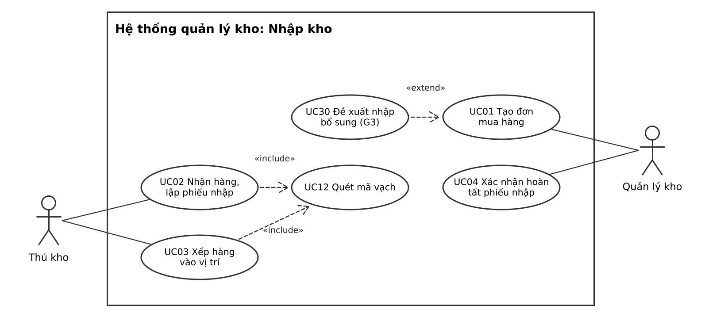

Hình 2.1. Sơ đồ use case phân hệ Nhập kho

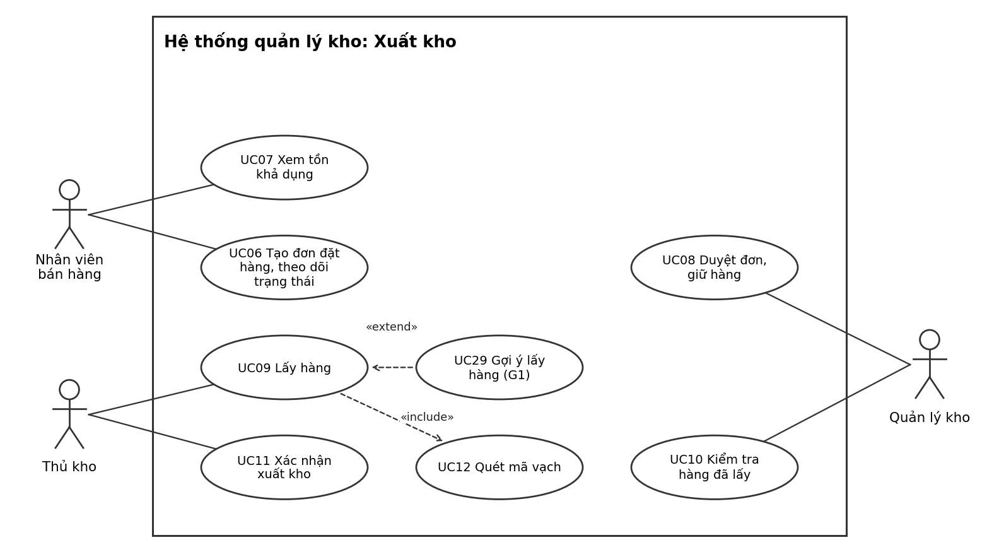

Hình 2.2. Sơ đồ use case phân hệ Xuất kho

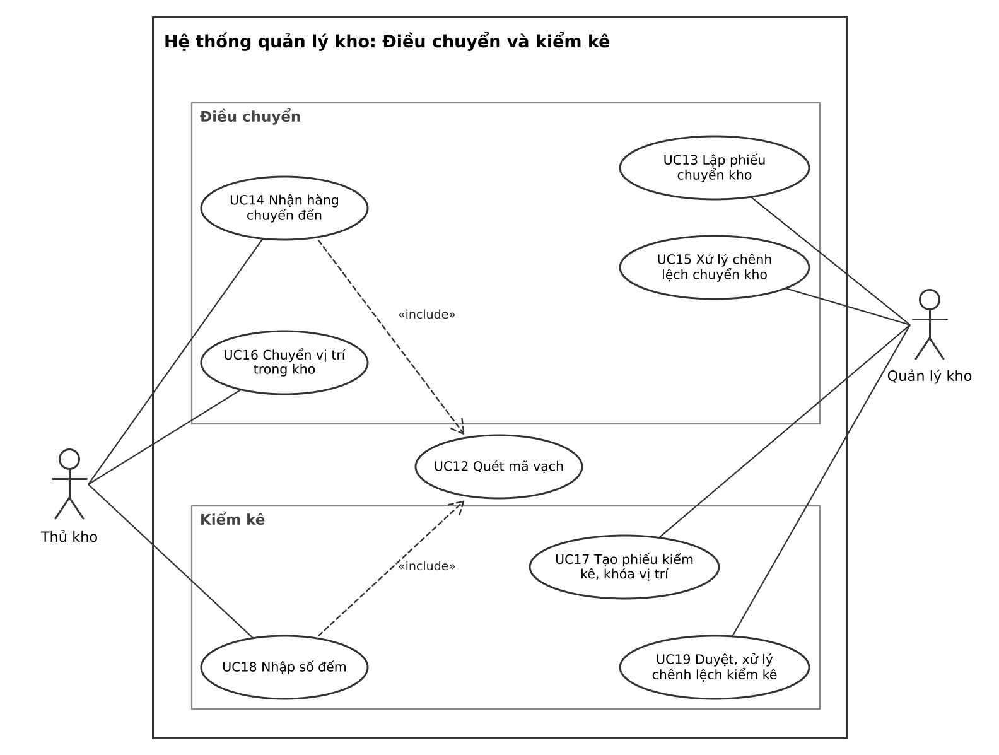

Hình 2.3. Sơ đồ use case Điều chuyển và Kiểm kê

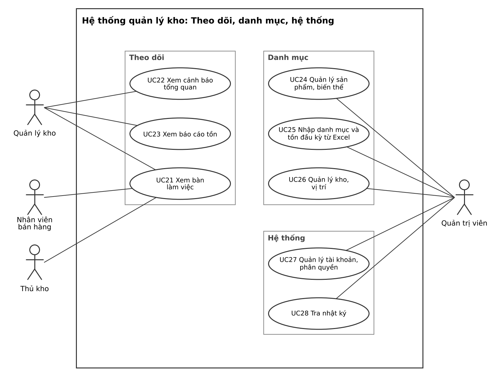

Hình 2.4. Sơ đồ use case Theo dõi, Danh mục và Hệ thống

Bảng 2.29. Danh sách use case và ánh xạ yêu cầu

| Mã | Use case | Tác nhân | FR | Mục Chương 2 | MoSCoW |
| --- | --- | --- | --- | --- | --- |
| UC01 | Tạo đơn mua hàng | Quản lý kho | FR01, FR21 | 2.1 dòng 1 | Must |
| UC02 | Nhận hàng, lập phiếu nhập | Thủ kho | FR01 | 2.1 dòng 2 đến 5 | Must |
| UC03 | Xếp hàng vào vị trí | Thủ kho | FR01, FR12 | 2.1 dòng 6; 2.12 dòng 3 | Must |
| UC04 | Xác nhận hoàn tất phiếu nhập | Quản lý kho | FR01 | 2.1 dòng 7 | Must |
| UC05 | [Hoãn] Đề nghị nhập hàng trả lại | Nhân viên bán hàng | FR15 | 2.1 dòng 7 | Won’t |
| UC06 | Tạo đơn đặt hàng, theo dõi trạng thái | Nhân viên bán hàng | FR06 | 2.2 dòng 1 | Must |
| UC07 | Xem tồn khả dụng | Nhân viên bán hàng | FR05 | 2.8 dòng 1; 2.9 dòng 2 | Must |
| UC08 | Duyệt đơn, giữ hàng | Quản lý kho | FR02 | 2.2 dòng 2 | Must |
| UC09 | Lấy hàng | Thủ kho | FR03 | 2.2 dòng 5 | Must |
| UC10 | Kiểm tra hàng đã lấy | Quản lý kho | FR04 | 2.2 dòng 6 | Must |
| UC11 | Xác nhận xuất kho | Thủ kho | FR03, FR04 | 2.2 dòng 7 | Must |
| UC12 | Quét mã vạch | Được UC02, UC03, UC09, UC14, UC18 gọi | FR03 | 2.2 dòng 5 | Must |
| UC13 | Lập phiếu chuyển kho | Quản lý kho | FR07 | 2.5 dòng 1 đến 3 | Must |
| UC14 | Nhận hàng chuyển đến | Thủ kho | FR07 | 2.5 dòng 4 | Must |
| UC15 | Xử lý chênh lệch chuyển kho | Quản lý kho | FR07 | 2.5 dòng 5 | Must |
| UC16 | Chuyển vị trí trong kho | Thủ kho | FR16 | 2.5 dòng 6 | Should |
| UC17 | Tạo phiếu kiểm kê, khóa vị trí | Quản lý kho | FR08 | 2.4 dòng 1 đến 3 | Must |
| UC18 | Nhập số đếm | Thủ kho | FR08 | 2.4 dòng 4 | Must |
| UC19 | Duyệt, xử lý chênh lệch kiểm kê | Quản lý kho | FR08 | 2.4 dòng 5 đến 7 | Must |
| UC20 | [Hoãn] Đóng combo | Quản lý kho | FR23 | 2.3 | Won’t |
| UC21 | Xem bàn làm việc | Quản lý kho, thủ kho, nhân viên bán hàng | FR19 | 2.6 | Could |
| UC22 | Xem cảnh báo tổng quan | Quản lý kho | FR13 | 2.7 | Should |
| UC23 | Xem báo cáo tồn | Quản lý kho | FR14 | 2.9 | Should |
| UC24 | Quản lý sản phẩm, biến thể | Quản trị viên | FR10, FR28 | 2.8 dòng 1 đến 5, 7 | Must |
| UC25 | Nhập danh mục và tồn đầu kỳ từ Excel | Quản trị viên | FR17 | 2.8 dòng 8; 2.1 dòng 7 | Should |
| UC26 | Quản lý kho, vị trí | Quản trị viên | FR11 | 2.10; 2.12 | Must |
| UC27 | Quản lý tài khoản, phân quyền | Quản trị viên | FR09 | 2.11 dòng 1 đến 4; 2.10 dòng 3 | Must |
| UC28 | Tra nhật ký | Quản trị viên | FR18 | 2.11 dòng 5 | Should |
| UC29 | Gợi ý lấy hàng (G1) | Thủ kho (mở rộng UC09) | FR20 | 2.2 dòng 5 | Should |
| UC30 | Đề xuất nhập bổ sung (G3) | Quản lý kho (mở rộng UC01) | FR21 | 2.1 dòng 1; 2.7 dòng 1 | Should |
| UC31 | [Hoãn] Gợi ý vị trí xếp (G2) | Thủ kho (mở rộng UC03) | FR24 | 2.1 dòng 6; 2.12 dòng 7 | Won’t |
| UC32 | [Hoãn] Đề xuất luân chuyển (G4) | Quản lý kho (mở rộng UC13) | FR25 | 2.5 dòng 1; 2.10 dòng 2 | Won’t |

### 2.16.2. Sơ đồ hoạt động

Sáu sơ đồ hoạt động chia làn theo vai trò; làn Hệ thống thể hiện các bước tự động như kiểm tra ràng buộc, ghi sổ biến động và đổi trạng thái. Trạng thái ghi trong ngoặc vuông hoặc sau chữ Phiếu, Lệnh, Đơn lấy theo Bảng 2.14. Hình thoi chỉ dùng cho điều kiện đúng hoặc sai, mỗi nhánh ra có nhãn điều kiện trong ngoặc vuông; các luồng nối thẳng vào khung hành động, không dùng hình thoi để gộp luồng. Bảng 2.30 ánh xạ từng sơ đồ với use case và ràng buộc ở Chương 2.

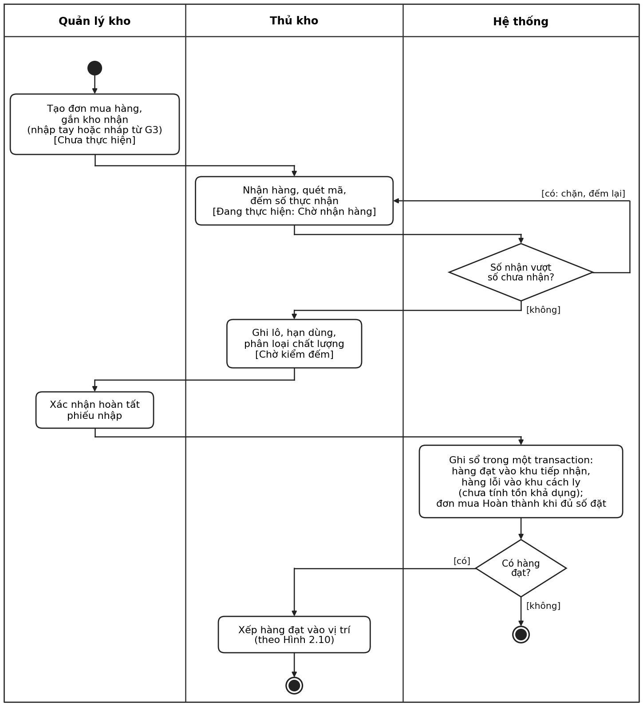

Hình 2.5. Sơ đồ hoạt động nhập kho

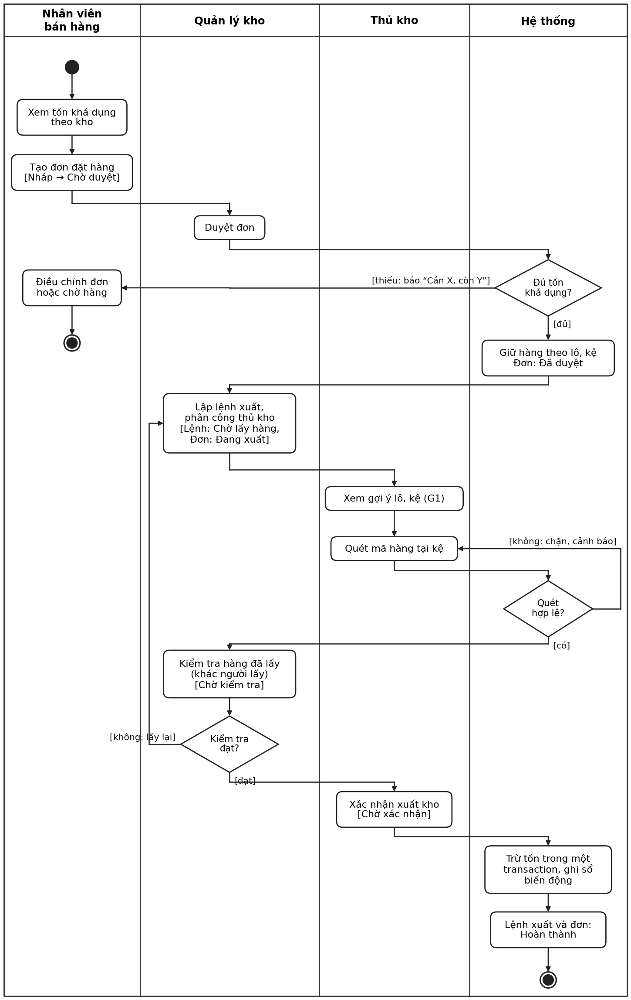

Hình 2.6. Sơ đồ hoạt động xuất kho

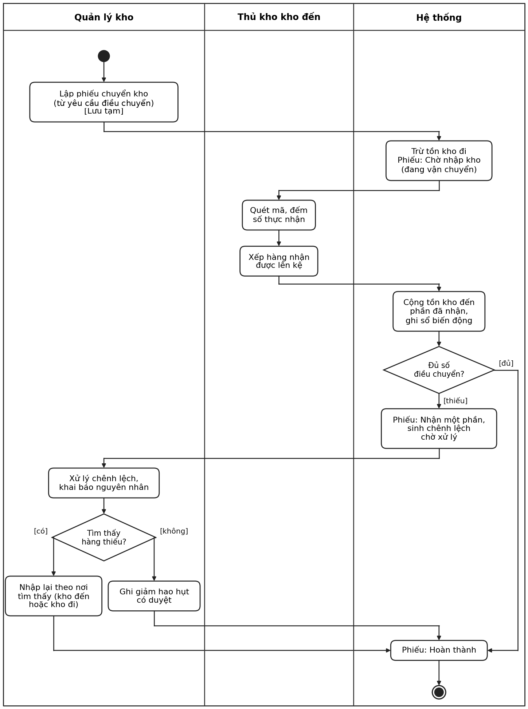

Hình 2.7. Sơ đồ hoạt động chuyển kho

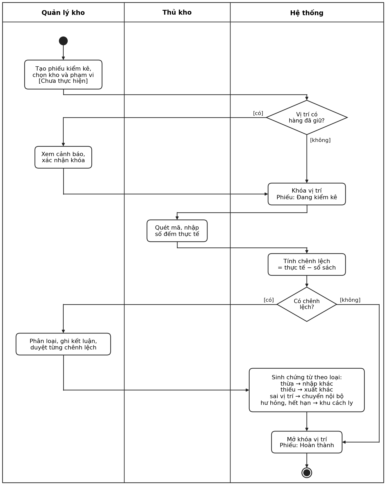

Hình 2.8. Sơ đồ hoạt động kiểm kê

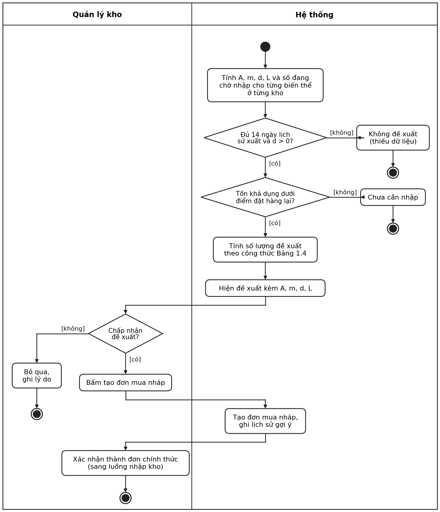

Hình 2.9. Sơ đồ hoạt động đề xuất nhập bổ sung (G3)

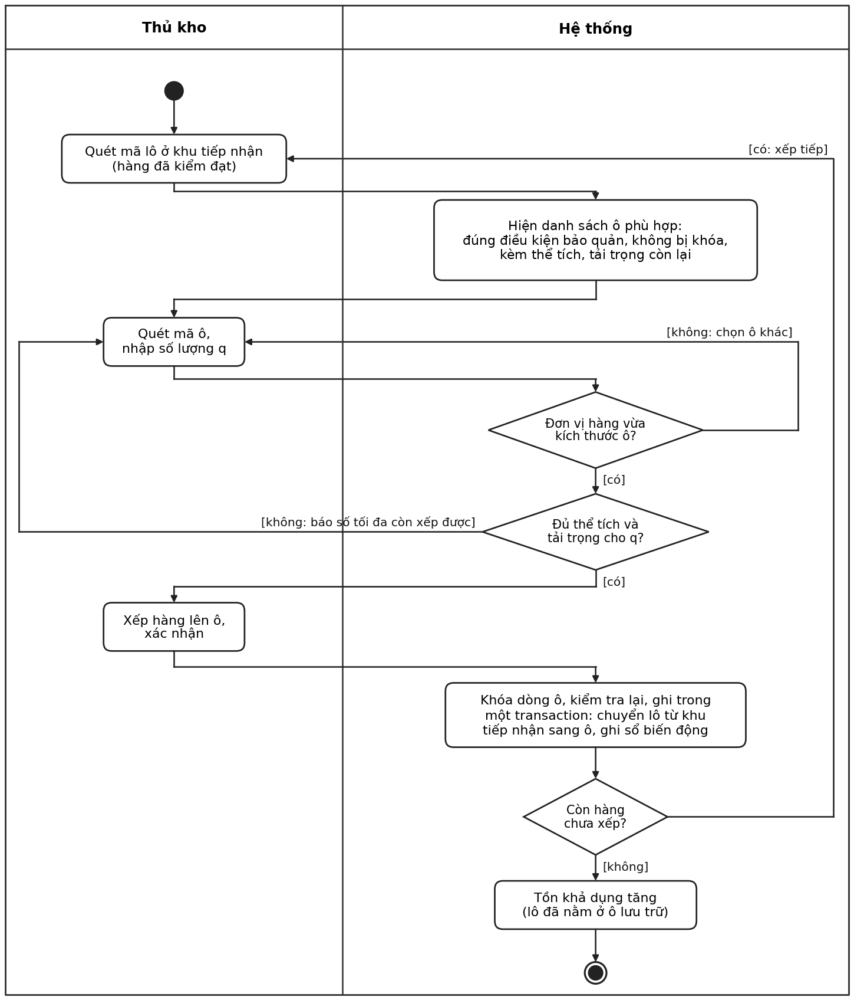

Hình 2.10. Sơ đồ hoạt động xếp hàng vào vị trí

Bảng 2.30. Ánh xạ sơ đồ hoạt động với use case, trạng thái và ràng buộc

| STT | Sơ đồ | Use case | Trạng thái (Bảng 2.14) | Ràng buộc thể hiện |
| --- | --- | --- | --- | --- |
| 1 | Hình 2.5. Nhập kho | UC01 đến UC04, UC12, UC30 | Đơn mua (vai trò lệnh nhập): Chưa thực hiện → Đang thực hiện (Chờ nhận hàng, Chờ kiểm đếm) → Hoàn thành | Số nhận không vượt số chưa nhận (2.1 dòng 2); hàng lỗi vào khu cách ly (2.1 dòng 6); ghi sổ trong một transaction (2.1 dòng 7); hàng chỉ tính tồn khả dụng khi đã xếp vào ô (Hình 2.10) |
| 2 | Hình 2.6. Xuất kho | UC06 đến UC12, UC29 | Đơn đặt hàng: Nháp → Chờ duyệt → Đã duyệt → Đang xuất → Hoàn thành; lệnh xuất: Chờ lấy hàng → Chờ kiểm tra → Chờ xác nhận → Hoàn thành | Thiếu hàng báo “Cần X, còn Y” (2.2 dòng 2); quét sai bị chặn (2.2 dòng 5); người kiểm khác người lấy (2.2 dòng 6); không tồn âm (2.2 dòng 7) |
| 3 | Hình 2.7. Chuyển kho | UC12 đến UC15 | Phiếu điều chuyển: Lưu tạm → Chờ nhập kho → Nhận một phần → Hoàn thành | Hàng đang vận chuyển không tính tồn khả dụng (2.5 dòng 3); nguyên nhân chênh lệch bắt buộc, ghi giảm có duyệt (2.5 dòng 5) |
| 4 | Hình 2.8. Kiểm kê | UC12, UC17 đến UC19 | Phiếu kiểm kê: Chưa thực hiện → Đang kiểm kê → Hoàn thành | Khóa vị trí, cảnh báo hàng đã giữ (2.4 dòng 3); không sửa trực tiếp số tồn (2.4 dòng 5); xử lý chênh lệch theo loại (2.4 dòng 6) |
| 5 | Hình 2.9. Đề xuất nhập bổ sung (G3) | UC30, UC01 | Đơn mua hàng: Nháp → Chưa thực hiện | Đủ 14 ngày lịch sử xuất (2.7 dòng 1); chỉ tạo nháp khi quản lý kho bấm (2.6 dòng 5); nháp thành chính thức khi xác nhận (2.1 dòng 1) |
| 6 | Hình 2.10. Xếp hàng vào vị trí | UC03, UC12 | Không đổi trạng thái chứng từ; lô chuyển từ khu tiếp nhận sang ô | Vừa kích thước, đủ không gian và tải trọng (Bảng 2.33; 2.12 dòng 3); ô không bị khóa (2.12 dòng 4); ghi trong một transaction (2.1 dòng 7) |

### 2.16.3. Mã vị trí 7 cấp và quy tắc kiểm tra sức chứa khi xếp hàng

Mỗi vị trí có mã 7 cấp ghép từ kho đến ô (Bảng 2.31), ví dụ K01-TA02-TG03-P04-H05-KE06-O07, tức Kho 1, Tòa 2, Tầng 3, Phòng – dãy 4, Hàng 5, Kệ 6, Ô 7. Hàng chỉ nằm ở cấp ô; mỗi ô có kích thước trong và tải trọng tối đa, mỗi biến thể có kích thước đóng gói và khối lượng một đơn vị tính chính (số đơn vị q ở Bảng 2.33 cũng tính theo đơn vị này, sau khi quy đổi). Bảng 2.32 là các bảng dữ liệu chính cho Sprint 2 và Sprint 3; Bảng 2.33 là quy tắc hệ thống áp dụng ở hai hình thoi “Đơn vị hàng vừa kích thước ô?” và “Đủ thể tích và tải trọng cho q?” của Hình 2.10.

Bảng 2.31. Cấu trúc mã vị trí 7 cấp

| STT | Cấp | Mã ví dụ | Thuộc tính chính |
| --- | --- | --- | --- |
| 1 | Kho | K01 | Tên, địa chỉ, loại hàng lưu trữ |
| 2 | Tòa | TA02 | Tên tòa trong khuôn viên kho |
| 3 | Tầng | TG03 | Số tầng |
| 4 | Phòng – dãy | P04 | Loại khu (tiếp nhận, lưu trữ, cách ly, xuất), điều kiện bảo quản |
| 5 | Hàng | H05 | Thứ tự hàng kệ (dùng cho thứ tự ghé của G1) |
| 6 | Kệ | KE06 | Loại kệ |
| 7 | Ô | O07 | Dài, rộng, cao bên trong (m), tải trọng tối đa (kg), trạng thái khóa; là cấp duy nhất chứa hàng |

Bảng 2.32. Bảng dữ liệu chính cho nhập kho và xếp hàng

| STT | Bảng dữ liệu | Khóa chính | Trường chính | Liên kết |
| --- | --- | --- | --- | --- |
| 1 | ViTri | MaViTri | MaCha, Cap (1 đến 7), Ten, LoaiKhu, DieuKienBaoQuan, Dai, Rong, Cao, TaiTrongToiDa, DangKhoa | Tự tham chiếu MaCha |
| 2 | BienThe | MaBienThe | MaSanPham, ThuocTinh, DaiDongGoi, RongDongGoi, CaoDongGoi, KhoiLuong, TheoDoiHanDung | SanPham |
| 3 | DonMua | MaDonMua | MaNhaCungCap, MaKho, NguoiTao, NgayTao, TrangThai | NhaCungCap, ViTri (cấp kho), NguoiDung |
| 4 | ChiTietDonMua | MaDonMua, MaBienThe | TenDonVi, HeSo, SoLuongDat, DonGia | DonMua, BienThe |
| 5 | PhieuNhap | MaPhieuNhap | MaDonMua (có thể rỗng), MaKho, NguoiLap, NguoiXacNhan, NgayNhap, TrangThai, TongTien (tính) | DonMua, ViTri (cấp kho), NguoiDung |
| 6 | ChiTietPhieuNhap | MaPhieuNhap, STT | MaLo, TenDonVi, HeSo, SoLuongGoc, SoLuongThucNhan, DonGia, ThanhTien (cột tính), ChatLuong | PhieuNhap, Lo |
| 7 | Lo | MaLo | MaBienThe, HanDung, NgayNhap | BienThe |
| 8 | TonKho | MaLo, MaViTri | SoLuong, SoLuongDaGiu | Lo, ViTri |
| 9 | SoBienDong | MaBienDong | MaLo, MaViTri, SoLuongThayDoi, LoaiChungTu, MaChungTu, MaKhoaChongLap, ThoiDiem, NguoiThucHien | Lo, ViTri, NguoiDung |
| 10 | DonViQuyDoi | MaBienThe, TenDonVi | HeSo, MaVach | BienThe |

Bảng 2.33. Quy tắc kiểm tra sức chứa khi xếp q đơn vị vào một ô

| STT | Kiểm tra | Cách tính | Khi không đạt |
| --- | --- | --- | --- |
| 1 | Vừa kích thước | Ba chiều đóng gói của một đơn vị, xếp tăng dần, không lớn hơn ba chiều bên trong của ô, xếp tăng dần (cho phép xoay hàng) | Chặn, chọn ô khác |
| 2 | Đủ không gian | Ô chỉ có một biến thể: số đơn vị xếp được theo lưới, thử 6 cách xoay, lấy cách xếp được nhiều nhất, trừ số đang có. Ô có nhiều biến thể: (thể tích ô × hệ số lấp đầy − thể tích đang dùng) chia thể tích một đơn vị; hệ số lấp đầy mặc định 0,85, cấu hình theo kho | Báo số tối đa còn xếp được |
| 3 | Đủ tải trọng | Khối lượng đang có + q × khối lượng một đơn vị không lớn hơn tải trọng tối đa của ô | Báo số tối đa còn xếp được |
| 4 | Số tối đa còn xếp | q_max = nhỏ nhất của (số theo không gian, phần nguyên của (tải trọng còn lại chia khối lượng một đơn vị)); tính bằng kiểu decimal để tránh sai số làm tròn | Xếp q_max, phần còn lại chọn ô khác |
| 5 | Điều kiện khác | Ô thuộc khu lưu trữ, đúng điều kiện bảo quản, không bị khóa kiểm kê | Chặn |
| 6 | Ghi an toàn | Khóa dòng ô, kiểm tra lại các điều kiện 1 đến 5 và ghi sổ trong cùng một transaction, để hai thủ kho không cùng xếp vượt một ô | Hủy giao dịch, trả mã 409 “Ô vừa được cập nhật, vui lòng thử lại” |

Ví dụ: ô trống 1 m × 1 m × 1 m, tải trọng 50 kg; thùng 0,5 × 0,5 × 0,4 m, 12 kg. Theo không gian xếp được 2 × 2 × 2 = 8 thùng, theo tải trọng chỉ được 4 thùng (48 kg), nên q_max = 4 và lệnh xếp 5 thùng (60 kg) bị chặn. Thanh dài 1,2 m không vừa ô dù thể tích nhỏ, bị chặn ở kiểm tra 1. Kiện 0,4 × 1 × 0,5 m nếu chỉ chia thể tích sẽ ra 5 kiện, nhưng xếp theo lưới chỉ được 4, nên không dùng thể tích đơn thuần cho ô một biến thể. Các ca này đã được chạy thử với hàm kiểm tra, cho kết quả đúng như trên.

### 2.16.4. Thiết kế dữ liệu và giao tiếp FE, BE cho hóa đơn nhập kho và xếp hàng

Hình 2.11 là ERD cho hai phần làm đầu tiên, gồm 13 bảng; nền xanh là bảng của hóa đơn nhập kho, nền xanh lá là bảng của vị trí và tồn kho. Ký hiệu ở hai đầu đường nối: hai vạch là đúng một, vòng tròn và vạch là không hoặc một, vạch và chân chim là một hoặc nhiều, vòng tròn và chân chim là không hoặc nhiều.

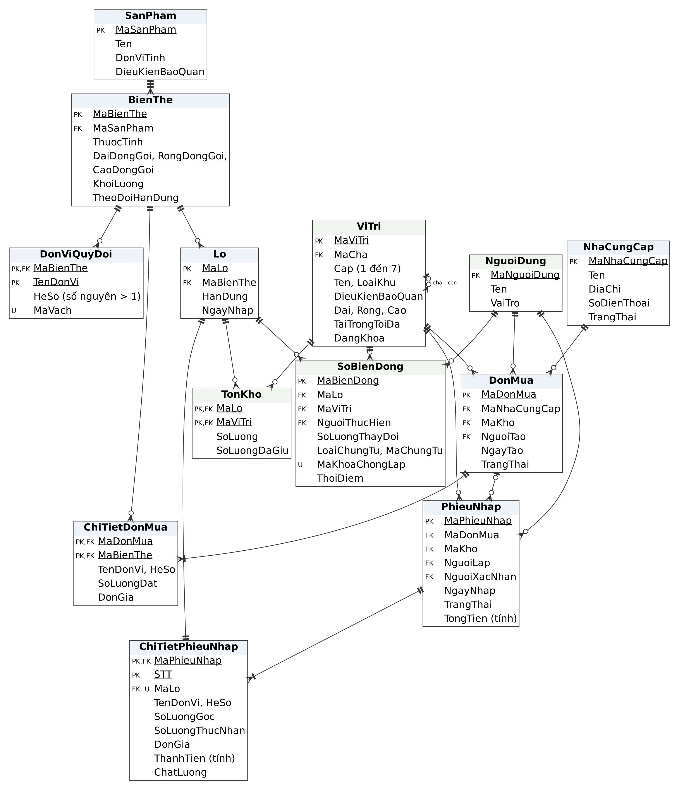

Hình 2.11. ERD cho hóa đơn nhập kho và xếp hàng vào vị trí

Thiết kế đạt dạng chuẩn 3: ChiTietPhieuNhap không lưu mã biến thể vì đã suy ra được từ lô; ThanhTien là cột tính, TongTien tính khi truy vấn nên không thể lệch với các dòng. Riêng TonKho là bảng tổng hợp có chủ đích để tra tồn nhanh, được cập nhật trong cùng transaction với SoBienDong và kiểm chứng bằng tiêu chí tổng biến động bằng tồn ở Bảng 1.6. Một đơn mua có thể nhận nhiều đợt nên có nhiều hóa đơn nhập; hóa đơn nhập khác không cần đơn mua. Đơn vị quy đổi chỉ là hệ số nhân ở tầng dòng chứng từ: TonKho và SoBienDong vẫn tính theo đơn vị tính chính nên cổng ghi tồn không đổi; dòng chứng từ lưu thêm TenDonVi và HeSo tại thời điểm lập vì đó là dữ liệu lịch sử, đổi hệ số về sau không được làm đổi chứng từ cũ. Bảng 2.34 là kiểu dữ liệu và ràng buộc chính (kiểu của PostgreSQL).

Bảng 2.34. Từ điển dữ liệu chính

| STT | Nhóm cột | Cột | Kiểu (PostgreSQL) | Ràng buộc |
| --- | --- | --- | --- | --- |
| 1 | Mã danh mục, chứng từ | MaNhaCungCap, MaSanPham, MaBienThe, MaDonMua, MaPhieuNhap, MaLo | varchar(20) | Khóa chính, không trùng |
| 2 | Mã vị trí | MaViTri, MaCha, MaKho | varchar(40) | Theo mẫu ở Bảng 2.31; Cap từ 1 đến 7; MaCha chỉ rỗng ở cấp kho; MaKho phải là vị trí cấp 1 |
| 3 | Kích thước | Dai, Rong, Cao, DaiDongGoi, RongDongGoi, CaoDongGoi | numeric(8,3), mét | Lớn hơn 0; kích thước ô bắt buộc khi Cap = 7 |
| 4 | Khối lượng | KhoiLuong, TaiTrongToiDa | numeric(10,3), kg | Lớn hơn 0; tải trọng bắt buộc khi Cap = 7 |
| 5 | Số lượng | SoLuongGoc, SoLuongDat, SoLuongThucNhan, SoLuong, SoLuongDaGiu, SoLuongThayDoi | numeric(14,3) | Số đặt, số nhận lớn hơn 0; tồn không âm; số đã giữ không lớn hơn tồn; số thay đổi khác 0; SoLuongGoc và SoLuongDat theo đơn vị đã chọn trên dòng chứng từ, các số còn lại luôn theo đơn vị tính chính (SoLuongThucNhan = SoLuongGoc × HeSo) |
| 6 | Tiền | DonGia | numeric(18,2), đồng | Không âm; DonGia theo đơn vị đã chọn trên dòng (giá một đơn vị tính chính = DonGia ÷ HeSo) |
| 7 | Cột tính | ThanhTien = SoLuongGoc × DonGia; TongTien = tổng ThanhTien của phiếu | numeric(18,2) | ThanhTien là cột tính lưu sẵn; TongTien tính khi truy vấn; không sửa tay |
| 8 | Trạng thái | TrangThai | varchar(20) | Chỉ nhận giá trị ở Bảng 2.14 |
| 9 | Ngày giờ | NgayTao, NgayNhap, ThoiDiem; HanDung | timestamptz; date | Hạn dùng bắt buộc khi biến thể theo dõi hạn dùng (kiểm tra ở tầng dịch vụ) |
| 10 | Chống ghi lặp | MaKhoaChongLap | varchar(64) | Không trùng; mỗi lần ghi tồn một mã |
| 11 | Kho của phiếu nhập | PhieuNhap.MaKho | varchar(40) | Nếu có MaDonMua thì phải trùng DonMua.MaKho |
| 12 | Đơn vị quy đổi | TenDonVi, HeSo, MaVach | varchar(20); integer; varchar(64) | HeSo là số nguyên lớn hơn 1; (MaBienThe, TenDonVi) không trùng và không trùng tên đơn vị tính chính; MaVach không trùng nếu có; đơn vị đã có dòng chứng từ dùng thì không sửa, không xóa, chỉ ngừng sử dụng |

Bảng 2.35 là giao tiếp giữa màn hình (FE) và API (BE) cho hai phần. Mỗi dòng do một người làm trọn cả màn hình lẫn API nên không phải chờ ai, trừ dòng 3 (xác nhận phiếu nhập dùng cổng ghi tồn) và dòng 7 (màn hình xếp hàng dùng API ô phù hợp của người khác): ở hai dòng này hai người thống nhất bảng này trước khi code và dùng bản giả cho tới khi API thật xong. Quy ước chung: API theo REST, dữ liệu JSON; mọi API kiểm tra quyền theo vai và theo kho ở máy chủ; API ghi tồn nhận mã chống ghi lặp ở header Idempotency-Key; mã HTTP: 401 khi chưa đăng nhập hoặc tài khoản bị khóa, 403 khi không có quyền theo vai hoặc theo kho, 422 khi lỗi nghiệp vụ kèm lý do (riêng lỗi xếp hàng kèm số tối đa còn xếp được), 409 khi hai người cùng xếp vào một ô và cần thử lại. Cột Người làm ghi mã việc ở Bảng 1.9 và người phụ trách; quy ước chung, phân quyền và tích hợp do Phạm Thế Cường phụ trách (S1-02, S1-03, S2-01).

Bảng 2.35. Màn hình và API cho hai phần làm đầu tiên

| STT | Phần | Màn hình (FE) | API (BE) | Bảng dữ liệu | FR, UC | Người làm (Bảng 1.9) |
| --- | --- | --- | --- | --- | --- | --- |
| 1 | 1 | Danh sách, lập đơn mua: nhà cung cấp, dòng hàng, số lượng, đơn giá | GET, POST /api/don-mua; GET /api/don-mua/{ma} | DonMua, ChiTietDonMua | FR01, UC01 | S2-04, Lê Đức Anh |
| 2 | 1 | Lập hóa đơn nhập: thủ kho nhập nhận hàng, đếm, lô, hạn dùng, chất lượng; đơn giá, thành tiền, tổng tiền chỉ hiện cho quản lý kho, quản trị viên (API không trả giá cho thủ kho) | POST /api/phieu-nhap; POST /api/phieu-nhap/{ma}/dong | PhieuNhap, ChiTietPhieuNhap, Lo | FR01, UC02 | S2-05, Nguyễn Văn Duy |
| 3 | 1 | Xác nhận hoàn tất hóa đơn nhập (quản lý kho) | POST /api/phieu-nhap/{ma}/xac-nhan | PhieuNhap, TonKho, SoBienDong | FR01, UC04 | S2-06, Nguyễn Văn Duy; cổng ghi tồn S2-02, Phạm Thế Cường |
| 4 | 1 | Danh sách hóa đơn nhập: lọc theo ngày, trạng thái, xem tổng tiền | GET /api/phieu-nhap | PhieuNhap, ChiTietPhieuNhap | FR01, UC04 | S2-06, Nguyễn Văn Duy |
| 5 | 2 | Khai báo kích thước, khối lượng biến thể | PUT /api/bien-the/{ma} | BienThe | FR10, UC24 | S2-03, Lê Đức Anh |
| 6 | 2 | Quản lý vị trí dạng cây 7 cấp; kích thước, tải trọng ô | GET /api/vi-tri/cay; POST /api/vi-tri; PUT /api/vi-tri/{ma} | ViTri | FR11, UC26 | S3-01, Lê Đức Anh |
| 7 | 2 | Xếp hàng: chọn lô ở khu tiếp nhận, xem ô phù hợp và chỗ còn lại | GET /api/vi-tri/o-phu-hop?maLo=&soLuong= | ViTri, TonKho, Lo, BienThe | FR12, UC03 | API ô phù hợp: S3-02, Nguyễn Văn Duy; màn hình: S3-04, Phạm Thế Cường |
| 8 | 2 | Xác nhận xếp vào ô; hiện lý do và số tối đa khi bị chặn | POST /api/xep-hang (maLo, maViTri, soLuong) | TonKho, SoBienDong | FR12, UC03 | S3-04, Phạm Thế Cường |

# CHƯƠNG 3. KẾT QUẢ THỰC NGHIỆM

# CHƯƠNG 4. KẾT LUẬN

## 4.1 Những kết quả đã thực hiện

## 4.2 Hướng phát triển tiếp theo

Đồ án được thu hẹp cho vừa sức nhóm 3 người trong 8 tuần. Các phần dưới đây đã được phân tích nhưng hoãn sang giai đoạn sau; đặc tả được giữ ở các mục đã chỉ ra và ở Phụ lục A: (1) gợi ý xếp hàng vào vị trí (G2, FR24, UC31) và báo cáo phân loại hàng tồn kho theo tần suất xuất đi kèm; (2) gợi ý luân chuyển hàng giữa các kho với chi phí thấp nhất (G4, FR25, UC32) cùng khai báo chi phí vận chuyển giữa các kho; (3) sơ đồ mặt bằng kho và hộp “Chọn trong sơ đồ kho” (FR22, mục 2.12 dòng 2, 4, 6), từ đó G1 mới tính được khoảng cách tới cửa xuất; (4) nhập hàng trả lại do nhân viên bán hàng đề nghị (FR15, UC05); (5) xuất Excel cho các danh sách và báo cáo (NFR08; phần nhập Excel đã làm ở FR17); (6) lắp ráp, tháo dỡ và đóng combo (mục 2.3, FR23, UC20); (7) mở rộng dữ liệu thử từ 2 lên 3 kho để kiểm chứng G4. Quét mã bằng camera điện thoại, kết nối phần mềm kế toán và CRM, theo dõi số serial (FR26, FR27), đơn vị quy đổi nhiều tầng hoặc hệ số thay đổi theo lô vẫn ở mức Won’t như ban đầu.

# TÀI LIỆU THAM KHẢO

- DeHoratius, N., Raman, A. (2008). Inventory record inaccuracy: An empirical analysis. Management Science, tr. 627–641. DOI: 10.1287/mnsc.1070.0789.

- Raman, A., DeHoratius, N., Ton, Z. (2001). Execution: The missing link in retail operations. California Management Review, 43(3).

- Kang, Y., Gershwin, S. B. (2004). Information inaccuracy in inventory systems. Massachusetts Institute of Technology (dspace.mit.edu).

- Apache OFBiz Wiki. Company Approves Sales Order. cwiki.apache.org.

- Odoo Community Association. Stock Inter-Warehouse Transfer (phiên bản 17.0). apps.odoo.com.

- MISA. Nhập kho hàng bán bị trả lại. helpact.misa.vn.

- Microsoft. Take returned items through inspection (Microsoft Dynamics AX 2012). technet.microsoft.com.

- Google for Developers. Storage locations, Logistics WMS specification v1. developers.google.com.

- Warehouse News. How to increase warehouse storage capacity. warehousenews.co.uk.

- Emergent Cold LatAm (2025). Dairy logistics: challenges in transportation and storage. emergentcoldlatam.com.

- Wasp Barcode Technologies. Why barcodes almost never fail. waspbarcode.com.

- Sapo. Tính thuế combo theo từng mặt hàng thành phần. sapo.vn.

- VnEconomy. Lẻ bóng mạng xã hội Việt (dẫn báo cáo The Connected Consumer quý II/2024 của Decision Lab). vneconomy.vn.

- Tạp chí Công Thương. Sẵn sàng với chuyển đổi số của người lao động trong các doanh nghiệp nhỏ và vừa (SMEs): thực trạng và giải pháp. tapchicongthuong.vn.

- MISA AMIS (2026). Chuyển đổi số doanh nghiệp vừa và nhỏ nên bắt đầu từ đâu? amis.misa.vn.

# PHỤ LỤC

A. Các phần hoãn khi nhóm giảm từ 5 xuống 3 thành viên

Phụ lục này giữ lại đặc tả của những phần đã phân tích nhưng không làm trong đồ án, để nhóm hoặc khóa sau làm tiếp mà không phải phân tích lại. Bảng A.1 là hai bài toán gợi ý G2 và G4 tách khỏi Bảng 1.4; Bảng A.2 liệt kê các yêu cầu và use case bị hoãn hoặc giảm mức ưu tiên cùng nơi còn ghi trong báo cáo.

Bảng A.1. Hai bài toán gợi ý bằng AI được hoãn (G2, G4)

| Bài toán (người dùng) | Đầu vào | Ràng buộc cứng | Mục tiêu | Đầu ra |
| --- | --- | --- | --- | --- |
| G2. Xếp hàng nhập vào đâu(thủ kho) | Lô đã kiểm đạt; tần suất xuất 30 ngày gần nhất; sức chứa các vị trí | Vị trí thuộc khu lưu trữ, còn đủ sức chứa (không gian và tải trọng), không bị khoá | Cực đại điểm S(p) = 0,5 × (gần cửa xuất) + 0,3 × (gần hàng cùng biến thể) + 0,2 × (độ lấp đầy phù hợp) | Ba vị trí tốt nhất kèm điểm và lý do |
| G4. Luân chuyển kho tối ưu chi phí(quản lý kho) | Tồn khả dụng và nhu cầu trung bình mỗi ngày của từng kho; chi phí mỗi đơn vị c(i, j) và phí cố định F(i, j) của từng tuyến giữa hai kho | Chỉ chuyển từ kho thừa sang kho thiếu; không vượt lượng dư của kho đi; không vượt lượng cần bù của kho đến; chỉ chuyển hàng khả dụng (không lấy hàng chờ kiểm, cách ly, hết hạn); không đề xuất khi nhu cầu bằng 0 hoặc lịch sử xuất dưới 14 ngày | Bù được càng nhiều lượng thiếu càng tốt; trong các phương án đó, cực tiểu tổng của c(i, j) × x(i, j) cộng F(i, j) cho mỗi tuyến có chuyển hàng | Danh sách đề xuất chuyển (kho đi, kho đến, biến thể, số lượng); tổng chi phí trước và sau tối ưu |

Ký hiệu thêm cho G4: c(i, j) là chi phí vận chuyển một đơn vị và F(i, j) là phí cố định của mỗi chuyến từ kho i sang kho j; chi phí này do quản trị viên nhập sẵn theo từng tuyến. Trong G2, hàng được phân loại ABC theo tần suất xuất: nhóm A (xuất nhiều) ưu tiên vị trí gần cửa xuất và tầng thấp; các trọng số 0,5, 0,3, 0,2 là giá trị ban đầu và được tinh chỉnh theo dữ liệu thử. Trong G4, số ngày đủ bán của một kho bằng tồn khả dụng chia cho nhu cầu trung bình mỗi ngày; kho thiếu khi số ngày đủ bán nhỏ hơn thời gian chờ hàng cộng số ngày an toàn, kho thừa khi lớn hơn một ngưỡng (ví dụ 60 ngày). Bài toán giải bằng thuật toán tham lam: ghép kho thừa với kho thiếu theo chi phí tăng dần; phương án đối chứng là ghép theo thứ tự, không xét chi phí. Chi phí vận chuyển giữa các kho do quản trị viên nhập sẵn theo từng tuyến; đề tài không giải bài toán định tuyến xe. Phát biểu theo vai trò: thủ kho — “Khi xếp hàng lên kệ, tôi muốn được gợi ý vị trí hợp lý, để hàng xuất nhiều dễ lấy và kệ không quá tải.”; quản lý kho — “Khi cân đối hàng giữa các kho, tôi muốn được đề xuất kho nào chuyển cho kho nào với chi phí thấp, để không thiếu hàng ở kho này mà tồn đọng ở kho kia.”

Bảng A.2. Yêu cầu và use case hoãn hoặc giảm mức ưu tiên

| Mã | Nội dung hoãn hoặc đổi mức | Mức cũ → mới | Nơi còn ghi |
| --- | --- | --- | --- |
| FR15, UC05 | Đề nghị nhập hàng trả lại của nhân viên bán hàng và phiếu nhập hàng trả lại | Should → Won’t | 2.1 dòng 7; Bảng 2.20 dòng 5 |
| FR22 (một phần UC26) | Sơ đồ mặt bằng kho và chọn vị trí trên sơ đồ | Could → Won’t | 2.12 dòng 2, 4, 6 |
| FR23, UC20 | Đóng combo, lắp ráp, tháo dỡ | Could → Won’t | 2.3; Bảng 2.3 |
| FR24, UC31 | Gợi ý ba vị trí xếp tốt nhất (G2) và báo cáo phân loại ABC | Could → Won’t | Bảng A.1; 2.1 dòng 6; 2.9 dòng 4 |
| FR25, UC32 | Đề xuất luân chuyển hàng giữa các kho với chi phí thấp nhất (G4) và khai báo chi phí vận chuyển giữa các kho | Could → Won’t | Bảng A.1; 2.5 dòng 1; 2.10 dòng 2 |
| FR19, UC21 | Bàn làm việc (làm nếu còn thời gian sau các mục Must và Should) | Should → Could | 2.6 |
| NFR08 | Xuất Excel báo cáo tồn kho giữ ở mức Could; phần nhập Excel đã chuyển thành FR17 (Should) | Should → Could | Bảng 2.27 |
| NFR09 | Sao lưu dữ liệu hằng ngày và khôi phục bản gần nhất | Should → Could | Bảng 2.27 |
| Dữ liệu thử | Từ 3 kho với khoảng 60 vị trí xuống 2 kho với khoảng 40 vị trí | — | 1.2.5; S1-06 |
